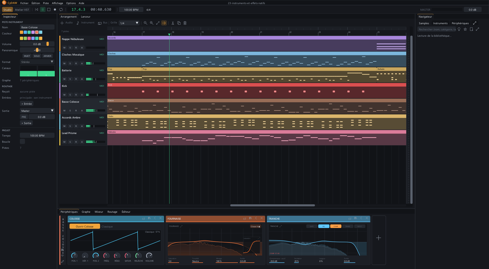
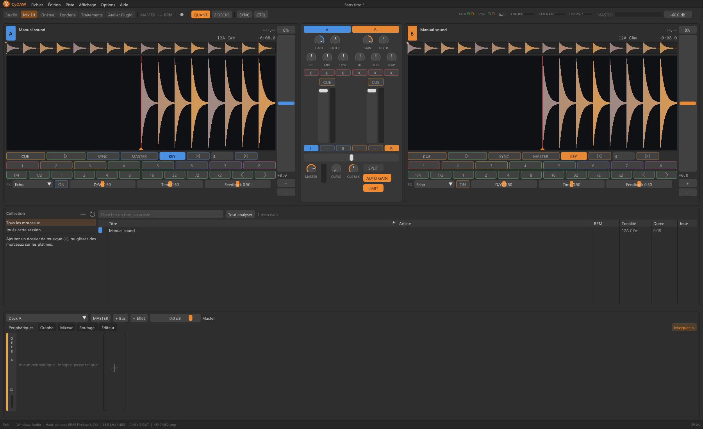
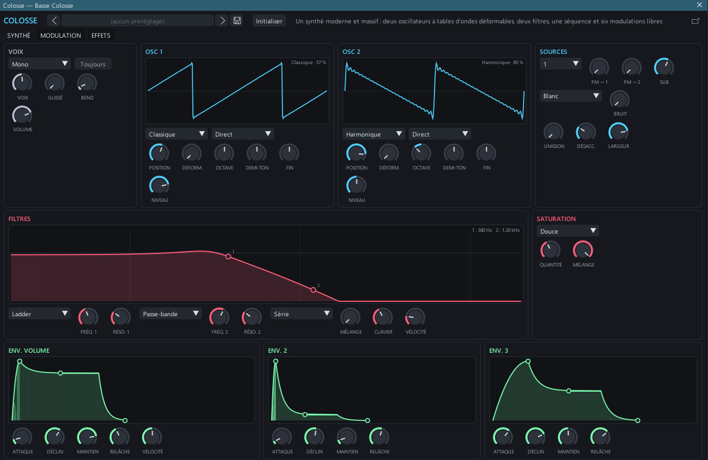
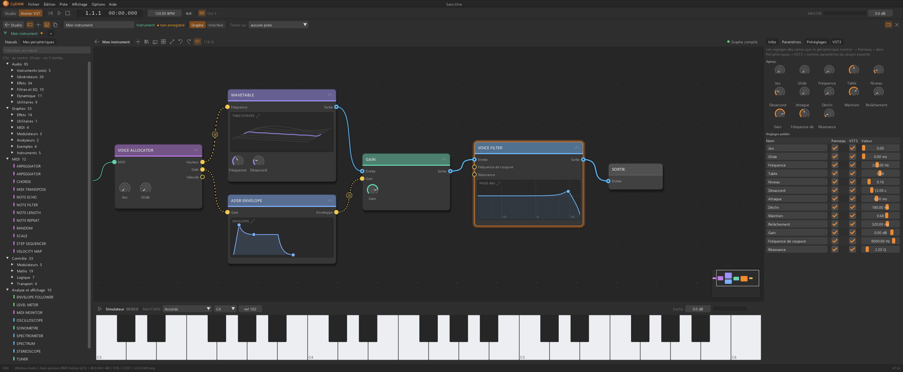

<table width="100%">
  <tr>
    <td width="300" align="left" valign="top">
      <a href="https://mrmybal.github.io/CyDaw/?lang=fr">Présentation</a><br>
      <a href="https://mrmybal.github.io/CyDaw/manual/Documentation.html#/fr/welcome">Manuel</a><br>
      <a href="https://github.com/MrMybal/CyDaw">GitHub</a><br><br>
      <sub>README</sub><br>
      <a href="README.md">English</a> · <a href="README.fr.md">Français</a>
    </td>
    <td width="400" align="center" valign="middle">
      <a href="https://mrmybal.github.io/CyDaw/?lang=fr"></a>
    </td>
    <td width="300" align="right" valign="top">
      <p><sub>Licence de l’application</sub><br><a href="LICENSE"><strong>AGPL-3.0</strong></a></p>
      <p><sub>Version</sub><br><a href="VERSION.fr.md"><strong>0.78.0 · Alpha 1</strong></a><br><strong>ALPHA</strong></p>
      <p><a href="https://github.com/MrMybal/CyDaw/releases/download/v2-0.78.0-alpha.1/CyDAW2-0.78.0-Windows-x64-Alpha.zip"><strong>Télécharger</strong></a><br><sub>Windows x64 · archive portable</sub></p>
    </td>
  </tr>
</table>

<h1 align="center">CyDaw</h1>

> **Branche CyDSP-CORE :** l'intégration audio utilise désormais **CyAudioCore**,
> qui gère **CyDSP** en interne pour le calcul DSP, y compris les plugins internes/exportés.
> Le desktop Windows et le worker isolé compilent sans JUCE. CyAudioCore assure
> l’audio/MIDI, les fichiers et l’hébergement VST3/CLAP/LV2/JSFX ; CyUI assure l’interface. Voir le
> [guide de compilation](docs/CyAudioCoreIntegration.md) et le
> [rapport actuel](docs/CyAudioCoreIntegrationReport.fr.md).

**CyDaw** est une station audionumérique open source pour les musiciens, sound designers et créateurs audio. Composez et arrangez un morceau, jouez un set DJ, montez des enregistrements, travaillez à l’image ou créez vos propres instruments et effets.

> **ALPHA · 0.78.0 · Alpha 1**
>
> Version expérimentale Windows x64 destinée aux essais et aux retours. Certaines fonctions peuvent être incomplètes. Consultez les [notes de version, évolutions des sources et limites connues](VERSION.fr.md). Les sources et le manuel en ligne peuvent être plus récents que l’archive Alpha 1 téléchargeable.

[](docs/images/cydaw-studio.png)

## À propos de CyDaw

### Un projet, plusieurs façons de travailler

| Espace | Ce que vous pouvez faire |
| --- | --- |
| **Studio** | Arranger audio et MIDI, lancer clips/scènes, éditer les notes et automatiser le mix. |
| **Mix DJ** | Jouer sur deux ou quatre platines avec hot cues, boucles, synchronisation, EQ, effets, crossfader et préécoute au casque. |
| **Fonderie** | Découper et assembler des prises, régler gains/fondus, inverser, étirer, traiter et exporter de l’audio multipiste. |
| **Cinéma** | Caler les sons sur les images ; organiser des sous-pistes audio/MIDI éditables dans des conteneurs de bus et mixer la bande son. |
| **Traitements** | Réutiliser des étapes de traitement audio/MIDI, écouter avant/après et appliquer le résultat aux clips. |
| **Atelier Plugin** | Concevoir des graphes de modules, publier réglages/presets, dessiner les interfaces et exporter des périphériques ou plugins natifs. |

[](.CyDocBuild/assets/dj-fr.png)

### Instruments, effets et modulation

Commencez par la synthèse native : **Prisme**, **Ambre**, **Colosse**, **Mosaïque**, **Nébuleuse**, **Opale**, **Quartz**, **Saphir**, **Onyx**, **Alliage**, **Argile**, **Dérive**, **Bronze**, **Jade**, **Tirette**, **Silex** et **Kick** couvrent tables d’ondes, analogique, FM, distorsion de phase, textures atmosphériques, objets résonants, orgue, claviers modélisés et percussions synthétisées.

Le sampler gère zones, couches de vélocité, round robin, contrôleurs/articulations SFZ et lecture depuis le disque. Batterie, Drum Machine, Instrument Layer, Instrument Selector et Nuée proposent kits, instruments par touche, couches, sélection et sons granulaires. Les instruments d’usine à échantillons se téléchargent séparément ; les modèles de son peuvent être absents de la version publiée.

[](docs/images/cydaw-colosse.png)

Construisez les chaînes de piste avec EQ, compression, limitation, saturation, délais, réverbérations, simulations d’amplis/baffles/micros, effets créatifs audio et effets MIDI. Pression, Fournaise, Écho Bande, Velours, Patine, Halo, Tranche, Finition et Sonomètre fournissent des outils dédiés au mixage. LFO, enveloppes, séquences, aléatoire, macros et suiveurs modulent les paramètres. Les conteneurs organisent les chaînes en série, parallèle, mid/side, multibandes ou sélectionnables.

### Du graphe à votre propre outil

Reliez les ports typés audio, MIDI et contrôle, exposez les paramètres et préparez les presets. Concevez séparément le grand éditeur et la carte de module compacte. Exportez un `.cydawdevice` éditable pour une autre installation compatible, ou compilez en **VST3, CLAP et LV2** avec les compilateurs/SDK requis. Les cibles d’export Windows et Linux x64 sont documentées ; une compilation croisée ne valide pas à elle seule le fonctionnement du plugin dans un hôte Linux. L’export macOS est reporté.

[](website/assets/workshop-showcase.png)

## Fonctionnalités

- **Édition audio et MIDI** : zoom de timeline, découpe/redimensionnement des clips, prises/comping, étirement temporel, piano roll, expressions par note et automation.
- **Mixage et routage** : bus, envois, sidechains, compensation de latence, pistes mono à 7.1 et entrées/sorties virtuelles.
- **Effets externes** : hébergement isolé **VST3, CLAP, LV2 et JSFX** sur les pistes audio, avec éditeur JSFX intégré. Cette voie ne fournit pas encore les instruments externes des pistes MIDI ni les effets des bus matériels/master.
- **Synchronisation du transport** : MIDI Clock, MTC/MMC, JACK Transport et Ableton Link avec des pairs compatibles. Chaque protocole partage des données temporelles différentes ; la synchronisation ne transporte pas l’audio.
- **Contrôleurs** : apprentissage MIDI/OSC, manette ou clavier informatique, plages de valeurs, courbes et retour bidirectionnel.
- **Échange de projets** : lecteurs pour Ableton Live, Bitwig, Studio One, REAPER, FL Studio, Ardour, LMMS, Zrythm, DAWproject et AAF ; la fidélité varie. Consultez le rapport d’import et comparez à un rendu de référence.
- **Bibliothèque sonore** : dossiers locaux et banques téléchargeables, catégories, favoris et filtres de tempo/tonalité ; la recherche facultative par description utilise un modèle téléchargé séparément.
- **Outils d’automatisation** : le [serveur MCP local](tools/mcp/README.md) peut créer des pistes, écrire des notes, configurer les périphériques et exporter des mixages.
- **Anglais et français** : interface et documentation illustrée, avec navigation HTML, recherche, images et schémas.

## Banques de sons et documentation

Les échantillons ne sont pas stockés dans ce dépôt. Ouvrez **Options > Banques de sons** pour télécharger les banques libres à l’emplacement choisi. Le dépôt fournit les cartes/catalogues ; les [crédits et licences d’usine](content/factory/LICENCE.txt) identifient leurs sources. Copiez les médias externes séparément pour transférer un projet ou un périphérique éditable.

Ouvrez **Aide > Manuel utilisateur** ou **Ctrl+F1** pour le manuel embarqué. La compilation depuis les sources génère le lecteur CyDoc hors ligne dans `Documentation/Documentation.html` avec son dossier `DocData/`. Aucun serveur ni accès Internet n’est nécessaire pour lire cet export. Le [manuel en ligne](https://mrmybal.github.io/CyDaw/manual/Documentation.html#/fr/welcome) suit les sources courantes et peut décrire des évolutions postérieures à l’Alpha 1. [English](https://mrmybal.github.io/CyDaw/manual/Documentation.html#/en/welcome).

---

## Installation

L’archive publiée de l’application est **Windows 10/11 x64 · Alpha 1**. Les cibles de compilation/export n’impliquent pas des applications Linux ou macOS téléchargeables.

1. [Télécharger CyDaw 0.78.0 Alpha 1](https://github.com/MrMybal/CyDaw/releases/download/v2-0.78.0-alpha.1/CyDAW2-0.78.0-Windows-x64-Alpha.zip). Les [notes de publication](https://github.com/MrMybal/CyDaw/releases/tag/v2-0.78.0-alpha.1) et [sommes SHA-256](https://github.com/MrMybal/CyDaw/releases/download/v2-0.78.0-alpha.1/SHA256SUMS.txt) l’accompagnent.
2. Extraire toute l’archive dans un dossier accessible en écriture. Garder DLL, worker de plugins, polices, traductions et licences à côté de l’exécutable.
3. Lancer **`CyDAW 2.exe`** (nom interne de l’exécutable), sélectionner **Windows Audio / WASAPI** dans les réglages audio et choisir les sorties reliées aux enceintes.
4. Télécharger les banques souhaitées dans **Options > Banques de sons**. L’archive publiée n’active ni ASIO ni VST2.

## Sources, compilation et bibliothèques nécessaires

<details>
<summary><strong>Compilation Windows depuis les sources</strong></summary>

Prérequis : **Visual Studio 2022** avec outils C++/SDK Windows, **CMake 3.24+**, **Git/Git LFS**, **Python 3.12+** et **Node.js 22+/npm** pour la documentation. CMake récupère la révision fixée de CyUI ; CyAudioCore gère sa dépendance CyDSP. l’accès au dépôt CyUI est requis s’il est restreint. Préparer le SDK partagé FFmpeg séparément. NASM active la génération native de code EEL2 ; sans lui, ysfx utilise son interpréteur portable.

```powershell
git lfs install
git clone https://github.com/MrMybal/CyDaw.git
cd CyDaw
python tools/setup_ffmpeg.py
cmake --preset desktop-windows-wasapi -DCYDAW_BUILD_V2=ON
cmake --build build/windows-wasapi --config Release --target CyDAW2
& '.\build\windows-wasapi\CyDAW2_artefacts\Release\CyDAW 2.exe'
```

La compilation prépare aussi le worker et la documentation hors ligne. Pour compiler toutes les cibles configurées et exécuter les vérifications :

```powershell
cmake --build --preset desktop-windows-wasapi --parallel 2
ctest --preset desktop-windows-wasapi --parallel 2
```

Voir [l’utilisation de la version de test](docs/V2_TEST_BUILD.md), la [configuration CyUI](src/v2/CyUI.cmake), la [préparation FFmpeg](third_party/FFMPEG.md) et la [génération documentaire](.CyDocBuild/README.md). Les autres pilotes audio et chaînes d’export de plugins ont leurs propres prérequis. Le preset WASAPI désactive les pilotes audio ASIO/JACK ; JACK Transport est une intégration distincte. Voir les [formats et exports de plugins](docs/PLUGIN_FORMATS.md).

</details>

---

## Licence

CyDaw est distribué sous la [GNU Affero General Public License v3](LICENSE) (AGPL-3.0). Le projet est maintenu par Cyberalien. Les bibliothèques, banques de sons et scripts tiers gardent leurs propres conditions.

### Bibliothèques tierces

| Bibliothèque · sources | Licence · texte | Utilisation / périmètre |
| --- | --- | --- |
| [CyAudioCore](https://github.com/MrMybal/CyAudioCore) / [CyDSP](https://github.com/MrMybal/CyDSP) | MIT pour les sources originales ; les composants tiers gardent leurs conditions | Audio/MIDI, codecs, sources, hôtes de plugins et calcul DSP interne. L’intégration du SDK ASIO reste dans l’application. |
| [Dear ImGui](https://github.com/ocornut/imgui) | [MIT](third_party/imgui/LICENSE.txt) | Interface native ; les composants stb incorporés conservent leurs notices. |
| [CyUI](https://github.com/MrMybal/CyUI) | [MIT](https://github.com/MrMybal/CyUI/blob/8367401fe45fc22bfed5e227cb3de343177f676b/LICENSE) | Contrôles d’interface et vues audio partagés. L’accès aux sources dépend des permissions du dépôt. |
| [CyUI editor components](https://github.com/MrMybal/CyUI) | [MIT et conditions permissives des composants](https://github.com/MrMybal/CyUI/blob/8367401fe45fc22bfed5e227cb3de343177f676b/THIRD_PARTY_NOTICES.md) | ImGuiColorTextEdit, Lexilla, en-têtes Scintilla et données de langages SciTE ; notices dans Licenses/CyUI. |
| [CLAP](https://github.com/free-audio/clap) | [MIT](third_party/clap/LICENSE) | API d’hébergement dans le worker et export natif CLAP. |
| [LV2](https://lv2plug.in/) | [ISC](third_party/lv2/COPYING) | API/métadonnées d’export natif ; CyAudioCore fournit le moteur d’hébergement LV2 et ses notices. |
| [ysfx](https://github.com/jpcima/ysfx) | [Apache-2.0](third_party/ysfx/LICENSE) | Compilation/exécution JSFX dans le worker isolé. |
| [WDL](https://www.cockos.com/wdl/) | [Conditions de type zlib](third_party/ysfx/thirdparty/WDL/LICENSE.txt) | EEL2 et LICE utilisés par ysfx. |
| [stb](https://github.com/nothings/stb) / [dr_libs](https://github.com/mackron/dr_libs) | [Domaine public ou MIT](third_party/ysfx/thirdparty/stb/LICENSE) ; [domaine public ou MIT-0](third_party/ysfx/thirdparty/dr_libs/LICENSE) | Fonctions image/audio de JSFX. |
| [Ableton Link 3.1.2](https://github.com/ableton/link) | [GPL-2.0-or-later](third_party/ableton-link/LICENSE.md) | Synchronisation du tempo et de la phase du transport. |
| [Standalone Asio](https://github.com/chriskohlhoff/asio) | [Boost Software License 1.0](third_party/ableton-link/modules/asio-standalone/LICENSE_1_0.txt) | Réseau de Link ; distinct du SDK de pilote audio ASIO de Steinberg. |
| [JACK2](https://github.com/jackaudio/jack2) | [LGPL-2.1-or-later](third_party/jack-transport/COPYING) | En-têtes de transport ; bibliothèque/serveur externe chargé dynamiquement à l’utilisation. |
| [FFmpeg shared libraries](https://ffmpeg.org/) | [LGPL-3.0-or-later et notices des composants](third_party/FFMPEG.md) | Décodage vidéo, vignettes et bande son du mode Cinéma ; SDK partagé Windows, non lié aux exports natifs de plugins. |
| [Zstandard](https://github.com/facebook/zstd) | [BSD-3-Clause](third_party/zstd/LICENSE) | Décodage des données compressées des projets Zrythm. |
| [Pugl](https://github.com/lv2/pugl) | [ISC](third_party/pugl/COPYING) | Éditeurs natifs Linux X11/OpenGL ; dépendance d’export, pas une application Linux publiée. |
| [CyDoc 0.1.0](https://github.com/MrMybal/CyDoc) | [MIT](https://github.com/MrMybal/CyDoc/blob/6ddf9a582defb2f11fbb3f992afef6f98dcadc93/LICENSE) | Lecteur HTML hors ligne ; Node.js, marked, Prism et esbuild servent à générer la documentation. |

Ce tableau indexe les principaux composants ; il ne remplace pas leurs notices transitives. Conserver `LICENSE` et le dossier `Licenses/` de l’archive, notamment `Licenses/CyUI`, `Licenses/FFmpeg` et `Licenses/PluginFormats`. Les polices et codecs conservent aussi leurs notices. Les dépendances facultatives et outils de compilation ne changent pas la licence de CyDaw. Voir les [dépendances des formats](third_party/PLUGIN_FORMAT_DEPENDENCIES.md), celles du [transport](third_party/TRANSPORT_DEPENDENCIES.md) et les [conditions de FFmpeg](third_party/FFMPEG.md).

## Références et liens

- [Présentation](https://mrmybal.github.io/CyDaw/?lang=fr) · [Manuel français](https://mrmybal.github.io/CyDaw/manual/Documentation.html#/fr/welcome) · [English manual](https://mrmybal.github.io/CyDaw/manual/Documentation.html#/en/welcome).
- [Notes de version](VERSION.fr.md) · [Alpha 1 publiée](https://github.com/MrMybal/CyDaw/releases/tag/v2-0.78.0-alpha.1) · [Toutes les versions](https://github.com/MrMybal/CyDaw/releases).
- [Dépôt des sources](https://github.com/MrMybal/CyDaw) · [Suivi des problèmes](https://github.com/MrMybal/CyDaw/issues).

<details>
<summary><strong>Références techniques, majoritairement en français</strong></summary>

- [Interface et port de contrôle](docs/V2_INTERFACE.md) · [Architecture](docs/ARCHITECTURE.md).
- [Sampler](docs/SAMPLER.md) · [Synthés](docs/SYNTHES.md) · [Prisme](docs/PRISME.md) · [Batterie](docs/BATTERIE.md) · [Kick](docs/KICK_ET_ELECTRO.md).
- [Effets de studio](docs/EFFETS_STUDIO.md) · [Effets de mixage](docs/EFFETS_MIXAGE.md) · [Effets créatifs/MIDI](docs/EFFETS_CREATIFS.md) · [Amplis et micros](docs/AMPLIS_ET_MICROS.md).
- [Bibliothèque](docs/BANQUE_DE_SONS.md) · [Modèles de son](docs/SOUND_MATCHING.md) · [Édition audio](docs/EDITION_AUDIO.md).
- [Cinéma](docs/CINEMA.md) · [Traitements](docs/TRAITEMENTS.md) · [Synchronisation du transport](docs/TRANSPORT_SYNC.md).
- [Contrôleurs](docs/CONTROLEURS.md) · [Modulateurs](docs/MODULATEURS.md) · [Conteneurs](docs/CONTENEURS.md) · [MCP](tools/mcp/README.md).

</details>
