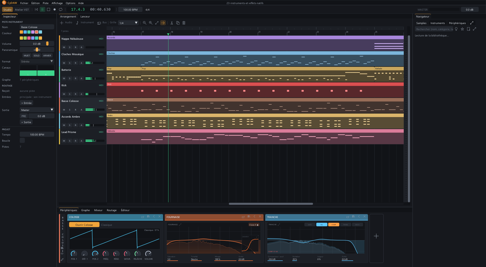
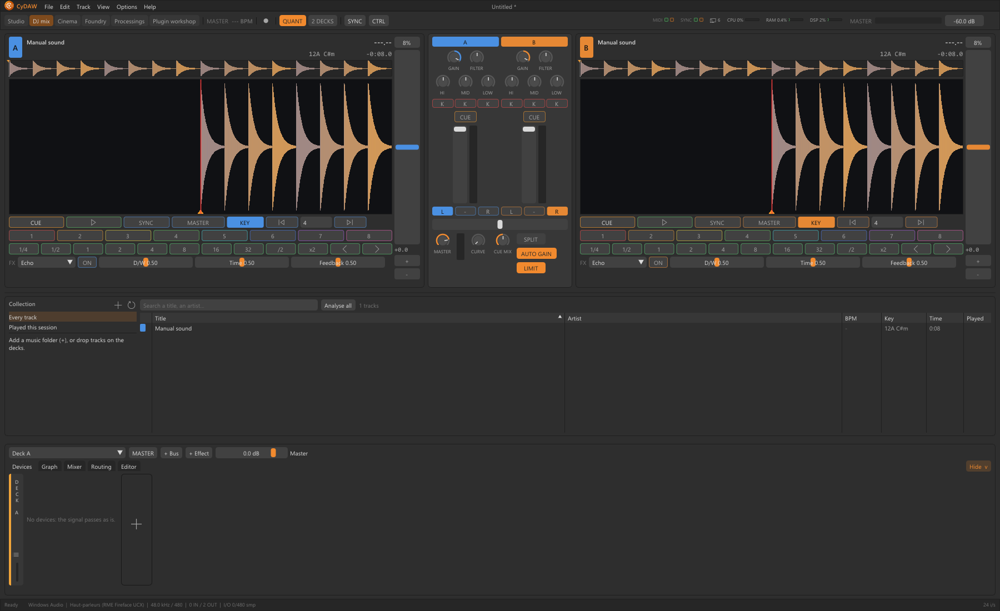
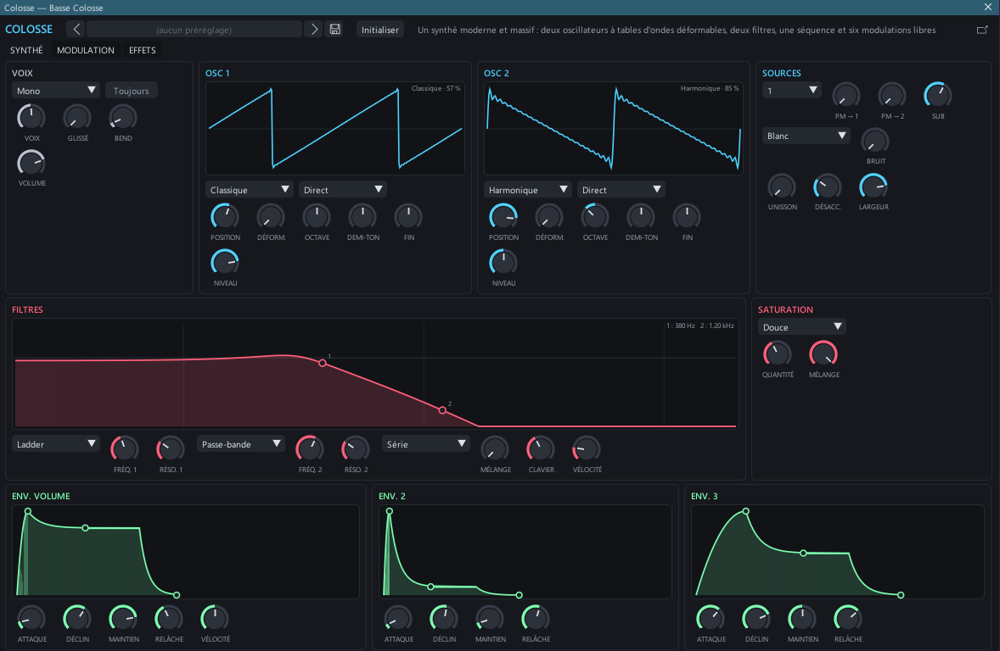
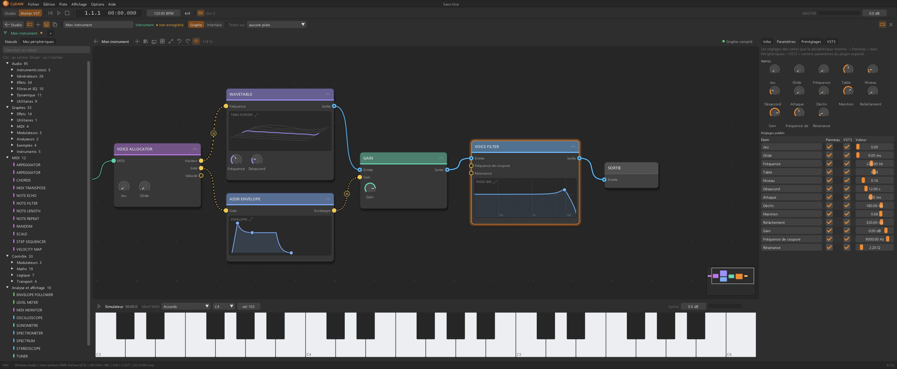

<table width="100%">
  <tr>
    <td width="300" align="left" valign="top">
      <a href="https://mrmybal.github.io/CyDaw/">Website</a><br>
      <a href="https://mrmybal.github.io/CyDaw/manual/Documentation.html#/en/welcome">Manual</a><br>
      <a href="https://github.com/MrMybal/CyDaw">GitHub</a><br><br>
      <sub>README</sub><br>
      <a href="README.md">English</a> · <a href="README.fr.md">Français</a>
    </td>
    <td width="400" align="center" valign="middle">
      <a href="https://mrmybal.github.io/CyDaw/"></a>
    </td>
    <td width="300" align="right" valign="top">
      <p><sub>Application license</sub><br><a href="LICENSE"><strong>AGPL-3.0</strong></a></p>
      <p><sub>Version</sub><br><a href="VERSION.md"><strong>0.78.0 · Alpha 1</strong></a><br><strong>ALPHA</strong></p>
      <p><a href="https://github.com/MrMybal/CyDaw/releases/download/v2-0.78.0-alpha.1/CyDAW2-0.78.0-Windows-x64-Alpha.zip"><strong>Download</strong></a><br><sub>Windows x64 · portable ZIP</sub></p>
    </td>
  </tr>
</table>

<h1 align="center">CyDaw</h1>

> **CyDSP-CORE branch:** audio integration is in progress; the complete desktop
> still uses JUCE services. This branch requires the expanded CyDSP checkout via
> `CYDAW_CYDSP_SOURCE_DIR`. See [build instructions and status](docs/CyDSPIntegration.md)
> and the [detailed issue report (French)](docs/CyDSPIntegrationReport.fr.md).

**CyDaw** is an open-source digital audio workstation for musicians, sound designers and audio creators. Compose and arrange music, perform a DJ set, edit recordings, work to picture or build your own instruments and effects.

> **ALPHA · 0.78.0 · Alpha 1**
>
> Experimental Windows x64 release for testing and feedback. Some features may be incomplete. Read the [version notes, source updates and known limitations](VERSION.md). The current sources and online manual can be newer than the downloadable Alpha 1 package.

[](docs/images/cydaw-studio.png)

## About CyDaw

### One project, several ways to work

| Workspace | What you can do |
| --- | --- |
| **Studio** | Arrange audio and MIDI, launch clips/scenes, edit notes and automate a mix. |
| **DJ mix** | Perform with two or four decks, hot cues, loops, sync, EQ, effects, crossfader and headphone cueing. |
| **Foundry** | Cut and assemble recordings, adjust gains/fades, reverse, stretch, process and render multitrack audio. |
| **Cinema** | Place sounds against video frames; organise editable audio/MIDI sub-tracks in bus containers and mix the soundtrack. |
| **Processing** | Reuse audio/MIDI processing steps, audition before/after and apply them to clips. |
| **Plugin workshop** | Design module graphs, publish controls/presets, draw interfaces and export reusable devices or native plugins. |

[](.CyDocBuild/assets/dj-en.png)

### Instruments, effects and modulation

Start with native synthesis: **Prisme**, **Ambre**, **Colosse**, **Mosaïque**, **Nébuleuse**, **Opale**, **Quartz**, **Saphir**, **Onyx**, **Alliage**, **Argile**, **Dérive**, **Bronze**, **Jade**, **Tirette**, **Silex** and **Kick** cover wavetable, analogue, FM, phase distortion, atmospheric textures, resonant objects, organ, modelled keys and synthesized percussion.

The sampler supports zones, velocity layers, round robin, SFZ controllers/articulations and disk streaming. Batterie, Drum Machine, Instrument Layer, Instrument Selector and Nuée provide kits, per-key instruments, layers, switching and granular sound. Factory sample instruments are downloaded separately; sound models may be absent from the release.

[](docs/images/cydaw-colosse.png)

Build track chains with native EQ, compression, limiting, saturation, delays, reverbs, amp/cabinet/microphone processing, creative audio effects and MIDI effects. Pression, Fournaise, Écho Bande, Velours, Patine, Halo, Tranche, Finition and Sonomètre provide focused mixing tools. LFOs, envelopes, steps, random sources, macros and followers modulate device parameters. Containers organise serial, parallel, mid/side, multiband and selectable chains.

### From a graph to your own tool

Connect typed audio, MIDI and control ports, expose parameters and prepare presets. Design the full editor and compact device card separately. Export an editable `.cydawdevice` for another compatible CyDaw installation, or build **VST3, CLAP and LV2** with the required compiler/SDKs. Windows and Linux x64 export targets are documented; cross-compilation alone does not validate a plugin in a Linux host. macOS export is deferred.

[](website/assets/workshop-showcase.png)

## Features

- **Audio and MIDI editing:** timeline zoom, clip splitting/resizing, takes/comping, time stretching, piano roll, note expression and automation.
- **Mixing and routing:** buses, sends, sidechains, latency compensation, mono-to-7.1 track formats and virtual I/O.
- **External effects:** isolated **VST3, CLAP, LV2 and JSFX** hosting on audio tracks, with an integrated JSFX editor. This path does not yet provide external instruments on MIDI tracks or effects on hardware buses/master.
- **Transport sync:** MIDI Clock, MTC/MMC, JACK Transport and Ableton Link with compatible peers. Protocols share different timing data; transport sync does not carry audio.
- **Controllers:** learn MIDI/OSC mappings, gamepad or computer-keyboard controls, ranges, curves and bidirectional feedback.
- **Project interchange:** readers for Ableton Live, Bitwig, Studio One, REAPER, FL Studio, Ardour, LMMS, Zrythm, DAWproject and AAF; fidelity varies. Read the import report and compare against a reference render.
- **Sound library:** local folders and downloadable banks, categories, favourites and tempo/key filters; optional description search uses a separately downloaded model.
- **Automation tools:** the [local MCP server](tools/mcp/README.md) can create tracks, write notes, configure devices and export mixes.
- **English and French:** application UI and illustrated documentation, with HTML navigation, search, images and diagrams.

## Sound banks and documentation

Samples are not stored in this repository. Open **Options > Sound banks** to download the free banks to a location you choose. The repository supplies maps/catalogues; [factory credits and licenses](content/factory/LICENCE.txt) identify their sources. Copy external media separately when transferring projects or editable devices.

Open **Help > User manual** or **Ctrl+F1** for the bundled manual. Source builds generate the offline CyDoc reader as `Documentation/Documentation.html` with its `DocData/` directory. No server or internet connection is needed to read that export. The [online manual](https://mrmybal.github.io/CyDaw/manual/Documentation.html#/en/welcome) follows current sources and may document changes after Alpha 1. [Français](https://mrmybal.github.io/CyDaw/manual/Documentation.html#/fr/welcome).

---

## Installation

The published application package is **Windows 10/11 x64 · Alpha 1**. Source build/export targets do not imply downloadable Linux or macOS application packages.

1. [Download CyDaw 0.78.0 Alpha 1](https://github.com/MrMybal/CyDaw/releases/download/v2-0.78.0-alpha.1/CyDAW2-0.78.0-Windows-x64-Alpha.zip). [Release notes](https://github.com/MrMybal/CyDaw/releases/tag/v2-0.78.0-alpha.1) and [SHA-256 checksums](https://github.com/MrMybal/CyDaw/releases/download/v2-0.78.0-alpha.1/SHA256SUMS.txt) accompany it.
2. Extract the complete ZIP to a writable folder. Keep the DLLs, plugin worker, fonts, translations and license folders beside the executable.
3. Start **`CyDAW 2.exe`** (the internal executable name), select **Windows Audio / WASAPI** in audio settings and choose the output channels connected to your speakers.
4. Download any wanted sound banks in **Options > Sound banks**. The published ZIP does not enable ASIO or VST2.

## Source, build and required libraries

<details>
<summary><strong>Windows source build</strong></summary>

Requirements: **Visual Studio 2022** with C++ tools/Windows SDK, **CMake 3.24+**, **Git/Git LFS**, **Python 3.11+** and **Node.js 22+/npm** for documentation. CMake fetches pinned JUCE 8.0.15 and CyUI sources; CyUI checkout requires access if its repository is restricted. Prepare the shared FFmpeg SDK separately. NASM enables native EEL2 code generation; without it ysfx uses its portable interpreter.

```powershell
git lfs install
git clone https://github.com/MrMybal/CyDaw.git
cd CyDaw
python tools/setup_ffmpeg.py
cmake --preset desktop-windows-wasapi -DCYDAW_BUILD_V2=ON
cmake --build build/windows-wasapi --config Release --target CyDAW2
& '.\build\windows-wasapi\CyDAW2_artefacts\Release\CyDAW 2.exe'
```

The build also prepares the plugin worker and offline documentation. To build all configured targets and run checks:

```powershell
cmake --build --preset desktop-windows-wasapi --parallel 2
ctest --preset desktop-windows-wasapi --parallel 2
```

See [build/test usage](docs/V2_TEST_BUILD.md), [CyUI configuration](src/v2/CyUI.cmake), [FFmpeg setup](third_party/FFMPEG.md) and [documentation generation](.CyDocBuild/README.md). Other audio backends and plugin-export toolchains have separate prerequisites. The WASAPI preset disables ASIO/JACK audio backends; JACK Transport is a separate integration. See [plugin formats and export](docs/PLUGIN_FORMATS.md).

</details>

---

## License

CyDaw is distributed under the [GNU Affero General Public License v3](LICENSE) (AGPL-3.0). The project is maintained by Cyberalien. Third-party libraries, sound banks and scripts retain their own terms.

### Third-party libraries

| Library · source | License · terms | Use / scope |
| --- | --- | --- |
| [JUCE 8.0.15](https://github.com/juce-framework/JUCE/tree/8.0.15) | [AGPLv3 / commercial licensing](https://github.com/juce-framework/JUCE/blob/8.0.15/LICENSE.md) | Audio I/O, codecs and plugin hosting; this project uses the AGPL route. JUCE component notices also apply. |
| [Dear ImGui](https://github.com/ocornut/imgui) | [MIT](third_party/imgui/LICENSE.txt) | Native UI; bundled stb helpers retain their notices. |
| [CyUI](https://github.com/MrMybal/CyUI) | [MIT](https://github.com/MrMybal/CyUI/blob/8367401fe45fc22bfed5e227cb3de343177f676b/LICENSE) | Shared UI controls and audio views. Source access depends on repository permissions. |
| [CyUI editor components](https://github.com/MrMybal/CyUI) | [MIT and permissive component terms](https://github.com/MrMybal/CyUI/blob/8367401fe45fc22bfed5e227cb3de343177f676b/THIRD_PARTY_NOTICES.md) | ImGuiColorTextEdit, Lexilla, Scintilla headers and SciTE language data; notices in Licenses/CyUI. |
| [CLAP](https://github.com/free-audio/clap) | [MIT](third_party/clap/LICENSE) | Plugin worker host API and native CLAP export. |
| [LV2](https://lv2plug.in/) | [ISC](third_party/lv2/COPYING) | Native export API/metadata; JUCE’s LV2 host stack has additional component notices. |
| [ysfx](https://github.com/jpcima/ysfx) | [Apache-2.0](third_party/ysfx/LICENSE) | JSFX compiler/runtime inside the isolated worker. |
| [WDL](https://www.cockos.com/wdl/) | [zlib-style](third_party/ysfx/thirdparty/WDL/LICENSE.txt) | EEL2 and LICE used by ysfx. |
| [stb](https://github.com/nothings/stb) / [dr_libs](https://github.com/mackron/dr_libs) | [Public domain or MIT](third_party/ysfx/thirdparty/stb/LICENSE); [public domain or MIT-0](third_party/ysfx/thirdparty/dr_libs/LICENSE) | JSFX image/audio helpers. |
| [Ableton Link 3.1.2](https://github.com/ableton/link) | [GPL-2.0-or-later](third_party/ableton-link/LICENSE.md) | Transport tempo/phase synchronisation. |
| [Standalone Asio](https://github.com/chriskohlhoff/asio) | [Boost Software License 1.0](third_party/ableton-link/modules/asio-standalone/LICENSE_1_0.txt) | Link networking; unrelated to the Steinberg ASIO audio driver SDK. |
| [JACK2](https://github.com/jackaudio/jack2) | [LGPL-2.1-or-later](third_party/jack-transport/COPYING) | Transport headers; external library/server loaded dynamically when used. |
| [FFmpeg shared libraries](https://ffmpeg.org/) | [LGPL-3.0-or-later and component notices](third_party/FFMPEG.md) | Cinema video, filmstrip and soundtrack decoding; shared Windows SDK, not linked into native plugin exports. |
| [Zstandard](https://github.com/facebook/zstd) | [BSD-3-Clause](third_party/zstd/LICENSE) | Decoding compressed Zrythm project data. |
| [Pugl](https://github.com/lv2/pugl) | [ISC](third_party/pugl/COPYING) | Linux X11/OpenGL native plugin editors; export dependency, not a Linux application release. |
| [CyDoc 0.1.0](https://github.com/MrMybal/CyDoc) | [MIT](https://github.com/MrMybal/CyDoc/blob/6ddf9a582defb2f11fbb3f992afef6f98dcadc93/LICENSE) | Offline HTML reader; Node.js, marked, Prism and esbuild are documentation build tools. |

This table indexes the main components; it does not replace their transitive notices. Keep `LICENSE`, `JUCE_LICENSE.md` and the archive’s `Licenses/` directory, including `Licenses/CyUI`, `Licenses/FFmpeg` and `Licenses/PluginFormats`. Fonts and codecs also retain their notices. Optional dependencies and build tools do not change CyDaw’s license. See the [format dependencies](third_party/PLUGIN_FORMAT_DEPENDENCIES.md), [transport dependencies](third_party/TRANSPORT_DEPENDENCIES.md) and [FFmpeg terms](third_party/FFMPEG.md).

## References and links

- [Product website](https://mrmybal.github.io/CyDaw/) · [English manual](https://mrmybal.github.io/CyDaw/manual/Documentation.html#/en/welcome) · [Manuel en français](https://mrmybal.github.io/CyDaw/manual/Documentation.html#/fr/welcome).
- [Version notes](VERSION.md) · [Published Alpha 1](https://github.com/MrMybal/CyDaw/releases/tag/v2-0.78.0-alpha.1) · [All releases](https://github.com/MrMybal/CyDaw/releases).
- [Source repository](https://github.com/MrMybal/CyDaw) · [Issue tracker](https://github.com/MrMybal/CyDaw/issues).

<details>
<summary><strong>Technical references (mostly French)</strong></summary>

- [Interface and control port](docs/V2_INTERFACE.md) · [Architecture](docs/ARCHITECTURE.md).
- [Sampler](docs/SAMPLER.md) · [Synths](docs/SYNTHES.md) · [Prisme](docs/PRISME.md) · [Batterie](docs/BATTERIE.md) · [Kick](docs/KICK_ET_ELECTRO.md).
- [Studio effects](docs/EFFETS_STUDIO.md) · [Mixing effects](docs/EFFETS_MIXAGE.md) · [Creative/MIDI effects](docs/EFFETS_CREATIFS.md) · [Amps and microphones](docs/AMPLIS_ET_MICROS.md).
- [Library](docs/BANQUE_DE_SONS.md) · [Sound models](docs/SOUND_MATCHING.md) · [Audio editing](docs/EDITION_AUDIO.md).
- [Cinema](docs/CINEMA.md) · [Processing](docs/TRAITEMENTS.md) · [Transport sync](docs/TRANSPORT_SYNC.md).
- [Controllers](docs/CONTROLEURS.md) · [Modulators](docs/MODULATEURS.md) · [Containers](docs/CONTENEURS.md) · [MCP](tools/mcp/README.md).

</details>
