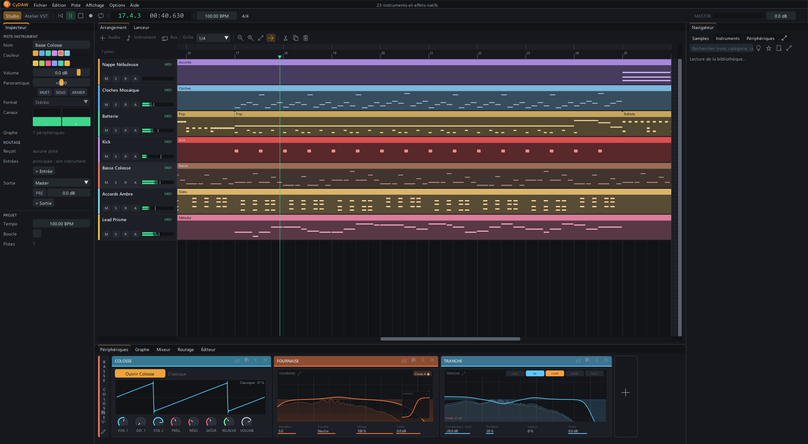
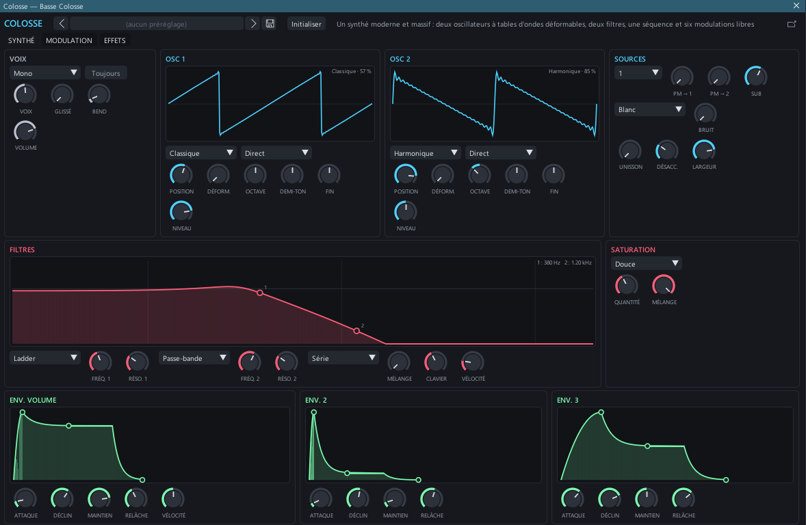

# CyDAW

**CyDAW** is a digital audio workstation (DAW) for Windows: compose, arrange, play, mix and finish a
track, with its own instruments, its own effects and a built-in sound library.



## What it offers

**Compose and arrange**
- Arrangement and clip launcher (scenes), on the same tracks.
- Note editor with per-note expressions (pitch, volume), legato for monophonic instruments.
- Audio editing: time stretching without changing pitch, takes and comping, clip versions.
- Automation of every setting, modulation (LFOs, macros), tempo and time signature.
- Import projects from other software: Ableton Live, Bitwig, Studio One, Reaper, FL Studio, Ardour,
  LMMS, Zrythm, DAWproject (Cubase…), AAF (Logic, Pro Tools…), and a MIDI file with its audio tracks.

**Its instruments**
- **Prisme** (wavetable), **Ambre** (analogue), **Colosse** (modern wavetable), **Mosaïque** (hybrid),
  **Nébuleuse** (layers and grains), **Kick** (synthesised kick drum).
- **Opale** (everyday polyphonic), **Quartz** and **Saphir** (FM), **Tirette** (organ), **Onyx** (phase
  distortion), **Alliage** (modular), **Argile** and **Dérive** (analogue), **Bronze** (resonant
  objects), **Jade** (modelled electric piano), **Silex** (synthesised drum machine).
- **Drum Machine** (one pad per key, each an instrument with its effects), **Instrument Layer** and
  **Instrument Selector** (layers of instruments, together or one at a time), and **Nuée** (granular, on
  its own sounds).
- **Batterie**: six acoustic kits, per-piece mixing, microphone settings, grooves laid down as MIDI
  clips.
- **Sampler**: zones, velocity layers, round robin, SFZ import (controllers, articulations, release
  noises), streaming from disk for long recordings.
- **More than 90 factory instruments** (pianos, strings, winds, guitars, basses, drums, percussion…) built
  from free (CC0) sound banks.
- **Sound models**: a recorded note analysed and resynthesised into a playable instrument.



**Its effects**
- Studio: equaliser, compressor, reverb, limiter and filter.
- Mixing: Pression (upward and downward multiband compression), Fournaise (saturation), Écho Bande (tape
  echo), Multibande Pro, Velours (resonance taming), Patine (analogue wear), Halo (reverb), Tranche
  (console channel strip), Finition (mastering) and Sonomètre (loudness).
- Amps, cabinets and microphones for guitars, basses and vocals.
- Creative: vocoder, pitch shifter and harmoniser, pitch correction, de-esser, convolution reverb,
  spectral freeze and blur, granular delay, rhythmic repeats, looper, frequency shifter, ring
  modulation, rotary speaker, resonators, comb filter, rhythmic volume.
- MIDI: arpeggiator, chords, scale, note echo, humanise, note length, step sequencer, note repeat.
- Utilities: tuner, stereo scope (goniometer, phase correlation), polarity and mono bass.

**Modulate**
- On every device, **modulators**: LFO, Steps, Random, ADSR, Keytrack, Expressions, Macro,
  Button, Math, Envelope Follower. Drag their arrow onto any knob, effects and instruments included; a
  ring shows how far it moves, adjustable while it plays.
- **Containers**: Chain, FX Layer, FX Selector, Mid-Side Split, Stereo Split, Multiband
  FX-2 and FX-3, XY FX and Replacer. Their chains show in the device strip, devices drop into them, they
  nest, their branches can be renamed, and their presets keep everything they hold.

**Mix and route**
- Mixer with buses, sends, sidechain and latency compensation.
- Tracks from mono to 7.1, virtual inputs and outputs with their own effects.
- **VST3, CLAP, LV2 and JSFX** plug-in hosting, each instance isolated in its own process, with a built-in
  JSFX script editor.

**DJ mixing**
- The **DJ mix** mode: two or four decks (tempo with key lock, sync, hot cues, loops, scratching, one
  effect per deck), a mixer (kill EQ, filter, crossfader, headphones, limiter), an analysed collection
  (tempo, beat grid, key), and recorded mixes.

**Edit sound files**
- The **Foundry**: a multitrack sound editor (several tracks, several sounds on each) — cut, paste,
  fades, normalise, stretch and transpose, process with the studio's effects, measure (peak, RMS, LUFS,
  spectrum), save as WAV, FLAC, AIFF or Ogg, export the mix.

**Build your own processing**
- The **Processings** mode: audio processings made of steps (an effect chain set up like a track, JSFX
  code, noise reduction, hum removal, click removal, filters, normalisation) that can let a reverb ring
  past the end of the sound, and MIDI processings written as scripts (humanise, swing, strum, note
  echoes…). Each one is tried by listening before / after, then applied to a clip as a single undo
  step.

**Sound to picture**
- The **Cinema** mode: an optional reference video, buses laid out in rows as in the arrangement, time
  containers of audio/MIDI sub-tracks with their clips, a list with framing, native effects, routing
  and automation. A video's soundtrack becomes an editable audio clip on its own bus automatically.

**Control with hardware**
- **MIDI / OSC controllers**, organised around devices: your MIDI keyboard, a gamepad, an OSC tablet
  (local or on the network), the computer keyboard. Create the device, move one of its controls so CyDAW
  recognises the hardware, then learn its rules by moving its controls one by one: each has its chain of
  transformations both ways (range, curve, encoder, toggle, dead zone) and what it controls, picked with
  a click in the interface. **Learn** mode also works the other way: click a CyDAW control, then move a
  hardware control.

**Make your own devices**
- The **Plugin workshop** builds devices from module graphs, draws them an interface, and exports them as
  **VST3, CLAP and LV2** plug-ins (Windows and Linux), samplers included: their samples travel inside the
  plug-in.

**Find your sounds**
- A library that brings together the sound banks and your own folders: categories, key, tempo,
  favourites, column filters.
- Optional search by description (a CLAP model downloaded from within the application, with its
  licence).

**Drive it**
- An **MCP** server (`tools/mcp`) lets an AI assistant create tracks, write notes, set up instruments
  and effects, or export a mix.

The interface is available in English and French.

## The sounds

The samples are not in this repository: the sound banks (free, CC0 or Unlicense) are downloaded from
within the application, in **Options › Sound banks**, to the location you choose. The repository holds
the instruments' maps and the list of banks. Their authors and licences are credited in
[`content/factory/LICENCE.txt`](content/factory/LICENCE.txt).

## Building

Requirements: Windows 10 or 11 (x64), Visual Studio 2022 (C++), CMake 3.24 or newer,
[Git LFS](https://git-lfs.com) (a few test files), Python 3.11 for the tools and tests.
JUCE 8 is fetched automatically.

```bash
git lfs install
git clone https://github.com/MrMybal/CyDaw.git
cd CyDaw
cmake --preset desktop-windows-wasapi
cmake --build build/windows-wasapi --config Release --target CyDAW2
```

The application is then in `build/windows-wasapi/CyDAW2_artefacts/Release/CyDAW 2.exe`. Run the tests
with `ctest -C Release` in the build folder.

## Documentation

The detailed documentation is written in French.

- [Interface and control port reference](docs/V2_INTERFACE.md)
- [Sampler and factory instruments](docs/SAMPLER.md) · [Synths](docs/SYNTHES.md) ·
  [Prisme](docs/PRISME.md) · [Batterie](docs/BATTERIE.md) · [Kick](docs/KICK_ET_ELECTRO.md)
- [Studio effects](docs/EFFETS_STUDIO.md) · [Mixing effects](docs/EFFETS_MIXAGE.md) ·
  [Creative and MIDI effects](docs/EFFETS_CREATIFS.md) · [Amps and microphones](docs/AMPLIS_ET_MICROS.md)
- [Sound library](docs/BANQUE_DE_SONS.md) · [Sound models](docs/SOUND_MATCHING.md)
- [Audio editing](docs/EDITION_AUDIO.md) · [Architecture](docs/ARCHITECTURE.md)
- [Cinema: video, audio editing and buses](docs/CINEMA.md)
- [Audio and MIDI processings: steps, code, before / after](docs/TRAITEMENTS.md)
- [Transport sync: MIDI, JACK, Link](docs/TRANSPORT_SYNC.md)
- [MIDI / OSC controllers: devices, rules, learning](docs/CONTROLEURS.md)
- [Modulators: LFOs, steps, envelopes, macros on every device](docs/MODULATEURS.md)
- [Containers: layers, selector, mid-side, bands, XY pad, replacer](docs/CONTENEURS.md)
- [MCP server](tools/mcp/README.md)

## Licence

CyDAW is distributed under the GNU Affero General Public License, version 3 (AGPL-3.0): see
[LICENSE](LICENSE). Maintained by Cyberalien.

It is built on [JUCE 8](https://juce.com) (AGPLv3) and [Dear ImGui](https://github.com/ocornut/imgui)
(MIT). The sound banks keep their own licences.

The external **VST3, CLAP, LV2 and JSFX** formats, the native exports and the JSFX editor are described
in [PLUGIN_FORMATS.md](docs/PLUGIN_FORMATS.md).
