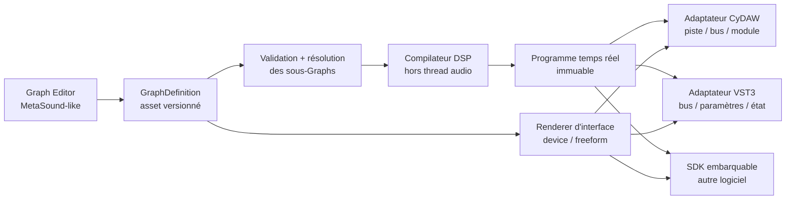

# Graph Editor et export VST3

Ce document fixe la frontière entre le système Graph, son éditeur et les
formats de plug-ins. Le but est qu'un même instrument ou effet créé visuellement
soit utilisable dans CyDAW, dans un éditeur autonome et, après export, dans un
autre DAW sous forme de VST3.

## Principe directeur

Un Graph n'est ni un composant d'interface ni un plug-in JUCE. C'est un asset
versionné qui décrit :

- ses ports publics strictement typés ;
- ses primitives DSP et ses sous-Graphs ;
- ses paramètres publiés et leurs identifiants stables ;
- ses interfaces `device` et `freeform` ;
- ses métadonnées, sa documentation et ses dépendances exactes.

L'éditeur MetaSound/Blueprint-like modifie cet asset sur le thread de contrôle.
Le moteur compile ensuite un programme DSP immuable. CyDAW et le VST3 ne sont
que deux adaptateurs autour du même programme.

## Couches du framework

### 1. `cydaw::graph` — modèle portable

Cette couche ne dépend pas de JUCE. Elle contient `GraphDefinition`,
`GraphInstance`, `GraphLibrary`, la validation, les ports, les paramètres et les
documents d'interface. Elle doit pouvoir être liée dans CyDAW, un outil en ligne
de commande ou un autre logiciel.

Les ports Audio Mono, Stéréo, 3, Quad, 5, 6, 7 et 8 canaux sont des types
distincts. Un câble entre formats différents est refusé. Une conversion exige
un node adaptateur explicite, visible et sauvegardé dans le Graph.

### 2. Compilateur et runtime DSP

Le compilateur résout les sous-Graphs, valide les cycles, construit l'ordre de
traitement, alloue/réutilise les buffers et produit une empreinte déterministe.
Le programme résultant possède toutes ses ressources avant publication.

Le callback audio :

- n'alloue pas ;
- ne verrouille pas ;
- ne lit pas de JSON ;
- ne reconstruit pas de composant graphique ;
- applique les paramètres et événements avec leur offset dans le bloc.

Une modification topologique compile un nouveau programme hors callback puis le
publie atomiquement. Un geste de knob ne recompile pas le Graph : il écrit une
valeur bornée dans la file de paramètres et laisse l'UI se redessiner
indépendamment.

### 3. `Graph Editor` — application modulaire

L'éditeur est composé de panneaux dockables et redimensionnables :

- `Details` à gauche : instance sélectionnée, alias local, description/tooltip,
  format de port et propriétés éditables ;
- canevas central : nodes, câbles typés, zoom, navigation et visualisations ;
- `Palette/Configuration` à droite : recherche contextuelle, catégories,
  métadonnées du Graph, bibliothèque et validation ;
- présentation `device/freeform` : création de l'interface publique ;
- diagnostics : erreurs de compilation, coût DSP, canaux, latence et événements.

Ces panneaux peuvent être masqués sans modifier le Graph. Leur layout est un
état d'éditeur séparé et sérialisé. Les descriptions saisies pour le Graph et
chaque node alimentent les tooltips et la documentation exportée.

À faible zoom, les contrôles interactifs lourds sont remplacés par une preview
peinte. Ils redeviennent interactifs lorsque leur taille est suffisante. Cela
évite les knobs cassés et les centaines de composants actifs pendant la
navigation.

### 4. Adaptateurs hôte

Un adaptateur mappe uniquement le contrat public :

| Graph | CyDAW | VST3 |
|---|---|---|
| Audio Mono/Stéréo/3–8 | bus de piste/module | bus audio déclaré |
| MIDI in/out | flux piste/clip | event bus |
| Transport | transport de session | process context hôte |
| Paramètre publié | automation/modulation | ParameterID 32 bits stable |
| Analysis | télémétrie bornée UI | télémétrie de l'éditeur du plug-in |
| Interface `device/freeform` | panneau/fenêtre | AudioProcessorEditor |

Les ports `Value` ou `Trigger` publics ne deviennent jamais implicitement des
bus VST3. Pour exporter, ils doivent être publiés comme paramètres ou adaptés
explicitement par un node compatible avec le format cible.

## Pipeline VST3

1. L'utilisateur choisit un Graph de rôle Instrument, Audio Effect, Analyzer ou
   Utility.
2. L'exporteur demande le nom du produit, la société, deux codes quatre
   caractères et la version du binaire.
3. `planVst3Export` valide le Graph, ses dépendances, les bus exacts et les
   identifiants de paramètres.
4. Le compilateur produit le programme DSP et son empreinte.
5. Le générateur crée un wrapper fin : déclaration des bus, paramètres, état,
   MIDI, transport et éditeur d'interface.
6. Le générateur natif écrit du C++ pour la topologie DSP, les paramètres,
   les programmes et la disposition Dear ImGui. CMake compile le moteur commun
   avec `CYDAW_BUILD_DESKTOP=OFF`, le SDK Steinberg VST3 (révision MIT épinglée)
   et Dear ImGui. L'adaptateur actuel est Windows x64, audio float32, HWND/D3D11.
   Aucun module JUCE ni éditeur de graphe n'est lié dans cet export.
7. Un hôte de test charge le bundle hors processus, restaure son état, automatise
   chaque paramètre et vérifie le rendu avant de présenter l'artefact.

Le fichier exporté embarque la topologie DSP résolue et son interface compilée. Il
ne dépend pas d'une installation de CyDAW sur la machine du musicien. Les assets
factory verrouillés ou tiers devront autoriser explicitement la redistribution.

## État implémenté

- modèle `GraphDefinition`/`GraphInstance` indépendant de JUCE ;
- bibliothèque versionnée et compilation déterministe des dépendances ;
- ports audio stricts Mono à 8 canaux ;
- descriptions persistantes de Graph/nodes utilisées comme tooltips ;
- panneau d'édition modulaire masquable et redimensionnable ;
- gestes de paramètres découplés de la recompilation DSP ;
- runtime commun capable de modifier les paramètres atomiques en place et de
  traiter les formats exacts de un à huit canaux ;
- `planVst3Export`, qui produit bus, paramètres, rôle, catégorie, identité et
  empreinte vérifiés sans dépendre de l'interface CyDAW ;
- application autonome `CyDAW Graph Editor` utilisant le même composant ;
- premier effet `CyDAW Graph Runtime.vst3` avec éditeur nodal embarqué, état
  visuel et programme DSP restaurables par l'hôte ;
- validation hors processus du VST3 : instanciation, traitement stéréo,
  création de l'éditeur et round-trip de l'état.

## Prochaines tranches exécutables

1. compiler le reste des primitives de `PrimitiveRegistry` vers le programme
   DSP portable commun ;
2. transformer le contrôle `VST3` en panneau d'export avec profils sauvegardés ;
3. générer les wrappers spécialisés à partir de `PluginExportPlan`, notamment
   instrument/MIDI et paramètres publiés automatisables par le DAW hôte ;
4. embarquer les dépendances de sous-graphes et les interfaces personnalisées ;
5. produire et tester les bundles Windows, macOS et Linux.

Cette séquence évite deux moteurs divergents : le son entendu dans CyDAW pendant
l'édition sera exactement celui du VST3 exporté.

## Atelier et export natif — 15 octobre 2026

L'éditeur V2 dispose d'un inspecteur suivant la sélection et d'un onglet E/S.
Les prises audio (1–8 canaux), MIDI, valeur et transport se créent explicitement,
avec nom et catégorie. Un graphe vide est proposé dans le menu Nouveau.
« Exposer » choisit les prises visibles ; un câble connecté reste visible.
Les paramètres d'effets stockés dans les emplacements étendus disposent aussi
 de prises, avec des identifiants optionnels stables pour conserver les graphes
anciens. Les paramètres de synthèse sans entrée de modulation existante montrent
un bouton désactivé et son explication.

L'interface enregistre deux scènes indépendantes : grande fenêtre et carte
Périphériques. Le schéma 17 conserve `deviceDesigned`, `deviceWidth`,
`deviceHeight`, `deviceControls` et l'objet `design` de chaque contrôle.
Le designer offre calques, sélection multiple ou rectangle, déplacement groupé,
alignement/distribution, ordre d'affichage, pages, verrouillage, zoom,
styles et code JSON validé avant remplacement. Les panneaux d'effets natifs
se déposent depuis leur palette et conservent leurs contrôles interactifs.

Les composants C++ utilisent `src/v2/CustomInterfaceABI.h` : contexte ImGui,
liaisons de paramètres et callbacks `get`/`set`, sur le thread interface.
Le bouton Compiler construit une DLL mise en cache par source/version ImGui/ABI.
Le fichier `.cydawdevice` garde le source. L'export VST3 compile directement ces
sources, renommant leur point d'entrée pour chaque composant ; aucune DLL du
cache de CyDAW n'est requise chez l'utilisateur du VST3.

`src/native_plugin/NativeRuntime` est le moteur sans JUCE, partagé avec le DAW
par un adaptateur de buffers dans `src/app/NativeDspRuntime`. Les programmes
VST3 utilisent les identifiants de paramètres stables et un état binaire versionné.
Les dessins existants sont adaptés à `std::string` par `NativeVisuals.cmake`,
sans compiler les services de fichiers/traduction JUCE de l'éditeur.

La génération actuelle accepte une sortie audio et jusqu'à quatre entrées
(dont trois auxiliaires), des notes MIDI, la synthèse et les effets. Les samplers,
modèles enregistrés, racks de pads et assets importés non embarqués sont refusés.
Les ports de contrôle/transport restent des contrats CyDAW et ne deviennent pas
automatiquement des bus VST3. L'adaptateur JUCE historique de démonstration reste
une cible séparée ; l'Atelier utilise le générateur natif.

Le SDK et Dear ImGui conservent leurs notices MIT. La licence du moteur CyDAW
n'est pas modifiée par cet export ; le bundle contient également sa notice.

Vérifications reproductibles : `cydaw_core_tests` (desktop OFF),
`tests/v2_workshop_designer_check.py`, le validateur Steinberg et
`CyDAWNativeViewTest` (option `CYDAW_NATIVE_VALIDATOR=ON`). Ce dernier attache une
vraie fenêtre HWND à un parent de test caché, fait tourner les trames et vérifie
plusieurs fermetures/réouvertures. Il ne capture pas le bureau.

### Sections d'instruments natives réutilisables

`InstrumentPanels` utilise les dispositions `SynthLayouts` et les tables de
paramètres des synthés, de Prisme et de Kick. Un contrôle `native-panel` garde
`instrumentType`, `instrumentPanel`, `instrumentCompact`, `instrumentKeys` et
ses `extraBindings`. Les clés non affectées sont absentes : le contrôle reste
grisé, et l'inspecteur peut ajouter ou retirer une liaison. Les courbes de filtre
sont communes au designer et aux fenêtres natives SynthView/PrismView.

La palette peut créer toute l'interface d'un instrument présent, ou un panneau
libre à relier à un graphe personnel. L'export écrit ces métadonnées et compile
le même renderer et les mêmes dispositions sans JUCE. Les paramètres internes
du panneau sont inclus même s'ils ne sont pas publiés à l'hôte.

La taille en pixels est éditable dans la barre du designer et dans l'inspecteur.
L'aperçu 1:1 et le cadrage ne modifient pas les dimensions enregistrées. Une
modification des dimensions s'applique aussi à une fenêtre de module déjà ouverte.

## Adaptateurs natifs CLAP et LV2

`NativeProcessor` porte le DSP et l’état communs; `EditorModel` / `EditorSurface` portent l’interface sans API de format. `NativePlugin` adapte VST3; `ClapExport` et `Lv2Export` adaptent les deux nouveaux formats. `NativeFormats.cmake` choisit la cible. Les presets LV2 emportent les valeurs de ports et l’état binaire complet en `atom:Chunk` / `xsd:base64Binary`, y compris les paramètres internes non exposés. Leurs fichiers TTL sont générés depuis la DLL effectivement compilée. Les entrées d’automatisation CLAP découpent le rendu aux positions d’échantillon annoncées.

Le chargement dans CyDAW est distinct : `ExtraPluginFormats`, `ClapInstance` et `JsfxInstance` vivent exclusivement dans le worker; LV2 utilise son adaptateur JUCE/Lilv. Cela n’ajoute aucune dépendance JUCE aux exports natifs. Voir [PLUGIN_FORMATS.md](PLUGIN_FORMATS.md).
