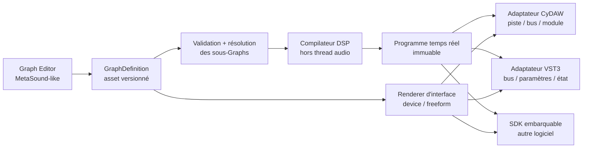

# Graph Editor et export VST3

Ce document fixe la frontière entre le système Graph, son éditeur et les
formats de plug-ins. Le but est qu'un même instrument ou effet créé visuellement
soit utilisable dans CyDAW, dans un éditeur autonome et, après export, dans un
autre DAW sous forme de VST3.

## Principe directeur

Un Graph n'est ni un composant d'interface ni un plug-in JUCE. C'est un asset
versionné qui décrit :

- ses ports publics strictement typés ;
- ses primitives DSP et ses sous-Graphs ;
- ses paramètres publiés et leurs identifiants stables ;
- ses interfaces `device` et `freeform` ;
- ses métadonnées, sa documentation et ses dépendances exactes.

L'éditeur MetaSound/Blueprint-like modifie cet asset sur le thread de contrôle.
Le moteur compile ensuite un programme DSP immuable. CyDAW et le VST3 ne sont
que deux adaptateurs autour du même programme.

## Couches du framework

### 1. `cydaw::graph` — modèle portable

Cette couche ne dépend pas de JUCE. Elle contient `GraphDefinition`,
`GraphInstance`, `GraphLibrary`, la validation, les ports, les paramètres et les
documents d'interface. Elle doit pouvoir être liée dans CyDAW, un outil en ligne
de commande ou un autre logiciel.

Les ports Audio Mono, Stéréo, 3, Quad, 5, 6, 7 et 8 canaux sont des types
distincts. Un câble entre formats différents est refusé. Une conversion exige
un node adaptateur explicite, visible et sauvegardé dans le Graph.

### 2. Compilateur et runtime DSP

Le compilateur résout les sous-Graphs, valide les cycles, construit l'ordre de
traitement, alloue/réutilise les buffers et produit une empreinte déterministe.
Le programme résultant possède toutes ses ressources avant publication.

Le callback audio :

- n'alloue pas ;
- ne verrouille pas ;
- ne lit pas de JSON ;
- ne reconstruit pas de composant graphique ;
- applique les paramètres et événements avec leur offset dans le bloc.

Une modification topologique compile un nouveau programme hors callback puis le
publie atomiquement. Un geste de knob ne recompile pas le Graph : il écrit une
valeur bornée dans la file de paramètres et laisse l'UI se redessiner
indépendamment.

### 3. `Graph Editor` — application modulaire

L'éditeur est composé de panneaux dockables et redimensionnables :

- `Details` à gauche : instance sélectionnée, alias local, description/tooltip,
  format de port et propriétés éditables ;
- canevas central : nodes, câbles typés, zoom, navigation et visualisations ;
- `Palette/Configuration` à droite : recherche contextuelle, catégories,
  métadonnées du Graph, bibliothèque et validation ;
- présentation `device/freeform` : création de l'interface publique ;
- diagnostics : erreurs de compilation, coût DSP, canaux, latence et événements.

Ces panneaux peuvent être masqués sans modifier le Graph. Leur layout est un
état d'éditeur séparé et sérialisé. Les descriptions saisies pour le Graph et
chaque node alimentent les tooltips et la documentation exportée.

À faible zoom, les contrôles interactifs lourds sont remplacés par une preview
peinte. Ils redeviennent interactifs lorsque leur taille est suffisante. Cela
évite les knobs cassés et les centaines de composants actifs pendant la
navigation.

### 4. Adaptateurs hôte

Un adaptateur mappe uniquement le contrat public :

| Graph | CyDAW | VST3 |
|---|---|---|
| Audio Mono/Stéréo/3–8 | bus de piste/module | bus audio déclaré |
| MIDI in/out | flux piste/clip | event bus |
| Transport | transport de session | process context hôte |
| Paramètre publié | automation/modulation | ParameterID 32 bits stable |
| Analysis | télémétrie bornée UI | télémétrie de l'éditeur du plug-in |
| Interface `device/freeform` | panneau/fenêtre | AudioProcessorEditor |

Les ports `Value` ou `Trigger` publics ne deviennent jamais implicitement des
bus VST3. Pour exporter, ils doivent être publiés comme paramètres ou adaptés
explicitement par un node compatible avec le format cible.

## Pipeline VST3

1. L'utilisateur choisit un Graph de rôle Instrument, Audio Effect, Analyzer ou
   Utility.
2. L'exporteur demande le nom du produit, la société, deux codes quatre
   caractères et la version du binaire.
3. `planVst3Export` valide le Graph, ses dépendances, les bus exacts et les
   identifiants de paramètres.
4. Le compilateur produit le programme DSP et son empreinte.
5. Le générateur crée un wrapper fin : déclaration des bus, paramètres, état,
   MIDI, transport et éditeur d'interface.
6. CMake/JUCE construit les bundles Windows, macOS et Linux. Le SDK VST3/JUCE
   utilisé par la chaîne doit respecter ses licences ; CyDAW ne réutilise pas un
   SDK VST2 historique pour cet export.
7. Un hôte de test charge le bundle hors processus, restaure son état, automatise
   chaque paramètre et vérifie le rendu avant de présenter l'artefact.

Le fichier exporté embarque une copie résolue du Graph et de ses dépendances. Il
ne dépend pas d'une installation de CyDAW sur la machine du musicien. Les assets
factory verrouillés ou tiers devront autoriser explicitement la redistribution.

## État implémenté

- modèle `GraphDefinition`/`GraphInstance` indépendant de JUCE ;
- bibliothèque versionnée et compilation déterministe des dépendances ;
- ports audio stricts Mono à 8 canaux ;
- descriptions persistantes de Graph/nodes utilisées comme tooltips ;
- panneau d'édition modulaire masquable et redimensionnable ;
- gestes de paramètres découplés de la recompilation DSP ;
- runtime commun capable de modifier les paramètres atomiques en place et de
  traiter les formats exacts de un à huit canaux ;
- `planVst3Export`, qui produit bus, paramètres, rôle, catégorie, identité et
  empreinte vérifiés sans dépendre de l'interface CyDAW ;
- application autonome `CyDAW Graph Editor` utilisant le même composant ;
- premier effet `CyDAW Graph Runtime.vst3` avec éditeur nodal embarqué, état
  visuel et programme DSP restaurables par l'hôte ;
- validation hors processus du VST3 : instanciation, traitement stéréo,
  création de l'éditeur et round-trip de l'état.

## Prochaines tranches exécutables

1. compiler le reste des primitives de `PrimitiveRegistry` vers le programme
   DSP portable commun ;
2. transformer le contrôle `VST3` en panneau d'export avec profils sauvegardés ;
3. générer les wrappers spécialisés à partir de `PluginExportPlan`, notamment
   instrument/MIDI et paramètres publiés automatisables par le DAW hôte ;
4. embarquer les dépendances de sous-graphes et les interfaces personnalisées ;
5. produire et tester les bundles Windows, macOS et Linux.

Cette séquence évite deux moteurs divergents : le son entendu dans CyDAW pendant
l'édition sera exactement celui du VST3 exporté.
