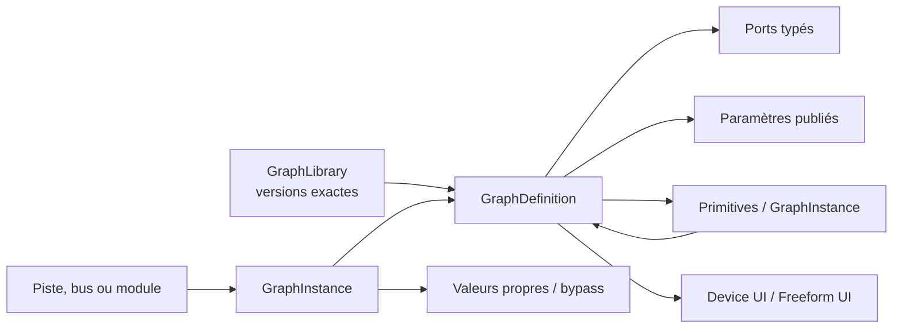

# CyDAW Graph System

Graph est le format interne commun de CyDAW pour les instruments, effets,
modulateurs, analyseurs et traitements locaux de piste ou de bus. Un module
interne n'est pas une classe d'interface séparée du moteur : c'est une instance
de Graph disposant éventuellement d'une présentation graphique.

## Principes non négociables

- Un `GraphDefinition` est un asset immuable et versionné.
- Un `GraphInstance` référence une version exacte et ne contient que ses
  valeurs propres, son bypass et éventuellement une définition locale embarquée.
- Une définition peut contenir des primitives DSP et d'autres Graphs.
- Les ports sont typés : Audio, MIDI, Value, Trigger, Transport ou Analysis.
- Le type, la cadence et le nombre de canaux doivent correspondre. Une
  conversion nécessite un nœud explicite ; aucune conversion implicite n'est
  cachée dans le moteur.
- Les entrées/sorties appartiennent au Graph. Elles ne sont pas imposées par le
  conteneur : un instrument peut publier MIDI vers Audio, un effet Audio vers
  Audio et un modulateur uniquement Value.
- Les paramètres publiés sont la seule API de contrôle stable d'un Graph.
  L'automation, la modulation, le mapping MIDI et l'interface utilisent le même
  identifiant de paramètre.
- Un Graph peut proposer plusieurs interfaces. CyDAW utilise d'abord une vue
  `device` contrainte pour la chaîne de périphériques et une vue `freeform`
  destinée à l'éditeur complet détachable.
- Les Graphs `inlineTrack` et `inlineBus` sont stockés dans le projet. Ils
  utilisent exactement le même modèle, mais ne sont pas ajoutés à la bibliothèque
  utilisateur tant que l'utilisateur ne les publie pas.

## Modèle

La référence est formée d'un identifiant stable et d'une version sémantique,
par exemple `factory.poly-synth@1.2.0`. Deux versions peuvent cohabiter. Un projet
ancien reste donc reproductible même après la mise à jour d'un Graph installé.

## Compilation et temps réel

1. L'éditeur modifie un modèle mutable hors du thread audio.
2. Le validateur contrôle les identifiants, ports, paramètres, interfaces,
   dépendances, cycles et compatibilités de connexion.
3. Le compilateur résout les sous-Graphs, établit un ordre déterministe et crée
   une empreinte de contenu utilisable comme clé de cache.
4. Le backend DSP prépare un plan immuable et ses buffers en dehors du callback.
5. Le moteur remplace atomiquement l'ancien plan par le nouveau à une frontière
   de bloc. Le callback ne verrouille pas, n'alloue pas et ne lit pas de JSON.

Un cycle DSP est refusé sauf s'il traverse une primitive déclarée comme cassant
le cycle (par exemple un délai d'au moins un échantillon). Un cycle de dépendance
entre deux définitions de Graph est toujours refusé.

## Paramètres, automation et modulation

Chaque paramètre publié indique sa plage, sa valeur par défaut et s'il accepte
l'automation ou la modulation. La modulation ne réécrit pas la valeur de base :
le moteur calcule `base + modulations`, puis applique la politique de plage du
paramètre. Un modulateur est lui-même un Graph publiant une sortie Value. Cette
symétrie permet de fabriquer un LFO, un suiveur d'enveloppe ou un séquenceur avec
les mêmes primitives que les autres modules.

## Interfaces

Les contrôles ne connaissent pas directement l'implémentation DSP. Ils se lient
à un paramètre publié ou à un port de télémétrie Analysis. Les vumètres,
waveforms et spectres lisent des snapshots bornés produits par le moteur ; ils
ne consultent jamais les buffers temps réel de manière concurrente.

Le format d'interface courant (schéma 15) fournit potentiomètres, faders,
interrupteurs, sélecteurs, pavés XY à deux paramètres, affichages de valeur liés, textes, panneaux de groupe, waveforms, spectres, enveloppes et
vumètres typés de 1 à 8 canaux. La palette les classe en contrôles de paramètres,
visualiseurs, layout et ports publiés. Le canevas libre possède une grille
configurable ; l'inspecteur permanent permet de saisir précisément le libellé,
la position et la taille normalisées de chaque contrôle. Les deux axes d'un
pavé XY conservent des bindings typés et des valeurs par défaut indépendants ;
le contrôle reste interactif dans l'éditeur complet comme directement dans le
nœud qui réutilise le Graph. L'affichage de valeur fournit une lecture seule
formatée avec unité et jauge normalisée, mise à jour avec le paramètre publié.
L'enveloppe ADSR est un contrôle à quatre bindings distincts (attaque, decay,
sustain, release) : ses poignées, son clavier et sa remise à zéro pilotent les
paramètres en direct dans l'interface complète, le nœud et le VST3 exporté.
Le contrôle de réponse de filtre associe deux bindings distincts (fréquence de
coupure et résonance/Q). Il affiche une courbe logarithmique interactive et
pilote les deux paramètres en direct dans l'interface complète, dans les nœuds
imbriqués et dans le VST3 exporté. La génération automatique d'interface le
propose dès qu'une paire `lowpass.cutoff`/`lowpass.resonance` ou
`voiceFilter.cutoff`/`voiceFilter.resonance` est publiée.
Le contrôle de dynamique associe `compressor.threshold` et
`compressor.ratio`. Sa courbe entrée/sortie possède deux poignées interactives,
reste synchronisée avec les contrôles assignés et pilote le même DSP dans le
nœud, l'interface libre et le VST3 exporté.

- `device` : grille bornée, réarrangement automatique possible, adaptée au bas
  de la fenêtre et aux chaînes de périphériques.
- `freeform` : surface libre, groupes, visualisations et contrôles complexes,
  ouvrable dans un panneau ou une fenêtre détachée.

Le bouton d'interface d'un module interne doit utiliser le même geste que le
bouton d'interface d'un VST. L'utilisateur peut ensuite ouvrir le Graph source
si la définition n'est pas protégée.

## Fichiers et bibliothèque

Les fichiers `.cydawgraph` de schéma 3 stockent l'identifiant, la version, le
rôle, la portée, les tags et l'état de l'éditeur. Le lecteur conserve la
compatibilité avec les schémas 1 et 2. La bibliothèque indexe les métadonnées sans
instancier le DSP et permet de filtrer Instrument, Effect, MIDI FX, Modulator,
Analyzer et Utility.

La bibliothèque factory initiale fournit désormais trente-deux classes Graph
inspectables et composables, réparties en arborescence : synthés polyphoniques,
canaux et dynamique, couleur/distorsion, délai/espace, mixage/mastering, outils
MIDI, modulateurs et analyseurs. Elle comprend notamment des traitements de
batterie, échos filtrés, effets de modulation, filtre dynamique, utilitaires
mono, protections master, zones MIDI et neuf caractères d'instrument. `Poly Keys`,
`Ambient Glass`, `Electric Organ` et `Percussive Bell` sont des exemples complets :
ils restent construits uniquement avec les primitives éditables, possèdent un
contrat MIDI→Audio stéréo et génèrent une façade avec ADSR, paramètres publiés et
visualisations temps réel.
Chaque classe possède une description, un auteur, des tags et une catégorie
persistants. Le Gestionnaire peut donc regrouper la collection par catégorie,
rôle, tag ou auteur sans instancier son DSP.

Les assets factory sont en lecture seule. Une modification crée une nouvelle
version utilisateur. Les dépendances sont référencées par version exacte et le
projet peut embarquer les définitions absentes pour rester portable.

## Création et audition live dans une piste

Le bouton `+ GRAPH` de l'éditeur et l'action homonyme du menu contextuel créent
une définition locale avec un identifiant UUID. Les modèles initiaux publient
uniquement leur contrat ; ils n'ajoutent jamais un traitement caché :

- effet audio et analyseur : passage transparent `Audio In -> Audio Out`, avec
  un format exact choisi de Mono à 7.1 ;
- instrument : `MIDI In` et `Audio Out`, silencieux tant que l'auteur n'ajoute
  pas explicitement ses primitives ou sous-graphes ;
- effet MIDI : passage transparent `MIDI In -> MIDI Out` ;
- modulateur : uniquement `Value Out`, sans LFO implicite ;
- utilitaire : passage transparent `Value In -> Value Out`.

La définition est immédiatement représentée par un module composite dans le
graphe de la piste. Un double-clic l'ouvre avec le même éditeur nodal. Une
modification topologique revalide et republie le plan DSP hors du callback ; une
modification de paramètre tente d'abord la mise à jour atomique du plan actif.
Le signal de test n'est pas une préécoute séparée : pour une piste audio, il
provient des clips réellement lus par la piste ; pour une piste instrument, il
provient de son entrée et de ses clips MIDI. Les changements sont donc entendus
avec le contexte, le mixage et le routage réels du projet.

Les modules portant la portée `inlineTrack` restent dans l'état de leur piste.
La fusion de la bibliothèque de projet ne propage que les définitions
réutilisables et préserve les définitions locales de chaque piste. L'utilisateur
pourra ensuite publier explicitement un Graph local comme asset versionné.

La recherche contextuelle trie les types par catégorie puis par nom, accepte une
recherche texte sur nom/catégorie/identifiant et propose un filtre de catégorie.
Cela constitue le premier mode de navigation de type Blueprint ; la palette
permanente utilisera le même catalogue.

## Frontières, primitives et sous-graphes au jalon 0.76

L'éditeur distingue trois classes qui ne sont jamais présentées comme
interchangeables :

- les **ports de Graph** décrivent uniquement le contrat public de la définition.
  `Audio In`, `Audio Out`, MIDI, Value et Transport sont des nœuds de frontière
  compacts, sans interface de device ni graphe interne ;
- les **primitives** sont les briques atomiques exécutées par le moteur :
  oscillateur, gain, filtre, opérateur Float, logique ou transformation MIDI ;
- les **sous-graphes** sont des définitions composées et réutilisables. Ils
  possèdent leur propre contrat, peuvent contenir des primitives et d'autres
  sous-graphes, et s'ouvrent au double-clic ou par le menu contextuel.

Un sous-graphe peut être verrouillé manuellement. Une instance verrouillée reste
consultable mais son éditeur est en lecture seule ; son déverrouillage ne modifie
pas les autres définitions. Le LFO d'usine sert de premier exemple : sa façade
reste utilisable comme un module, tandis que son graphe interne expose le cœur
LFO et la sortie Value publiée.

Les ports Audio de frontière portent un nombre de canaux explicite entre 1 et 8.
Les formats usuels sont nommés Mono, Stéréo, Quad, 5.1 et 7.1 ; les autres restent
accessibles par leur nombre de canaux. Deux ports audio de formats fixes
différents ne peuvent pas être reliés sans nœud de conversion explicite.
Les primitives DSP audio déclarées polymorphes peuvent adopter le format exact
de leur premier câble. Ce choix retape toutes leurs prises Audio ensemble ; dès
que la primitive appartient à une chaîne, son format devient strict et une
connexion incompatible est refusée. La palette l'indique par le badge `1–8 CAN`
et l'infobulle détaille chaque prise.

Chaque instance possède enfin un **alias local**. Renommer `Oscillator` en
`Sub Bass`, par exemple, change uniquement son intitulé dans ce Graph et dans sa
présentation ; l'identifiant de type, la catégorie et la définition source
restent intacts.

### Organisation de l'éditeur et gestionnaire

- le panneau gauche affiche et édite les détails de la sélection courante ;
- le panneau droit conserve la configuration du Graph édité et les métadonnées
  autoritaires du nœud : nom, catégorie, classe, identifiant et contrats ;
- le clic droit d'un nœud regroupe navigation interne, alias local,
  verrouillage, format audio, duplication, déconnexion et suppression. Pour
  un sous-graphe, `Créer une variante` clone sa classe, conserve la filiation
  et bascule uniquement l'instance sélectionnée vers cette nouvelle classe ;
- le Gestionnaire de Graph offre deux vues du même catalogue : un arbre par
  catégories/rôles et un explorateur récursif des fichiers utilisateur. Une
  classe réutilisable sélectionnée y expose directement `Créer une variante` ;
- la recherche filtre l'arbre, le double-clic charge un preset ou ouvre le
  sous-graphe, et un panneau de détails permet de vérifier l'asset avant action.

## Primitives disponibles aux jalons 0.75–0.76

- Audio : oscillateur, bruit, gain, somme multi-connexion, passe-bas,
  passe-haut, délai, réverbération, compresseur, écrêteur dur, largeur stéréo et
  suppression de composante continue.
- Value/Float : constante, addition, soustraction, multiplication, division,
  minimum, maximum, clamp, valeur absolue et négation.
- Logique : supérieur, inférieur, égalité avec tolérance, ET, OU, OU exclusif
  et NON. Les résultats sont des valeurs booléennes `0` ou `1`.
- MIDI : transposition, plage de notes, facteur de vélocité et moniteur
  d'événements. Les trois transformations sont intégrées au plan du synthé
  polyphonique et s'entendent pendant l'édition en contexte.
- Visualisation : oscilloscope, spectre, vu-mètre, affichage Value et moniteur
  MIDI. Les vues audio consomment les snapshots d'analyse bornés déjà utilisés
  par les interfaces libres des Graphs.
- Présentation de module : potentiomètres, faders, interrupteurs, formes d'onde,
  spectres, enveloppes, vu-mètres exacts de 1 à 8 canaux, textes et panneaux de
  regroupement. Un inspecteur permanent complète le déplacement libre et les
  huit poignées avec l'édition numérique du libellé et de la géométrie.

Les opérateurs à plusieurs entrées sont décrits par le registre typé
`PrimitiveRegistry`. L'éditeur affiche et route maintenant chaque port déclaré
séparément, avec son nom, son type, sa direction et son nombre exact de canaux.
Les câbles conservent l'identité de leurs deux ports dans les fichiers
`.cydawgraph`, y compris pour les mixers, les sidechains et les bus multicanaux.

## Interface du VST3 Graph Runtime au jalon 0.77

Le VST3 Graph Runtime ouvre désormais la présentation graphique publiée par le
Graph comme interface principale. L'onglet `GRAPH` donne accès au même graphe
nodal, modifiable dans l'instance du plugin, tandis que l'onglet `INTERFACE`
retrouve la façade de contrôle libre créée par l'auteur. Les modifications de
structure et de paramètres sont republiées dans le runtime sans remplacer les
valeurs d'automation déjà détenues par le DAW hôte.

Les paramètres publiés ont une source de vérité unique : une modification dans
l'interface, dans le graphe ou depuis l'automation de l'hôte met à jour les deux
vues avec la même valeur native. Les visualiseurs publiés (waveform, spectre et
vu-mètres de 1 à 8 canaux) reçoivent des trames d'analyse à 30 Hz par une file
SPSC bornée. Le thread audio ne prend donc ni verrou ni allocation pour alimenter
l'interface du plugin.

### Membres publics et bibliothèque

Le panneau droit de l'éditeur comporte trois vues distinctes : `GRAPH` pour les
métadonnées autoritaires, `MEMBRES` pour le contrat public et `PALETTE` pour les
briques insérables. `MEMBRES` regroupe séparément :

- les entrées publiques Audio 1 à 8 canaux, MIDI, Value et Transport ;
- les sorties publiques portant les mêmes types stricts ;
- les paramètres publiés, avec leur plage, leur unité et leur exposition
  éventuelle à l'hôte/VST3.

Sélectionner un membre sélectionne son nœud de frontière ou sa primitive et
affiche l'inspecteur éditable de gauche. Le double-clic ou la touche Entrée cadre
ce nœud dans le canevas. Le bouton `+ MEMBRE` réutilise le même menu typé que la
configuration du Graph, sans créer de traitement DSP implicite. Le clic droit
permet maintenant de modifier le nom public et la description, déplacer le
membre dans l'ordre du contrat, ou retaper une frontière vers Audio 1 à 8,
MIDI, Value ou Transport. Un changement de type conserve l'identifiant stable,
propage un nouveau nombre de canaux dans les chaînes polymorphes et déconnecte
explicitement les liaisons devenues incompatibles. Il peut aussi retirer une
entrée/sortie publique ou basculer directement, pour un paramètre,
`Afficher dans Périphériques` et `Exposer à l'hôte / VST3`. Le même réglage de
visibilité est présent explicitement dans l'inspecteur de paramètre ; la façade
compacte est reconstruite immédiatement sans recompiler le DSP.
Une recherche locale filtre les trois groupes par nom, type, plage, unité ou
état d'exposition et conserve le contexte de section des résultats.

Le gestionnaire conserve l'identité de l'asset sélectionné pendant un rescan ou
un changement de regroupement. Quand aucune sélection antérieure n'est encore
valide, le premier résultat filtré est sélectionné automatiquement et son panneau
de détails est rempli. La ligne active possède un fond et un repère orange afin
que l'état de sélection soit visible sans dépendre uniquement de la couleur du
texte.

## Étapes d'intégration

- Le cœur `cydaw::graph` implémente maintenant définitions, instances,
  validation, bibliothèque, ordre de compilation et empreinte.
- `NodeGraphComponent` produit les définitions du Graph racine et de ses modules
  composés, et conserve identité, version, rôle, portée et tags.
- Le format `.cydawgraph` schéma 3 et le navigateur exploitent ces métadonnées.
- L'éditeur crée maintenant des Graph locaux de piste, les insère dans le chemin
  audio/MIDI compatible et propage séparément structure et paramètres en direct.
- Chaque classe de Graph réutilisable possède maintenant sa propre version
  sémantique. Les instances et sous-graphes compilés référencent cette version,
  indépendamment de la version du Graph racine ; elle est affichée dans
  l'inspecteur avec le nombre d'overrides locaux.
- Les variantes de classe conservent la clé stable de leur classe parente,
  repartent en version `1.0.0` et restent modifiables sans toucher à l'original
  ni à ses autres instances. La filiation et la version propre sont visibles
  dans l'inspecteur et le Gestionnaire de Graph.
- Le schéma d'état 28 conserve alias locaux, formats exacts, prises multiples,
  interfaces, repères de vue, commentaires, routage visuel et verrouillage des
  sous-graphes, ainsi que catégorie et auteur de chaque classe réutilisable,
  sans confondre ces métadonnées avec l'identité des primitives.
- Le gestionnaire réutilise le catalogue catégorisé pour les presets d'usine,
  fichiers utilisateur et sous-graphes de la session.
