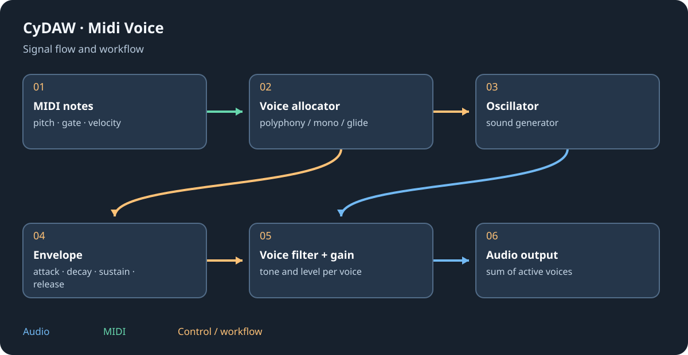

# Creative, MIDI and utility effects

Creative processing can change timing, pitch, spectral content or spatial movement. Add one transformation at a time and keep a reference to the source. An audio effect needs audio; a MIDI effect needs note/control events before an instrument.

## Audio transformations {#audio}
Vocodeur imposes a modulator's spectral shape on a carrier; make sure both required signals exist. Harmonie, Justesse and Décaleur address different pitch/harmony/frequency operations. Dé-esseur controls excessive sibilant energy; Pompe creates rhythmic level movement. Empreinte uses an impulse response, Givre holds spectral material, Grains granulates, Saccade repeats rhythmically and Boucleur captures loops. Anneau ring-modulates, Rotor rotates, Résonateurs/Corps emphasise resonant bodies and Peigne creates comb filtering.

Simple Chorus, Flanger and Phaser create different delay/phase motion. Trémolo changes level; Auto-pan moves stereo position. Bitcrusher reduces resolution; Gate, Limiteur and Transitoires control dynamics. Ping-pong delay alternates repeats. Compare stereo effects in mono and manage feedback.

## MIDI processing {#midi}
Arpège makes patterns from held notes; Accords creates harmonies; Gamme constrains pitch. Écho de notes repeats events, Aléa varies them, Durée changes lengths, Séquenceur supplies a pattern and Roulement repeats quickly. Older transposition, note-filter and velocity nodes are also available. Monitor incoming and outgoing notes to diagnose empty ranges, delayed note-offs or unexpected transposition. These devices do not create audio without an instrument downstream.

## Utilities and basic nodes {#utilities}
Utilitaire controls channel polarity, gain and stereo functions. Accordeur reports tuning; Stéréoscope shows spatial relationships. Mono/stereo conversion, DC removal, high/low-pass, gain/pan, stereo width and Mixeur 4 build simple chains. Spectrum, oscilloscope, VU and MIDI monitors observe signals rather than improve them automatically. Control nodes include LFO, macros, arithmetic, logic and transport-derived values; use compatible typed ports.

See [graphs](graphs.md), [modulators](modulators.md) and [node/control reference](reference-nodes.md).
