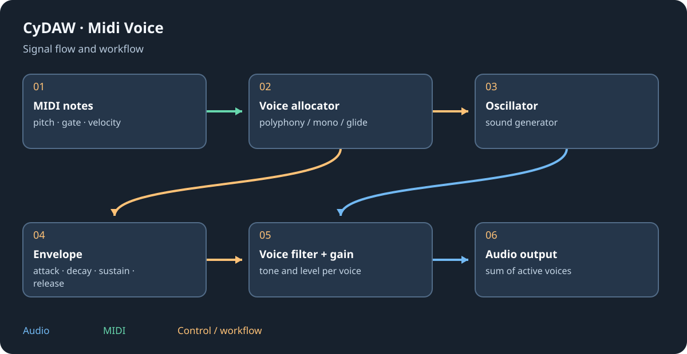

# Kick, Silex, Batterie and pads

Choose synthesis when you want to shape a drum from oscillation/noise; choose sampled kits when you need recorded acoustic pieces and microphones. Kick and Silex synthesize sound. Batterie and factory kits depend on their sample banks. Drum Machine is an instrument container, not the same engine as Batterie.

## Kick and Silex {#synthesis}
For Kick, establish pitch and pitch decay before adding transient/click and saturation. Listen to the tail against the song's bass and tempo; an excessively long decay can mask the next hit. Silex provides synthesized kick, snare, clap, hats, toms, cymbals and percussion with their own settings and character. Check closed/open hat interaction and balance pieces before bus compression.

## Acoustic kits and pads {#kits}
Load a Batterie kit, wait for its bank and inspect piece levels, microphone blend and ambience. A groove supplies MIDI timing, not a rendered recording. For Drum Machine choose a pad's instrument, open its chain for effects, set level/pan and use choke groups for mutually exclusive sounds. The visible 16 pads are a window into the larger note map; confirm the actual MIDI key.

## Layer and finish {#layering}
Layer transient and body deliberately, checking phase/polarity and timing. Route related drum tracks through a bus if they need common glue; retain individual outputs when balancing the kit. A high-pass before distortion can change how the low end drives it, while after distortion it changes the result. Compare at matched loudness. Instrument containers are not currently exportable as complete native plugin instruments; consult export verification rather than assuming every pad engine is included.

See [sampler](sampler.md), [containers](containers.md) and [mixing](mixing.md).
