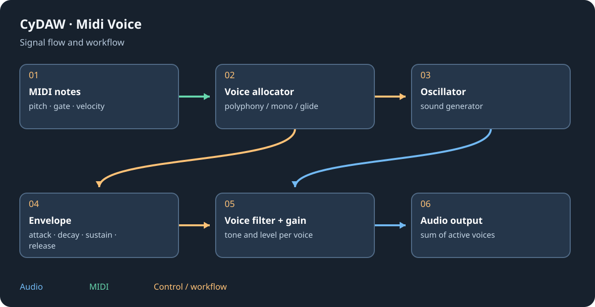

# Glossary and units

These terms describe different layers of a session. Read the unit and context before copying a number between devices: a raw parameter index, a percentage and a displayed musical value can represent the same choice differently.

## Signal and structure {#structure}
| Term | Meaning |
| --- | --- |

| Audio | Sample values played through output channels. |
| MIDI | Note/controller events, not recorded sound. |
| Voice | One active note's instrument state. |
| Clip | A timed reference to audio, events or notes. |
| Track | Clip playback plus instrument/devices and routing. |
| Bus | A route collecting other track outputs. |
| Container | Device branches, instrument layers or Cinema time sub-tracks, depending on context. |
| Master | The final treatment/mix point of a session; DJ tempo MASTER is a different role. |
| Sidechain | A control/detector source, often driving dynamics. |
| Send/return | An additional route and its destination, often parallel effects. |
| Preset/program | Stored settings of a device, chain or exported plugin. |
| Definition/instance | A reusable graph versus its particular live values. |
| Dry/wet | Unprocessed versus processed contribution. |

## Time, level and measurement {#units}
| Unit | Read it as |
| --- | --- |
| Hz / kHz | Cycles per second / thousands of cycles. |
| ms / s | Milliseconds / seconds; 1000 ms = 1 s. |
| BPM | Quarter-note beats per minute in the tempo context. |
| Beat/bar | Musical time; depends on tempo/signature. |
| Sample/frame | A discrete audio or video position; context matters. |
| fps | Video frames per second, not the audio sample rate. |
| dB | Relative gain on a logarithmic scale. |
| dBFS | Digital level relative to full scale. |
| RMS / peak | Energy-related level versus highest instantaneous magnitude. |
| True peak | Estimate of peaks between digital samples. |
| LUFS | Loudness measurement with weighting/gating context. |
| Q | Filter/EQ resonance or bandwidth parameter. |
| % | Displayed fraction; engine values may be normalised differently. |

## Read the generated reference {#reference}
Reference tables preserve engine keys, minimum, default and maximum values reported by the running registry. They are raw schema numbers, not a claim that every display uses the same unit or spacing. Choice indices require the UI labels; logarithmic controls are not linear fractions of frequency. Ports list direction, data type and declared channels. A port count is not a guarantee of supported plugin-export boundaries.

See [instrument reference](reference-instruments.md), [effect reference](reference-effects.md) and [control/node reference](reference-nodes.md).
