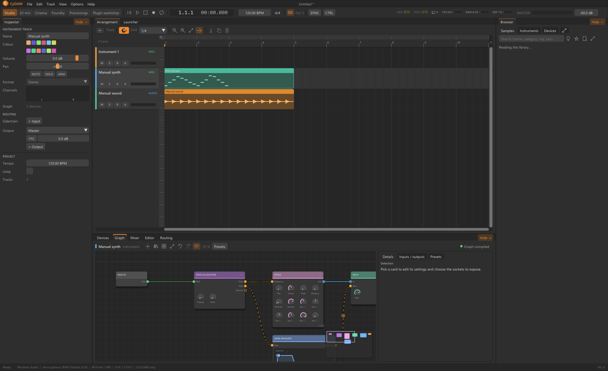

# Graphs, typed ports and exposed values

Graph shows how audio, notes and control values travel through a device. Stable node, port and parameter identities let the same setting serve a knob, automation, modulation and host publication. Adding a visible socket, publishing a host parameter and drawing a control are separate decisions.

## Build and navigate {#editing}
Add nodes from the tree, Tab/search or a double-click. Compatible-node search can open when a cable is released in empty space. Connect output to input of the correct type. Audio, MIDI, Value, Trigger, Transport and Analysis carry different data; inspect channel count and control meaning, not only socket colour. Use explicit conversion nodes where required. Delete mistaken connections rather than piling compensating routes on top.

Pan/zoom the canvas, frame content and arrange selected structures using the graph tools. Selection Details follows the node. Enter a nested graph with its open action and use breadcrumb/back or Escape to return. Ctrl+G groups selected cards into a device; inspect the boundary ports this creates.

## Create a graph interface {#exposure}
In Details, Expose controls whether a parameter/port is presented on the device boundary. Add your own typed graph inputs/outputs in E/S; name and categorise them rather than exposing every internal value. Create Input promotes a value to a typed external input and connects it. Create Variable creates a named local constant preserving value, unit and range. Disconnect an occupied input before promoting it.

A socket can exist in CyDAW without being a plugin host parameter. Choose Panel/host visibility separately and bind the designed control to the correct published ID. Changing displayed names should not change stable identities on which saved automation depends.

## Save, presets and boundaries {#presets}
Save a reusable device under its name/category. Programs capture current parameter values under a preset name; replace/rename/reorder/delete deliberately. Nested devices can have their own preset bank. The track's live values and a reusable definition's defaults are different scopes; check a fresh instance as well as the one already open.

Validation checks wiring, data kinds and export support. A compiling graph is not proof of useful sound: test silence, note-off, bypass and tail behaviour. A graph with multiple control consumers or unsupported boundaries may run in CyDAW yet need an export adapter.

See [workshop](workshop.md), [interface design](interface-design.md) and [native node reference](reference-nodes.md).
