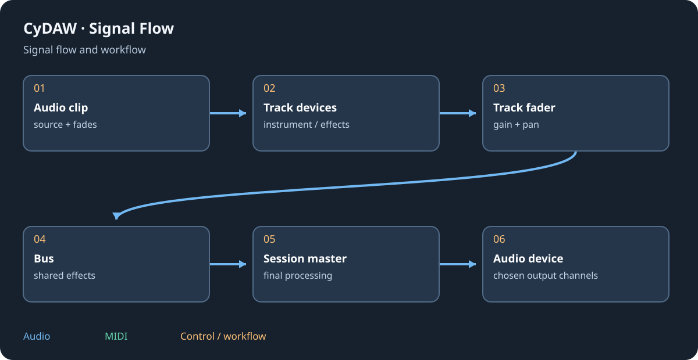

# Amp, cabinet and microphone

Ampli, Baffle et micro and Micro model different stages of a recording chain. An amp provides gain/tone/nonlinearity; cabinet and microphone stages shape the spectrum and perspective. They are useful beyond guitar, but their order and input level strongly affect the result.

## Build the chain {#chain}
Begin with a clean source at a moderate level. Choose an amp character and adjust input/drive before output compensation. Add cabinet/microphone shaping after the amp for a recorded-guitar perspective; a raw driven amp without a cabinet stage can be intentionally harsh. Change one microphone/position variable at a time rather than compensating every change with unrelated EQ.

## Blend and perform {#blend}
Compare dry and processed paths where mixing is offered. Multiple cabinet/mic paths can interfere in phase; listen in mono as well as stereo. For vocals, make small changes and judge consonant intelligibility, proximity and noise between phrases. A modelled microphone is an effect; it does not change the actual capture hardware or recover detail absent from the recording.

## Commit and reuse {#presets}
Save the whole ordered chain if a sound depends on amp plus cabinet plus microphone. A preset of one stage does not store its neighbours. Check latency and monitoring balance while recording, and keep an unprocessed recording if you may want another tone later. Follow the current module's parameter reference for exact choices and ranges.

See [audio recording](studio.md#recording), [mixing](mixing.md) and [effect reference](reference-effects.md).
