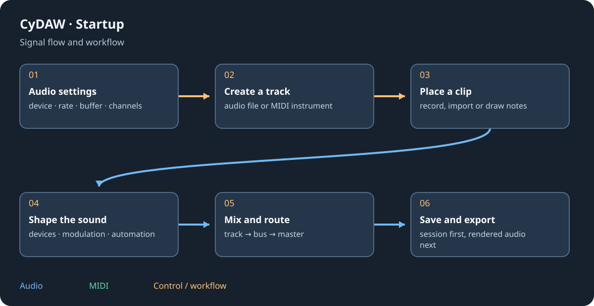

# Save, import and render deliverables

Save preserves editable session structure. Export renders audio or creates a distributable device/plugin. Import translates another format and can lose unsupported state. Keep original projects and source media until the destination has been checked.

## Session and media {#save}
Save Studio projects under a useful name and keep their source/edits folders. Foundry/Cinema sessions have their own documents and processing state; DJ recording is a rendered performance. A reusable .cydawdevice stores a device graph, not the complete song. Check missing-media reports on reopening before deleting a working source directory. Copying only an executable or project JSON is not a media backup.

## Import other projects {#import}
File > Import project opens a new session and reports unsupported/missing items. Supported readers include Live .als, Bitwig .bwproject, Reaper .rpp, FL Studio .flp, Ardour, LMMS, Zrythm, DAWproject and AAF; MIDI plus neighbouring audio files is a fallback. Studio One .song is approximate; use a supported interchange export where possible. Imported native instruments can become CyDAW equivalents; this does not guarantee their original timbre. External plugins may become missing-plugin placeholders. Automation, sends, folder hierarchies and mixer FX vary by reader: read the report and compare against a rendered reference.

## Render and verify {#render}
Choose mix/stems, range, destination, sample rate and available file format/bit depth. Include a deliberate tail for delays/reverbs. A master limiter cannot repair clipped source files. Reimport or play the result in another player, checking start, end, silence, channel order and loudness. Keep editable work for revisions.

Plugin builds need the full bundle/resources; graph transfer needs compatible CyDAW schema and external media. Cross-compilation is not runtime validation. See [format export](plugin-formats.md), [Foundry](foundry.md#saving), [Cinema](cinema.md#delivery) and [licences](licenses.md).
