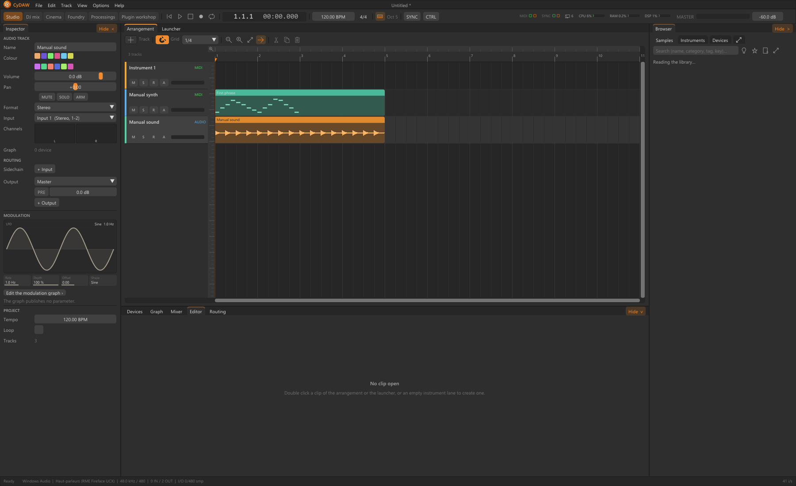

# Sound library and factory banks

Browser brings together personal folders and installed factory banks. Samples, Instruments and Devices are different searches. Adding a folder indexes files; it does not necessarily copy them into a project. Bank download folders, sample caches and original sources have different lifetimes.

## Search and classify {#search}
Add source folders from the folder menu. Filter family, category, instrument, bank and text; sort columns and mark favourites. Background analysis prepares duration, levels, waveform, tempo/key where relevant and caches unchanged files. An incomplete scan does not prove files have disappeared. User-assigned categories take precedence over automatic name/folder classification.

Audition a result, then drag it to the intended audio clip, sampler, deck or Foundry/Cinema location. A recording placed in an audio lane is not the same as a pitched single-sample instrument. Instrument sample notes may use metadata rather than full-track tempo detection.

## Banks and optional semantic search {#banks}
Options > Sound banks shows available/downloaded banks and their licence/source information. Download needed banks before choosing factory sample instruments. A displayed instrument map without its media cannot sound. Keep downloaded archives/caches separate from files used by an existing project.

Optional semantic search uses an audio/text model through the Python companion for descriptions and similar-sound results. Here CLAP means the audio-language model, not the CLAP plugin format. Without it, normal name/category searches still work. Install the model/dependencies through the relevant settings and inspect download/licence information; search quality depends on the model and indexed sounds.

## Keep media available {#media}
Moving or deleting a source folder can break projects/devices that reference it. Preserve files or relink as supported, then reopen the project to verify. Factory banks keep their own licences; a graph export may list external files rather than include them. Before redistributing samples or plugin resources, consult their delivered source notices.

See [sampler](sampler.md), [sound recreation](resynthesis.md) and [file portability](import-export.md).
