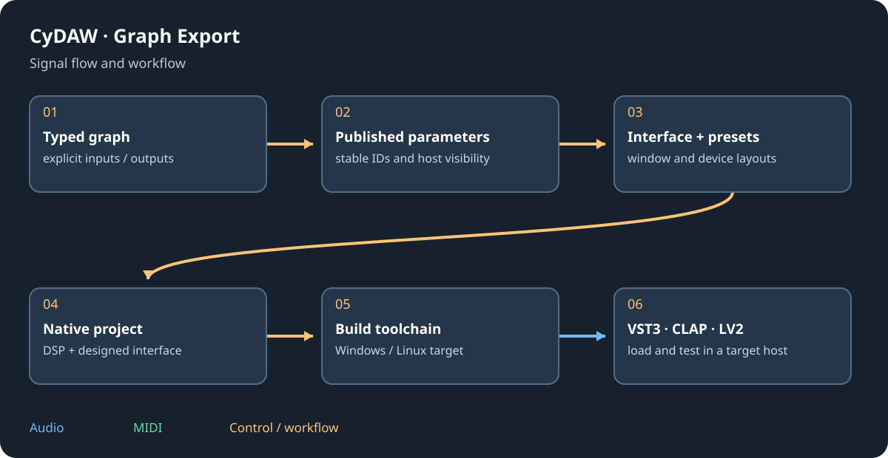

# Versions, licences and documentation

This manual accompanies the Windows CyDAW V2 interface and records the current Alpha capabilities rather than promising every feature of every plugin standard. Text, diagrams and captures are supplied locally with the application. No browser connection is required to read them.

## Application and dependencies {#licences}
CyDAW's supplied LICENSE is GNU AGPL version 3. JUCE has its supplied terms; Dear ImGui and CyUI supply MIT licences. The package includes CyUI's licence and TextEditor/Lexilla/Scintilla notices under Licenses/CyUI, alongside other dependency notices. FFmpeg is the pinned shared LGPL build with configuration and corresponding source supplied in its licence folder. Refer to these exact delivered texts for the version in use.

External format SDKs, custom components, plugin dependencies, sound banks and sample sources retain their own terms. The format chosen for export does not change the included source's licence. A factory instrument's media terms are separate from the executable's.

## Source links and offline files {#sources}
[CyDAW source](https://github.com/MrMybal/CyDaw) and [CyUI source](https://github.com/MrMybal/CyUI) identify the projects. [CyUI's pinned MIT licence](https://github.com/MrMybal/CyUI/blob/8367401fe45fc22bfed5e227cb3de343177f676b/LICENSE) matches this integration. Access to a private source repository can require permissions; the installed notice texts remain readable offline.

The docs/manual folder contains English/French Markdown, editable SVG diagrams, real interface screenshots and a registry snapshot used to generate references. Technical developer notes remain in the broader docs folder and may describe historical milestones; the current manual's explicit limits take priority for this release.

## Maintenance and corrections {#maintenance}
The bilingual contents use matching stable chapter/section IDs, so switching language retains the topic. Reference values come from a running registry snapshot, not hand-copied knobs. Validation checks local links, section parity, figures and coverage before packaging. If you find a wrong gesture or outdated screenshot, report the software version and chapter/section name.

Start again at [Welcome](welcome.md), consult [troubleshooting](troubleshooting.md) or [plugin limitations](plugin-formats.md#limits).

The CyDoc reader is MIT licensed; its licence and generation notices are shipped in help/Licenses. See the [CyDoc repository](https://github.com/MrMybal/CyDoc).
