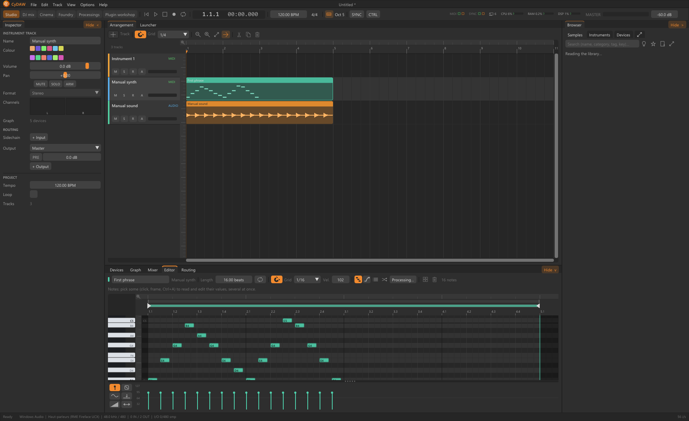

# Notes and MIDI expression

A MIDI clip stores note events; the track instrument turns them into sound. Open Editor for the piano roll: time is horizontal and pitch vertical. Velocity, controllers and per-note expressions depend on the chosen instrument, so audition through the actual sound.

## Draw and edit notes {#notes}
Double-click adds/removes a note; right-click erases. Select notes before mouse or arrow moves. Drag note edges for duration and choose a grid for rhythm. Alt can suspend snapping during a gesture. Q quantises to the chosen grid: compare before/after rather than assuming every note belongs exactly on a beat. Velocity shapes individual accents; track volume changes the whole phrase.

## Playability and expression {#expression}
Set sensible polyphony. Poly permits overlaps; Mono and Legato change held-note interaction and glide. Draw pitch/gain expression per note for individual bends or dynamics. Sustain and release affect what continues after note-off. Ctrl+K toggles computer-keyboard notes; its octave may put notes outside a sampler's mapped range.

## Transform and reuse {#transform}
Duplicate clips for variations, then edit their notes. Note processings humanise, strum, adjust duration or add echoes in an undoable application. Arpège, Accords, Gamme and Écho de notes instead transform incoming MIDI before the instrument; they differ from offline edits rewriting stored notes.

Continue with [synths](synths.md), [note processings](processing.md#midi) and [automation](automation.md).
