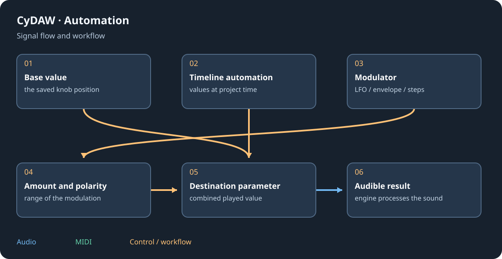

# Modulators and macros

Each device can own control sources in the modulation column beside its card. The modulator button in the header opens that column; its plus adds a source. Existing graph cables and track modulation still exist alongside these per-device sources.

## Choose a source {#sources}
| Source | Output |
| --- | --- |
| LFO | Periodic sine/triangle/saw/square/random motion. |
| Random | Sample-and-hold values with change probability. |
| Steps | Up to sixteen drawn steps. |
| ADSR | Note-triggered envelope, velocity/legato options. |
| Keytrack | Last note's pitch, velocity or held state. |
| Expressions | Wheel, aftertouch, pitch bend or chosen CC. |
| Macro / Button | A performance knob or switch. |
| Math | Combine two control sources. |
| Envelope Follower | Follow the audio level of its device. |

Sync follows note durations and transport phase; Free uses hertz. Retrigger restarts on notes. Choose this before setting depth so the same rate value has the intended meaning.

## Assign and edit depth {#assign}
Drag the source arrow onto a knob to assign it. Clicking the arrow arms it: dragging knobs now changes modulation amount without changing their base values. Negative depth reverses direction; double-click resets depth; click the arrow again or Escape disarms. Coloured rings show ranges and a played-value marker shows the current result. Hover to inspect sources and amounts.

## Scope and reuse {#scope}
Several modulators may target one knob; inspect the combined range. The per-device modulators are evaluated as control-rate, monophonic graph signals, affecting all instrument voices together. Per-note behaviour inside a synth is a separate mechanism. Removing a device removes its owned modulators. Supported modulators travel with the graph into exported plugins.

See [automation](automation.md), [synths](synths.md) and [graphs](graphs.md).
