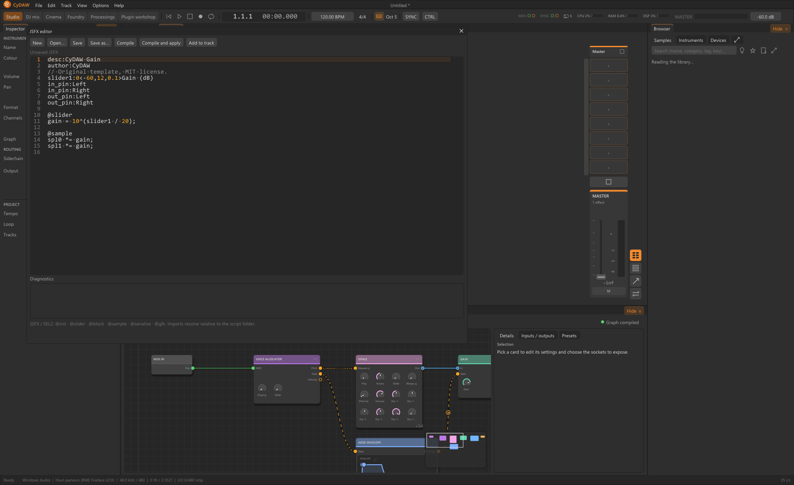
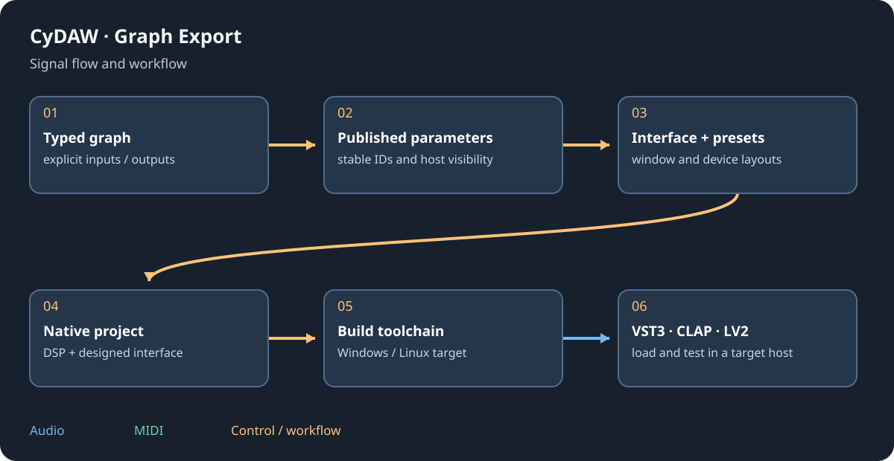

# Host plugins, edit JSFX and export

VST3, CLAP, LV2 and JSFX hosting shares CyDAW's external audio-plugin chain. Native export from Plugin workshop is a separate capability: it builds your graph/interface into VST3, CLAP or LV2. A format name says neither which operating system a binary targets nor which optional host extensions it implements.

## Scan and host {#hosting}
Open the normal Devices plus/library and Plugin folders to include installed locations. VST3/CLAP system/user paths, LV2 bundles, personal JSFX, compatible REAPER Effects folders and delivered examples are searched. CLAP_PATH/LV2_PATH add locations. Keep .vst3/.lv2 bundles complete; a DLL removed from its bundle may lose metadata, UI or resources.

Scan/loading uses isolated workers with timeout/cache. Separate entries in one bundle can appear separately. Parameters, available programs, editor and state use the normal plugin chain. In this version external plugins are hosted on audio tracks; they are not yet MIDI-track instruments or hardware-bus/master effects. Native CyDAW devices remain available there.

## JSFX source editor {#jsfx}
Open View > JSFX script editor, its library/card control or drop a .jsfx file. New creates a gain example. Open/Save/Save as manage source; compile checks current text in a worker without saving it. Compile and apply saves/reloads only a successful compilation. Add to track compiles, saves and inserts or refreshes the card.

~~~eel2
desc:Manual gain
slider1:0<-24,12,0.1>Gain (dB)
@slider
gain = 10^(slider1/20);
@sample
spl0 *= gain;
spl1 *= gain;
~~~

Save a new script before insertion. Imports resolve from its original folder and supported Effects/Data roots. Sections, sliders, @serialize, audio files and @gfx are supported by ysfx; diagnostics are not a step debugger. The Alpha 0.78 tempo-propagation regression check is still unresolved: do not treat a successful compile as proof that every tempo-dependent script receives the expected transport.

## Build formats and platforms {#export}
In Workshop > Export select VST3, CLAP and/or LV2, then Windows x64 and/or Linux x64. Generate projects without compiling or Build selected targets. Results are per target under Plugin Exports/device/platform/format. Windows requires the C++ toolchain/CMake and CyDAW sources. Linux cross-build from Windows prepares verified Zig/sysroot tools and needs Python/Ninja; the target host needs X11/OpenGL. macOS export is deferred.

Copy the whole output: VST3 bundle, CLAP plus required Resources/licences, or full LV2 folder with manifests, presets and binary. Sample/model exports package decoded voice data; memory/size can be large. An exported plugin opens the designed interface, not the graph editor; JUCE is not linked into this native export.

## Limits and validation {#limits}
Verification still governs supported graphs: one audio output, up to four audio inputs and up to eight channels; instrument-container/pad voices remain excluded. A scalar boundary feeding one published parameter can map to that host parameter; one boundary feeding several needs an adapter. CLAP's optional thread-pool/per-note modulation extensions are not advertised by CyDAW's current host.

A Windows build does not validate Linux runtime/audio/GUI. Test load, state restore, notes, parameters, automation, presets, bypass and editor reopen in an actual target host. Changing formats does not remove licences of the included engine, components, banks or dependencies.

See [workshop](workshop.md), [interface design](interface-design.md) and [licences](licenses.md).
