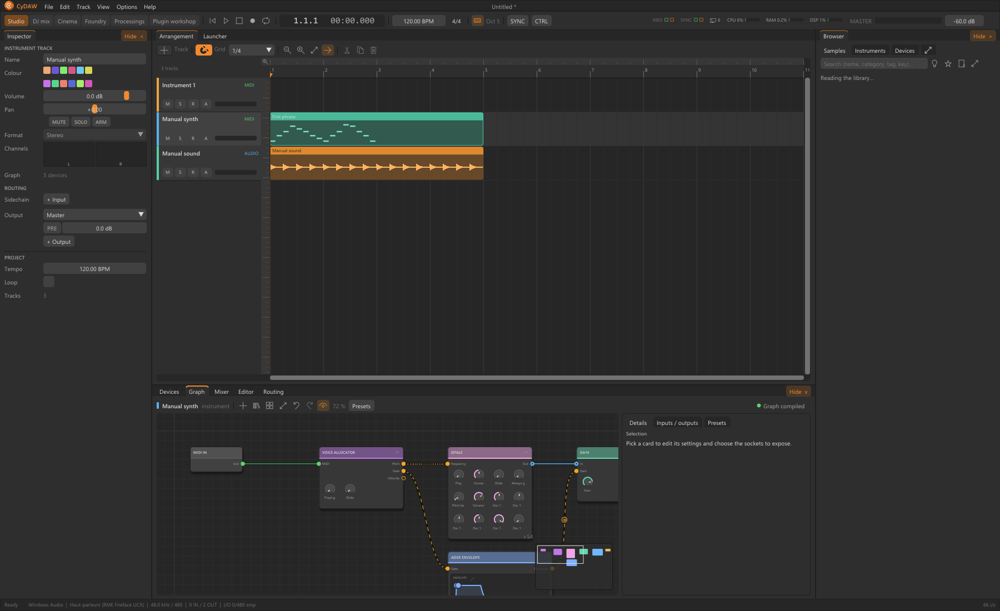

# Effect parameter reference

Generated from the CyDAW 0.78.0 registry. Each section describes a native type, not a track preset or external plugin. Search to find an engine key, range or port.

Numbers are raw engine-schema values. Display units, logarithmic scales, choices and file/table controls belong to the module panel and cannot be inferred from these numbers. Defaults describe a fresh node, not necessarily the loaded preset. A declared port does not guarantee an exportable plugin boundary.

See the [glossary](glossary.md#reference), [instruments](synths.md) and [effects](studio-effects.md) for listening workflows. For limits read [export](plugin-formats.md#limits).

## AMP (amp-sim) {#amp-sim}

Category: DSP / Effects.

Amp simulator: noise gate, pedal (boost, overdrive, fuzz), valve preamp, passive tone stack (bass, middle, treble), power stage with sag, presence and depth; eight models, from American clean to modern high gain and bass amps. Put Cabinet and microphone after it.

| Engine key | Minimum | Default | Maximum |
| --- | --- | --- | --- |
| `gain` | 0 | 5 | 10 |
| `bass` | 0 | 5 | 10 |
| `middle` | 0 | 5 | 10 |
| `treble` | 0 | 5 | 10 |
| `presence` | 0 | 5 | 10 |
| `master` | 0 | 5 | 10 |
| `output` | -24 | 0 | 12 |
| `mix` | 0 | 1 | 1 |
| `model` | 0 | 1 | 7 |
| `bright` | 0 | 0 | 1 |
| `depth` | 0 | 5 | 10 |
| `sag` | 0 | 0.300000012 | 1 |
| `tight` | 20 | 20 | 400 |
| `gate` | -90 | -90 | -20 |
| `pedal` | 0 | 0 | 3 |
| `pedal-drive` | 0 | 0.5 | 1 |
| `pedal-tone` | 0 | 0.5 | 1 |
| `pedal-level` | -12 | 0 | 12 |
| `oversampling` | 0 | 2 | 2 |
| `channel` | 0 | 0 | 1 |
| `model-b` | 0 | 2 | 7 |
| `gain-b` | 0 | 7 | 10 |
| `bass-b` | 0 | 5 | 10 |
| `middle-b` | 0 | 6 | 10 |
| `treble-b` | 0 | 5.5 | 10 |
| `presence-b` | 0 | 6 | 10 |
| `master-b` | 0 | 5 | 10 |
| `bright-b` | 0 | 0 | 1 |
| `depth-b` | 0 | 5 | 10 |

| Port / key | Direction | Type | Channels |
| --- | --- | --- | --- |
| audio-in / `audio-in` | Input | audio | 2 |
| audio-out / `audio-out` | Output | audio | 2 |
| gain / `gain` | Input | value | 1 |
| bass / `bass` | Input | value | 1 |
| middle / `middle` | Input | value | 1 |
| treble / `treble` | Input | value | 1 |
| presence / `presence` | Input | value | 1 |
| master / `master` | Input | value | 1 |
| output / `output` | Input | value | 1 |
| mix / `mix` | Input | value | 1 |
| model / `model` | Input | value | 1 |
| bright / `bright` | Input | value | 1 |
| depth / `depth` | Input | value | 1 |
| sag / `sag` | Input | value | 1 |
| tight / `tight` | Input | value | 1 |
| gate / `gate` | Input | value | 1 |
| pedal / `pedal` | Input | value | 1 |
| pedal-drive / `pedal-drive` | Input | value | 1 |
| pedal-tone / `pedal-tone` | Input | value | 1 |
| pedal-level / `pedal-level` | Input | value | 1 |
| oversampling / `oversampling` | Input | value | 1 |
| channel / `channel` | Input | value | 1 |
| model-b / `model-b` | Input | value | 1 |
| gain-b / `gain-b` | Input | value | 1 |
| bass-b / `bass-b` | Input | value | 1 |
| middle-b / `middle-b` | Input | value | 1 |
| treble-b / `treble-b` | Input | value | 1 |
| presence-b / `presence-b` | Input | value | 1 |
| master-b / `master-b` | Input | value | 1 |
| bright-b / `bright-b` | Input | value | 1 |
| depth-b / `depth-b` | Input | value | 1 |

## ANNEAU (anneau) {#anneau}

Category: DSP / Effects.

Multiplies the sound by a wave: bells, robot voices, very fast tremolo. Frequency, wave shape, ring or amplitude modulation, drive, LFO (rate, depth in octaves, stereo phase), input low cut.

| Engine key | Minimum | Default | Maximum |
| --- | --- | --- | --- |
| `frequency` | 1 | 220 | 5000 |
| `drive` | 0 | 0 | 24 |
| `lfo-rate` | 0.00999999978 | 0.5 | 10 |
| `lfo-depth` | 0 | 0 | 2 |
| `mix` | 0 | 0.5 | 1 |
| `output` | -24 | 0 | 24 |
| `stereo` | 0 | 0 | 1 |
| `shape` | 0 | 0 | 3 |
| `mode` | 0 | 0 | 1 |
| `sync` | 0 | 0 | 12 |
| `low-cut` | 20 | 20 | 2000 |
| `lfo-shape` | 0 | 0 | 3 |

| Port / key | Direction | Type | Channels |
| --- | --- | --- | --- |
| audio-in / `audio-in` | Input | audio | 2 |
| audio-out / `audio-out` | Output | audio | 2 |
| frequency / `frequency` | Input | value | 1 |
| drive / `drive` | Input | value | 1 |
| lfo-rate / `lfo-rate` | Input | value | 1 |
| lfo-depth / `lfo-depth` | Input | value | 1 |
| mix / `mix` | Input | value | 1 |
| output / `output` | Input | value | 1 |
| stereo / `stereo` | Input | value | 1 |
| shape / `shape` | Input | value | 1 |
| mode / `mode` | Input | value | 1 |
| sync / `sync` | Input | value | 1 |
| low-cut / `low-cut` | Input | value | 1 |
| lfo-shape / `lfo-shape` | Input | value | 1 |

## AUDIO SUM (audio-sum) {#audio-sum}

Category: DSP / Audio utilities.

No numeric parameter declared by this schema.

| Port / key | Direction | Type | Channels |
| --- | --- | --- | --- |
| audio-in / `audio-in` | Input | audio | 2 |
| audio-out / `audio-out` | Output | audio | 2 |

## AUTO FILTER (auto-filter) {#auto-filter}

Category: DSP / Filters and EQ.

A resonant low-pass whose cutoff an LFO sweeps: wah, wobble.

| Engine key | Minimum | Default | Maximum |
| --- | --- | --- | --- |
| `cutoff` | 40 | 800 | 15000 |
| `resonance` | 0.300000012 | 2 | 10 |
| `rate` | 0.0500000007 | 1 | 16 |
| `depth` | 0 | 0.5 | 1 |
| `sync` | 0 | 0 | 12 |

| Port / key | Direction | Type | Channels |
| --- | --- | --- | --- |
| audio-in / `audio-in` | Input | audio | 2 |
| audio-out / `audio-out` | Output | audio | 2 |
| cutoff / `cutoff` | Input | value | 1 |
| resonance / `resonance` | Input | value | 1 |
| rate / `rate` | Input | value | 1 |
| depth / `depth` | Input | value | 1 |
| sync / `sync` | Input | value | 1 |

## BITCRUSHER (bitcrusher) {#bitcrusher}

Category: DSP / Effects.

Fewer bits and a lower sample rate: rough, lo-fi digital sound.

| Engine key | Minimum | Default | Maximum |
| --- | --- | --- | --- |
| `bits` | 1 | 8 | 16 |
| `downsample` | 1 | 4 | 32 |
| `drive` | 0 | 0 | 24 |
| `mix` | 0 | 1 | 1 |

| Port / key | Direction | Type | Channels |
| --- | --- | --- | --- |
| audio-in / `audio-in` | Input | audio | 2 |
| audio-out / `audio-out` | Output | audio | 2 |
| bits / `bits` | Input | value | 1 |
| downsample / `downsample` | Input | value | 1 |
| drive / `drive` | Input | value | 1 |
| mix / `mix` | Input | value | 1 |

## LOOPER (boucleur) {#boucleur}

Category: DSP / Effects.

Records what comes in and plays it back as a loop, then layers new takes over it: record, play, overdub, stop, clear; free length or bars locked to the tempo, start on the bar, half or double speed, reverse.

| Engine key | Minimum | Default | Maximum |
| --- | --- | --- | --- |
| `feedback` | 0 | 1 | 1 |
| `level` | 0 | 1 | 1 |
| `dry` | 0 | 1 | 1 |
| `output` | -24 | 0 | 24 |
| `state` | 0 | 0 | 3 |
| `bars` | 0 | 0 | 5 |
| `quantize` | 0 | 1 | 1 |
| `speed-mode` | 0 | 1 | 2 |
| `reverse` | 0 | 0 | 1 |
| `clear` | 0 | 0 | 100 |

| Port / key | Direction | Type | Channels |
| --- | --- | --- | --- |
| audio-in / `audio-in` | Input | audio | 2 |
| audio-out / `audio-out` | Output | audio | 2 |
| feedback / `feedback` | Input | value | 1 |
| level / `level` | Input | value | 1 |
| dry / `dry` | Input | value | 1 |
| output / `output` | Input | value | 1 |
| state / `state` | Input | value | 1 |
| bars / `bars` | Input | value | 1 |
| quantize / `quantize` | Input | value | 1 |
| speed-mode / `speed-mode` | Input | value | 1 |
| reverse / `reverse` | Input | value | 1 |
| clear / `clear` | Input | value | 1 |

## CABINET AND MIC (cab-sim) {#cab-sim}

Category: DSP / Effects.

A guitar or bass cabinet taken by one or two microphones: the cabinet (1x12 open back to 8x10 bass), each microphone's type, where it points on the speaker (centre or edge), its distance and angle, the blend of the two, their phase, the room.

| Engine key | Minimum | Default | Maximum |
| --- | --- | --- | --- |
| `position-a` | 0 | 0.300000012 | 1 |
| `distance-a` | 1 | 3 | 100 |
| `position-b` | 0 | 0.600000024 | 1 |
| `distance-b` | 1 | 10 | 100 |
| `blend` | 0 | 0.5 | 1 |
| `room` | 0 | 0.100000001 | 1 |
| `low-cut` | 20 | 20 | 400 |
| `output` | -24 | 0 | 24 |
| `model` | 0 | 3 | 7 |
| `mic-a` | 0 | 0 | 6 |
| `angle-a` | 0 | 0 | 90 |
| `mic-b` | 0 | 2 | 6 |
| `angle-b` | 0 | 0 | 90 |
| `mic-b-on` | 0 | 0 | 1 |
| `polarity-b` | 0 | 0 | 1 |
| `align` | 0 | 1 | 1 |
| `high-cut` | 2000 | 20000 | 20000 |
| `resonance` | 0 | 0.5 | 1 |
| `stereo` | 0 | 0 | 1 |
| `mix` | 0 | 1 | 1 |
| `room-size` | 0 | 0.25 | 1 |
| `room-tone` | 1000 | 5000 | 12000 |

| Port / key | Direction | Type | Channels |
| --- | --- | --- | --- |
| audio-in / `audio-in` | Input | audio | 2 |
| audio-out / `audio-out` | Output | audio | 2 |
| position-a / `position-a` | Input | value | 1 |
| distance-a / `distance-a` | Input | value | 1 |
| position-b / `position-b` | Input | value | 1 |
| distance-b / `distance-b` | Input | value | 1 |
| blend / `blend` | Input | value | 1 |
| room / `room` | Input | value | 1 |
| low-cut / `low-cut` | Input | value | 1 |
| output / `output` | Input | value | 1 |
| model / `model` | Input | value | 1 |
| mic-a / `mic-a` | Input | value | 1 |
| angle-a / `angle-a` | Input | value | 1 |
| mic-b / `mic-b` | Input | value | 1 |
| angle-b / `angle-b` | Input | value | 1 |
| mic-b-on / `mic-b-on` | Input | value | 1 |
| polarity-b / `polarity-b` | Input | value | 1 |
| align / `align` | Input | value | 1 |
| high-cut / `high-cut` | Input | value | 1 |
| resonance / `resonance` | Input | value | 1 |
| stereo / `stereo` | Input | value | 1 |
| mix / `mix` | Input | value | 1 |
| room-size / `room-size` | Input | value | 1 |
| room-tone / `room-tone` | Input | value | 1 |

## CHORUS (chorus) {#chorus}

Category: DSP / Effects.

Thickens the sound with slightly delayed, modulated copies: body and stereo width.

| Engine key | Minimum | Default | Maximum |
| --- | --- | --- | --- |
| `rate` | 0.0500000007 | 0.600000024 | 8 |
| `depth` | 0 | 0.5 | 1 |
| `delay` | 2 | 14 | 40 |
| `width` | 0 | 0.800000012 | 1 |
| `mix` | 0 | 0.5 | 1 |

| Port / key | Direction | Type | Channels |
| --- | --- | --- | --- |
| audio-in / `audio-in` | Input | audio | 2 |
| audio-out / `audio-out` | Output | audio | 2 |
| rate / `rate` | Input | value | 1 |
| depth / `depth` | Input | value | 1 |
| delay / `delay` | Input | value | 1 |
| width / `width` | Input | value | 1 |
| mix / `mix` | Input | value | 1 |

## PRO COMPRESSOR (comp-pro) {#comp-pro}

Category: DSP / Dynamics.

Studio compressor: eight styles (Clean, Classic, Opto, Vocal, Mastering, Bus, Punch, Pumping), knee, range, attack, release (automatic or not), hold, lookahead, a filtered detector (high and low pass, to audition), stereo link or mid/side, automatic makeup and a mix for parallel compression.

| Engine key | Minimum | Default | Maximum |
| --- | --- | --- | --- |
| `threshold` | -60 | -18 | 0 |
| `ratio` | 1 | 4 | 20 |
| `knee` | 0 | 6 | 24 |
| `attack` | 0.0500000007 | 10 | 250 |
| `release` | 5 | 120 | 2500 |
| `makeup` | -12 | 0 | 24 |
| `mix` | 0 | 1 | 1 |
| `sidechain` | 20 | 20 | 500 |
| `style` | 0 | 0 | 7 |
| `range` | 0 | 60 | 60 |
| `hold` | 0 | 0 | 500 |
| `lookahead` | 0 | 0 | 20 |
| `auto-release` | 0 | 0 | 1 |
| `auto-gain` | 0 | 0 | 1 |
| `sidechain-low` | 500 | 20000 | 20000 |
| `link` | 0 | 1 | 1 |
| `channels` | 0 | 0 | 2 |
| `audition` | 0 | 0 | 1 |

| Port / key | Direction | Type | Channels |
| --- | --- | --- | --- |
| audio-in / `audio-in` | Input | audio | 2 |
| audio-out / `audio-out` | Output | audio | 2 |
| threshold / `threshold` | Input | value | 1 |
| ratio / `ratio` | Input | value | 1 |
| knee / `knee` | Input | value | 1 |
| attack / `attack` | Input | value | 1 |
| release / `release` | Input | value | 1 |
| makeup / `makeup` | Input | value | 1 |
| mix / `mix` | Input | value | 1 |
| sidechain / `sidechain` | Input | value | 1 |
| style / `style` | Input | value | 1 |
| range / `range` | Input | value | 1 |
| hold / `hold` | Input | value | 1 |
| lookahead / `lookahead` | Input | value | 1 |
| auto-release / `auto-release` | Input | value | 1 |
| auto-gain / `auto-gain` | Input | value | 1 |
| sidechain-low / `sidechain-low` | Input | value | 1 |
| link / `link` | Input | value | 1 |
| channels / `channels` | Input | value | 1 |
| audition / `audition` | Input | value | 1 |
| sidechain-in / `sidechain-in` | Input | audio | 2 |

## COMPRESSOR (compressor) {#compressor}

Category: DSP / Dynamics.

| Engine key | Minimum | Default | Maximum |
| --- | --- | --- | --- |
| `threshold` | -80 | -18 | 0 |
| `ratio` | 1 | 4 | 100 |
| `attack` | 0.0001 | 0.01 | 1 |
| `release` | 0.001 | 0.1 | 5 |

| Port / key | Direction | Type | Channels |
| --- | --- | --- | --- |
| audio-in / `audio-in` | Input | audio | 2 |
| sidechain / `sidechain` | Input | audio | 2 |
| audio-out / `audio-out` | Output | audio | 2 |
| threshold / `threshold` | Input | value | 1 |
| ratio / `ratio` | Input | value | 1 |
| reduction / `reduction` | Output | value | 1 |

## CORPS (corps) {#corps}

Category: DSP / Effects.

Makes the sound resonate in an object: beam, marimba, string, membrane, plate, pipe or tube. Tune, decay, material, inharmonicity, listening position, width, input low cut.

| Engine key | Minimum | Default | Maximum |
| --- | --- | --- | --- |
| `tune` | 40 | 220 | 2000 |
| `decay` | 0 | 0.5 | 1 |
| `material` | 0 | 0.5 | 1 |
| `inharmonic` | -1 | 0 | 1 |
| `position` | 0 | 0.300000012 | 1 |
| `mix` | 0 | 0.5 | 1 |
| `output` | -24 | 0 | 24 |
| `width` | 0 | 0.5 | 1 |
| `body-type` | 0 | 0 | 6 |
| `low-cut` | 20 | 80 | 2000 |

| Port / key | Direction | Type | Channels |
| --- | --- | --- | --- |
| audio-in / `audio-in` | Input | audio | 2 |
| audio-out / `audio-out` | Output | audio | 2 |
| tune / `tune` | Input | value | 1 |
| decay / `decay` | Input | value | 1 |
| material / `material` | Input | value | 1 |
| inharmonic / `inharmonic` | Input | value | 1 |
| position / `position` | Input | value | 1 |
| mix / `mix` | Input | value | 1 |
| output / `output` | Input | value | 1 |
| width / `width` | Input | value | 1 |
| body-type / `body-type` | Input | value | 1 |
| low-cut / `low-cut` | Input | value | 1 |

## DC BLOCKER (dc-blocker) {#dc-blocker}

Category: DSP / Filters and EQ.

No numeric parameter declared by this schema.

| Port / key | Direction | Type | Channels |
| --- | --- | --- | --- |
| audio-in / `audio-in` | Input | audio | 2 |
| audio-out / `audio-out` | Output | audio | 2 |

## DE-ESSER (de-esser) {#de-esser}

Category: DSP / Dynamics.

Tames a voice's loud 's' and 'sh' sounds, only when they pass the threshold: frequency, threshold, range, release, reduction of the band alone or of the whole sound, high-pass or band detection, and hearing what the detector hears.

| Engine key | Minimum | Default | Maximum |
| --- | --- | --- | --- |
| `threshold` | -60 | -28 | 0 |
| `frequency` | 2000 | 6000 | 12000 |
| `range` | 0 | 10 | 24 |
| `release` | 10 | 60 | 300 |
| `output` | -24 | 0 | 24 |
| `mode` | 0 | 0 | 1 |
| `detector-type` | 0 | 0 | 1 |
| `listen` | 0 | 0 | 1 |
| `bandwidth` | 0.300000012 | 1 | 3 |
| `attack` | 0.100000001 | 1 | 20 |
| `link` | 0 | 1 | 1 |

| Port / key | Direction | Type | Channels |
| --- | --- | --- | --- |
| audio-in / `audio-in` | Input | audio | 2 |
| audio-out / `audio-out` | Output | audio | 2 |
| threshold / `threshold` | Input | value | 1 |
| frequency / `frequency` | Input | value | 1 |
| range / `range` | Input | value | 1 |
| release / `release` | Input | value | 1 |
| output / `output` | Input | value | 1 |
| mode / `mode` | Input | value | 1 |
| detector-type / `detector-type` | Input | value | 1 |
| listen / `listen` | Input | value | 1 |
| bandwidth / `bandwidth` | Input | value | 1 |
| attack / `attack` | Input | value | 1 |
| link / `link` | Input | value | 1 |

## DECALEUR (decaleur) {#decaleur}

Category: DSP / Effects.

Shifts every frequency of the sound by the same number of hertz (not by an interval): metallic sounds, beatings, endless spirals with feedback. Shift, fine, stereo spread, LFO, one sideband, both, or opposite sides.

| Engine key | Minimum | Default | Maximum |
| --- | --- | --- | --- |
| `shift` | -2000 | 100 | 2000 |
| `fine` | -50 | 0 | 50 |
| `spread` | 0 | 0 | 200 |
| `feedback` | 0 | 0 | 0.949999988 |
| `lfo-rate` | 0.00999999978 | 0.5 | 10 |
| `lfo-depth` | 0 | 0 | 1000 |
| `mix` | 0 | 1 | 1 |
| `output` | -24 | 0 | 24 |
| `mode` | 0 | 0 | 2 |
| `sync` | 0 | 0 | 12 |
| `lfo-shape` | 0 | 0 | 3 |
| `delay` | 0 | 0 | 1000 |

| Port / key | Direction | Type | Channels |
| --- | --- | --- | --- |
| audio-in / `audio-in` | Input | audio | 2 |
| audio-out / `audio-out` | Output | audio | 2 |
| shift / `shift` | Input | value | 1 |
| fine / `fine` | Input | value | 1 |
| spread / `spread` | Input | value | 1 |
| feedback / `feedback` | Input | value | 1 |
| lfo-rate / `lfo-rate` | Input | value | 1 |
| lfo-depth / `lfo-depth` | Input | value | 1 |
| mix / `mix` | Input | value | 1 |
| output / `output` | Input | value | 1 |
| mode / `mode` | Input | value | 1 |
| sync / `sync` | Input | value | 1 |
| lfo-shape / `lfo-shape` | Input | value | 1 |
| delay / `delay` | Input | value | 1 |

## DELAY (delay) {#delay}

Category: DSP / Effects.

| Engine key | Minimum | Default | Maximum |
| --- | --- | --- | --- |
| `time` | 1 | 250 | 10000 |
| `feedback` | 0 | 0.25 | 0.999 |
| `mix` | 0 | 0.25 | 1 |

| Port / key | Direction | Type | Channels |
| --- | --- | --- | --- |
| audio-in / `audio-in` | Input | audio | 2 |
| audio-out / `audio-out` | Output | audio | 2 |
| time / `time` | Input | value | 1 |
| feedback / `feedback` | Input | value | 1 |
| mix / `mix` | Input | value | 1 |

## DRIVE (drive) {#drive}

Category: DSP / Effects.

| Engine key | Minimum | Default | Maximum |
| --- | --- | --- | --- |
| `drive-db` | 0 | 0 | 36 |

| Port / key | Direction | Type | Channels |
| --- | --- | --- | --- |
| audio-in / `audio-in` | Input | audio | 2 |
| audio-out / `audio-out` | Output | audio | 2 |
| drive / `drive` | Input | value | 1 |

## ECHO BANDE (echo-bande) {#echo-bande}

Category: DSP / Effects.

A tape echo: three playback heads in twelve modes, a spring reverb, an intensity that can run away, wow and flutter, the tape's wear, the echoes' bass and treble, the time free or synced to the tempo.

| Engine key | Minimum | Default | Maximum |
| --- | --- | --- | --- |
| `time` | 30 | 120 | 350 |
| `intensity` | 0 | 0.449999988 | 1.20000005 |
| `echo` | 0 | 0.699999988 | 1 |
| `reverb` | 0 | 0.300000012 | 1 |
| `bass` | -12 | 0 | 12 |
| `treble` | -12 | 0 | 12 |
| `wow` | 0 | 0.300000012 | 1 |
| `mix` | 0 | 0.5 | 1 |
| `mode` | 0 | 4 | 11 |
| `sync` | 0 | 0 | 12 |
| `drive` | 0 | 0 | 24 |
| `age` | 0 | 0.300000012 | 1 |
| `width` | 0 | 0.5 | 1 |

| Port / key | Direction | Type | Channels |
| --- | --- | --- | --- |
| audio-in / `audio-in` | Input | audio | 2 |
| audio-out / `audio-out` | Output | audio | 2 |
| time / `time` | Input | value | 1 |
| intensity / `intensity` | Input | value | 1 |
| echo / `echo` | Input | value | 1 |
| reverb / `reverb` | Input | value | 1 |
| bass / `bass` | Input | value | 1 |
| treble / `treble` | Input | value | 1 |
| wow / `wow` | Input | value | 1 |
| mix / `mix` | Input | value | 1 |
| mode / `mode` | Input | value | 1 |
| sync / `sync` | Input | value | 1 |
| drive / `drive` | Input | value | 1 |
| age / `age` | Input | value | 1 |
| width / `width` | Input | value | 1 |

## EMPREINTE (empreinte) {#empreinte}

Category: DSP / Effects.

A convolution reverb: the response of a real place, loaded from a file (up to eight seconds), or one of the ten built-in spaces (room, studio, halls, cathedral, plate, spring, echo chamber, tunnel, cave). Length, reverse, pre-delay, early and tail levels, low cut, high cut, width.

| Engine key | Minimum | Default | Maximum |
| --- | --- | --- | --- |
| `mix` | 0 | 0.300000012 | 1 |
| `predelay` | 0 | 0 | 250 |
| `low-cut` | 10 | 10 | 1000 |
| `high-cut` | 1000 | 20000 | 20000 |
| `width` | 0 | 1 | 1 |
| `early` | -24 | 0 | 6 |
| `tail` | -24 | 0 | 6 |
| `output` | -24 | 0 | 24 |
| `space-type` | 0 | 2 | 9 |
| `ir-length` | 0.100000001 | 1 | 1 |
| `reverse` | 0 | 0 | 1 |

| Port / key | Direction | Type | Channels |
| --- | --- | --- | --- |
| audio-in / `audio-in` | Input | audio | 2 |
| audio-out / `audio-out` | Output | audio | 2 |
| mix / `mix` | Input | value | 1 |
| predelay / `predelay` | Input | value | 1 |
| low-cut / `low-cut` | Input | value | 1 |
| high-cut / `high-cut` | Input | value | 1 |
| width / `width` | Input | value | 1 |
| early / `early` | Input | value | 1 |
| tail / `tail` | Input | value | 1 |
| output / `output` | Input | value | 1 |
| space-type / `space-type` | Input | value | 1 |
| ir-length / `ir-length` | Input | value | 1 |
| reverse / `reverse` | Input | value | 1 |

## PARAMETRIC EQ (eq) {#eq}

Category: DSP / Filters and EQ.

| Engine key | Minimum | Default | Maximum |
| --- | --- | --- | --- |
| `tone` | -1 | 0 | 1 |

| Port / key | Direction | Type | Channels |
| --- | --- | --- | --- |
| audio-in / `audio-in` | Input | audio | 2 |
| audio-out / `audio-out` | Output | audio | 2 |
| tone / `tone` | Input | value | 1 |

## EQ BAND (eq-band) {#eq-band}

Category: DSP / Filters and EQ.

| Engine key | Minimum | Default | Maximum |
| --- | --- | --- | --- |
| `frequency` | 20 | 1000 | 20000 |
| `gain` | -30 | 0 | 30 |
| `q` | 0.1 | 1 | 18 |

| Port / key | Direction | Type | Channels |
| --- | --- | --- | --- |
| audio-in / `audio-in` | Input | audio | 2 |
| audio-out / `audio-out` | Output | audio | 2 |
| frequency / `frequency` | Input | value | 1 |
| gain / `gain` | Input | value | 1 |
| q / `q` | Input | value | 1 |

## PRO EQ (eq-pro) {#eq-pro}

Category: DSP / Filters and EQ.

8-band parametric equaliser: bells, shelves, low and high cuts up to 48 dB/oct, notch, band-pass and tilt, with the spectrum before and after.

| Engine key | Minimum | Default | Maximum |
| --- | --- | --- | --- |
| `b1-enabled` | 0 | 0 | 1 |
| `b1-type` | 0 | 0 | 7 |
| `b1-frequency` | 10 | 40 | 22000 |
| `b1-gain` | -30 | 0 | 30 |
| `b1-q` | 0.100000001 | 1 | 30 |
| `b1-slope` | 0 | 1 | 3 |
| `b2-enabled` | 0 | 0 | 1 |
| `b2-type` | 0 | 0 | 7 |
| `b2-frequency` | 10 | 120 | 22000 |
| `b2-gain` | -30 | 0 | 30 |
| `b2-q` | 0.100000001 | 1 | 30 |
| `b2-slope` | 0 | 1 | 3 |
| `b3-enabled` | 0 | 0 | 1 |
| `b3-type` | 0 | 0 | 7 |
| `b3-frequency` | 10 | 350 | 22000 |
| `b3-gain` | -30 | 0 | 30 |
| `b3-q` | 0.100000001 | 1 | 30 |
| `b3-slope` | 0 | 1 | 3 |
| `b4-enabled` | 0 | 0 | 1 |
| `b4-type` | 0 | 0 | 7 |
| `b4-frequency` | 10 | 900 | 22000 |
| `b4-gain` | -30 | 0 | 30 |
| `b4-q` | 0.100000001 | 1 | 30 |
| `b4-slope` | 0 | 1 | 3 |
| `b5-enabled` | 0 | 0 | 1 |
| `b5-type` | 0 | 0 | 7 |
| `b5-frequency` | 10 | 2200 | 22000 |
| `b5-gain` | -30 | 0 | 30 |
| `b5-q` | 0.100000001 | 1 | 30 |
| `b5-slope` | 0 | 1 | 3 |
| `b6-enabled` | 0 | 0 | 1 |
| `b6-type` | 0 | 0 | 7 |
| `b6-frequency` | 10 | 5000 | 22000 |
| `b6-gain` | -30 | 0 | 30 |
| `b6-q` | 0.100000001 | 1 | 30 |
| `b6-slope` | 0 | 1 | 3 |
| `b7-enabled` | 0 | 0 | 1 |
| `b7-type` | 0 | 0 | 7 |
| `b7-frequency` | 10 | 10000 | 22000 |
| `b7-gain` | -30 | 0 | 30 |
| `b7-q` | 0.100000001 | 1 | 30 |
| `b7-slope` | 0 | 1 | 3 |
| `b8-enabled` | 0 | 0 | 1 |
| `b8-type` | 0 | 0 | 7 |
| `b8-frequency` | 10 | 16000 | 22000 |
| `b8-gain` | -30 | 0 | 30 |
| `b8-q` | 0.100000001 | 1 | 30 |
| `b8-slope` | 0 | 1 | 3 |
| `output` | -24 | 0 | 24 |
| `listen` | 0 | 0 | 8 |
| `b1-dynamic` | 0 | 0 | 1 |
| `b1-range` | -30 | -6 | 30 |
| `b1-threshold` | -60 | -24 | 0 |
| `b1-attack` | 0.5 | 10 | 200 |
| `b1-release` | 10 | 120 | 2000 |
| `b1-detector` | 0 | 0 | 1 |
| `b2-dynamic` | 0 | 0 | 1 |
| `b2-range` | -30 | -6 | 30 |
| `b2-threshold` | -60 | -24 | 0 |
| `b2-attack` | 0.5 | 10 | 200 |
| `b2-release` | 10 | 120 | 2000 |
| `b2-detector` | 0 | 0 | 1 |
| `b3-dynamic` | 0 | 0 | 1 |
| `b3-range` | -30 | -6 | 30 |
| `b3-threshold` | -60 | -24 | 0 |
| `b3-attack` | 0.5 | 10 | 200 |
| `b3-release` | 10 | 120 | 2000 |
| `b3-detector` | 0 | 0 | 1 |
| `b4-dynamic` | 0 | 0 | 1 |
| `b4-range` | -30 | -6 | 30 |
| `b4-threshold` | -60 | -24 | 0 |
| `b4-attack` | 0.5 | 10 | 200 |
| `b4-release` | 10 | 120 | 2000 |
| `b4-detector` | 0 | 0 | 1 |
| `b5-dynamic` | 0 | 0 | 1 |
| `b5-range` | -30 | -6 | 30 |
| `b5-threshold` | -60 | -24 | 0 |
| `b5-attack` | 0.5 | 10 | 200 |
| `b5-release` | 10 | 120 | 2000 |
| `b5-detector` | 0 | 0 | 1 |
| `b6-dynamic` | 0 | 0 | 1 |
| `b6-range` | -30 | -6 | 30 |
| `b6-threshold` | -60 | -24 | 0 |
| `b6-attack` | 0.5 | 10 | 200 |
| `b6-release` | 10 | 120 | 2000 |
| `b6-detector` | 0 | 0 | 1 |
| `b7-dynamic` | 0 | 0 | 1 |
| `b7-range` | -30 | -6 | 30 |
| `b7-threshold` | -60 | -24 | 0 |
| `b7-attack` | 0.5 | 10 | 200 |
| `b7-release` | 10 | 120 | 2000 |
| `b7-detector` | 0 | 0 | 1 |
| `b8-dynamic` | 0 | 0 | 1 |
| `b8-range` | -30 | -6 | 30 |
| `b8-threshold` | -60 | -24 | 0 |
| `b8-attack` | 0.5 | 10 | 200 |
| `b8-release` | 10 | 120 | 2000 |
| `b8-detector` | 0 | 0 | 1 |

| Port / key | Direction | Type | Channels |
| --- | --- | --- | --- |
| audio-in / `audio-in` | Input | audio | 2 |
| audio-out / `audio-out` | Output | audio | 2 |
| output / `output` | Input | value | 1 |
| listen / `listen` | Input | value | 1 |
| b1-enabled / `b1-enabled` | Input | value | 1 |
| b1-type / `b1-type` | Input | value | 1 |
| b1-frequency / `b1-frequency` | Input | value | 1 |
| b1-gain / `b1-gain` | Input | value | 1 |
| b1-q / `b1-q` | Input | value | 1 |
| b1-slope / `b1-slope` | Input | value | 1 |
| b2-enabled / `b2-enabled` | Input | value | 1 |
| b2-type / `b2-type` | Input | value | 1 |
| b2-frequency / `b2-frequency` | Input | value | 1 |
| b2-gain / `b2-gain` | Input | value | 1 |
| b2-q / `b2-q` | Input | value | 1 |
| b2-slope / `b2-slope` | Input | value | 1 |
| b3-enabled / `b3-enabled` | Input | value | 1 |
| b3-type / `b3-type` | Input | value | 1 |
| b3-frequency / `b3-frequency` | Input | value | 1 |
| b3-gain / `b3-gain` | Input | value | 1 |
| b3-q / `b3-q` | Input | value | 1 |
| b3-slope / `b3-slope` | Input | value | 1 |
| b4-enabled / `b4-enabled` | Input | value | 1 |
| b4-type / `b4-type` | Input | value | 1 |
| b4-frequency / `b4-frequency` | Input | value | 1 |
| b4-gain / `b4-gain` | Input | value | 1 |
| b4-q / `b4-q` | Input | value | 1 |
| b4-slope / `b4-slope` | Input | value | 1 |
| b5-enabled / `b5-enabled` | Input | value | 1 |
| b5-type / `b5-type` | Input | value | 1 |
| b5-frequency / `b5-frequency` | Input | value | 1 |
| b5-gain / `b5-gain` | Input | value | 1 |
| b5-q / `b5-q` | Input | value | 1 |
| b5-slope / `b5-slope` | Input | value | 1 |
| b6-enabled / `b6-enabled` | Input | value | 1 |
| b6-type / `b6-type` | Input | value | 1 |
| b6-frequency / `b6-frequency` | Input | value | 1 |
| b6-gain / `b6-gain` | Input | value | 1 |
| b6-q / `b6-q` | Input | value | 1 |
| b6-slope / `b6-slope` | Input | value | 1 |
| b7-enabled / `b7-enabled` | Input | value | 1 |
| b7-type / `b7-type` | Input | value | 1 |
| b7-frequency / `b7-frequency` | Input | value | 1 |
| b7-gain / `b7-gain` | Input | value | 1 |
| b7-q / `b7-q` | Input | value | 1 |
| b7-slope / `b7-slope` | Input | value | 1 |
| b8-enabled / `b8-enabled` | Input | value | 1 |
| b8-type / `b8-type` | Input | value | 1 |
| b8-frequency / `b8-frequency` | Input | value | 1 |
| b8-gain / `b8-gain` | Input | value | 1 |
| b8-q / `b8-q` | Input | value | 1 |
| b8-slope / `b8-slope` | Input | value | 1 |
| b1-dynamic / `b1-dynamic` | Input | value | 1 |
| b1-range / `b1-range` | Input | value | 1 |
| b1-threshold / `b1-threshold` | Input | value | 1 |
| b1-attack / `b1-attack` | Input | value | 1 |
| b1-release / `b1-release` | Input | value | 1 |
| b1-detector / `b1-detector` | Input | value | 1 |
| b2-dynamic / `b2-dynamic` | Input | value | 1 |
| b2-range / `b2-range` | Input | value | 1 |
| b2-threshold / `b2-threshold` | Input | value | 1 |
| b2-attack / `b2-attack` | Input | value | 1 |
| b2-release / `b2-release` | Input | value | 1 |
| b2-detector / `b2-detector` | Input | value | 1 |
| b3-dynamic / `b3-dynamic` | Input | value | 1 |
| b3-range / `b3-range` | Input | value | 1 |
| b3-threshold / `b3-threshold` | Input | value | 1 |
| b3-attack / `b3-attack` | Input | value | 1 |
| b3-release / `b3-release` | Input | value | 1 |
| b3-detector / `b3-detector` | Input | value | 1 |
| b4-dynamic / `b4-dynamic` | Input | value | 1 |
| b4-range / `b4-range` | Input | value | 1 |
| b4-threshold / `b4-threshold` | Input | value | 1 |
| b4-attack / `b4-attack` | Input | value | 1 |
| b4-release / `b4-release` | Input | value | 1 |
| b4-detector / `b4-detector` | Input | value | 1 |
| b5-dynamic / `b5-dynamic` | Input | value | 1 |
| b5-range / `b5-range` | Input | value | 1 |
| b5-threshold / `b5-threshold` | Input | value | 1 |
| b5-attack / `b5-attack` | Input | value | 1 |
| b5-release / `b5-release` | Input | value | 1 |
| b5-detector / `b5-detector` | Input | value | 1 |
| b6-dynamic / `b6-dynamic` | Input | value | 1 |
| b6-range / `b6-range` | Input | value | 1 |
| b6-threshold / `b6-threshold` | Input | value | 1 |
| b6-attack / `b6-attack` | Input | value | 1 |
| b6-release / `b6-release` | Input | value | 1 |
| b6-detector / `b6-detector` | Input | value | 1 |
| b7-dynamic / `b7-dynamic` | Input | value | 1 |
| b7-range / `b7-range` | Input | value | 1 |
| b7-threshold / `b7-threshold` | Input | value | 1 |
| b7-attack / `b7-attack` | Input | value | 1 |
| b7-release / `b7-release` | Input | value | 1 |
| b7-detector / `b7-detector` | Input | value | 1 |
| b8-dynamic / `b8-dynamic` | Input | value | 1 |
| b8-range / `b8-range` | Input | value | 1 |
| b8-threshold / `b8-threshold` | Input | value | 1 |
| b8-attack / `b8-attack` | Input | value | 1 |
| b8-release / `b8-release` | Input | value | 1 |
| b8-detector / `b8-detector` | Input | value | 1 |
| sidechain-in / `sidechain-in` | Input | audio | 2 |

## 3-BAND EQ (eq-three) {#eq-three}

Category: DSP / Filters and EQ.

Lows, mids and highs, with both crossover frequencies adjustable.

| Engine key | Minimum | Default | Maximum |
| --- | --- | --- | --- |
| `low` | -24 | 0 | 12 |
| `mid` | -24 | 0 | 12 |
| `high` | -24 | 0 | 12 |
| `low-frequency` | 50 | 250 | 800 |
| `high-frequency` | 1000 | 3500 | 12000 |

| Port / key | Direction | Type | Channels |
| --- | --- | --- | --- |
| audio-in / `audio-in` | Input | audio | 2 |
| audio-out / `audio-out` | Output | audio | 2 |
| low / `low` | Input | value | 1 |
| mid / `mid` | Input | value | 1 |
| high / `high` | Input | value | 1 |
| low-frequency / `low-frequency` | Input | value | 1 |
| high-frequency / `high-frequency` | Input | value | 1 |

## PRO FILTER (filter-pro) {#filter-pro}

Category: DSP / Filters and EQ.

Four filters (low-pass, high-pass, band-pass, notch, peak, comb; 12 to 48 dB/oct, drive, stereo spread) in series, in parallel or in pairs, moved by two LFOs, an envelope follower and four free modulations; drag a source onto a cutoff to modulate it.

| Engine key | Minimum | Default | Maximum |
| --- | --- | --- | --- |
| `f1-on` | 0 | 1 | 1 |
| `f1-type` | 0 | 0 | 5 |
| `f1-slope` | 0 | 1 | 2 |
| `f1-cutoff` | 20 | 2000 | 20000 |
| `f1-resonance` | 0 | 0.200000003 | 1 |
| `f1-drive` | 0 | 0 | 36 |
| `f1-spread` | -2 | 0 | 2 |
| `f2-on` | 0 | 0 | 1 |
| `f2-type` | 0 | 1 | 5 |
| `f2-slope` | 0 | 1 | 2 |
| `f2-cutoff` | 20 | 300 | 20000 |
| `f2-resonance` | 0 | 0.200000003 | 1 |
| `f2-drive` | 0 | 0 | 36 |
| `f2-spread` | -2 | 0 | 2 |
| `f3-on` | 0 | 0 | 1 |
| `f3-type` | 0 | 2 | 5 |
| `f3-slope` | 0 | 1 | 2 |
| `f3-cutoff` | 20 | 1000 | 20000 |
| `f3-resonance` | 0 | 0.300000012 | 1 |
| `f3-drive` | 0 | 0 | 36 |
| `f3-spread` | -2 | 0 | 2 |
| `f4-on` | 0 | 0 | 1 |
| `f4-type` | 0 | 3 | 5 |
| `f4-slope` | 0 | 1 | 2 |
| `f4-cutoff` | 20 | 4000 | 20000 |
| `f4-resonance` | 0 | 0.300000012 | 1 |
| `f4-drive` | 0 | 0 | 36 |
| `f4-spread` | -2 | 0 | 2 |
| `routing` | 0 | 0 | 2 |
| `mix` | 0 | 1 | 1 |
| `output` | -24 | 0 | 24 |
| `lfo1-rate` | 0.00999999978 | 1 | 20 |
| `lfo1-shape` | 0 | 0 | 6 |
| `lfo1-sync` | 0 | 0 | 12 |
| `lfo1-stereo` | 0 | 0 | 0.5 |
| `lfo2-rate` | 0.00999999978 | 0.25 | 20 |
| `lfo2-shape` | 0 | 1 | 6 |
| `lfo2-sync` | 0 | 0 | 12 |
| `lfo2-stereo` | 0 | 0 | 0.5 |
| `follow-attack` | 0.100000001 | 10 | 500 |
| `follow-release` | 1 | 150 | 2000 |
| `follow-gain` | -24 | 0 | 24 |
| `m1-source` | 0 | 0 | 3 |
| `m1-destination` | 0 | 1 | 13 |
| `m1-amount` | -1 | 0 | 1 |
| `m2-source` | 0 | 0 | 3 |
| `m2-destination` | 0 | 0 | 13 |
| `m2-amount` | -1 | 0 | 1 |
| `m3-source` | 0 | 0 | 3 |
| `m3-destination` | 0 | 0 | 13 |
| `m3-amount` | -1 | 0 | 1 |
| `m4-source` | 0 | 0 | 3 |
| `m4-destination` | 0 | 0 | 13 |
| `m4-amount` | -1 | 0 | 1 |

| Port / key | Direction | Type | Channels |
| --- | --- | --- | --- |
| audio-in / `audio-in` | Input | audio | 2 |
| audio-out / `audio-out` | Output | audio | 2 |
| f1-cutoff / `f1-cutoff` | Input | value | 1 |
| f1-resonance / `f1-resonance` | Input | value | 1 |
| f2-cutoff / `f2-cutoff` | Input | value | 1 |
| f2-resonance / `f2-resonance` | Input | value | 1 |
| mix / `mix` | Input | value | 1 |
| output / `output` | Input | value | 1 |
| lfo1-rate / `lfo1-rate` | Input | value | 1 |
| lfo2-rate / `lfo2-rate` | Input | value | 1 |
| f1-on / `f1-on` | Input | value | 1 |
| f1-type / `f1-type` | Input | value | 1 |
| f1-slope / `f1-slope` | Input | value | 1 |
| f1-drive / `f1-drive` | Input | value | 1 |
| f1-spread / `f1-spread` | Input | value | 1 |
| f2-on / `f2-on` | Input | value | 1 |
| f2-type / `f2-type` | Input | value | 1 |
| f2-slope / `f2-slope` | Input | value | 1 |
| f2-drive / `f2-drive` | Input | value | 1 |
| f2-spread / `f2-spread` | Input | value | 1 |
| f3-on / `f3-on` | Input | value | 1 |
| f3-type / `f3-type` | Input | value | 1 |
| f3-slope / `f3-slope` | Input | value | 1 |
| f3-cutoff / `f3-cutoff` | Input | value | 1 |
| f3-resonance / `f3-resonance` | Input | value | 1 |
| f3-drive / `f3-drive` | Input | value | 1 |
| f3-spread / `f3-spread` | Input | value | 1 |
| f4-on / `f4-on` | Input | value | 1 |
| f4-type / `f4-type` | Input | value | 1 |
| f4-slope / `f4-slope` | Input | value | 1 |
| f4-cutoff / `f4-cutoff` | Input | value | 1 |
| f4-resonance / `f4-resonance` | Input | value | 1 |
| f4-drive / `f4-drive` | Input | value | 1 |
| f4-spread / `f4-spread` | Input | value | 1 |
| routing / `routing` | Input | value | 1 |
| lfo1-shape / `lfo1-shape` | Input | value | 1 |
| lfo1-sync / `lfo1-sync` | Input | value | 1 |
| lfo1-stereo / `lfo1-stereo` | Input | value | 1 |
| lfo2-shape / `lfo2-shape` | Input | value | 1 |
| lfo2-sync / `lfo2-sync` | Input | value | 1 |
| lfo2-stereo / `lfo2-stereo` | Input | value | 1 |
| follow-attack / `follow-attack` | Input | value | 1 |
| follow-release / `follow-release` | Input | value | 1 |
| follow-gain / `follow-gain` | Input | value | 1 |
| m1-source / `m1-source` | Input | value | 1 |
| m1-destination / `m1-destination` | Input | value | 1 |
| m1-amount / `m1-amount` | Input | value | 1 |
| m2-source / `m2-source` | Input | value | 1 |
| m2-destination / `m2-destination` | Input | value | 1 |
| m2-amount / `m2-amount` | Input | value | 1 |
| m3-source / `m3-source` | Input | value | 1 |
| m3-destination / `m3-destination` | Input | value | 1 |
| m3-amount / `m3-amount` | Input | value | 1 |
| m4-source / `m4-source` | Input | value | 1 |
| m4-destination / `m4-destination` | Input | value | 1 |
| m4-amount / `m4-amount` | Input | value | 1 |

## FINITION (finition) {#finition}

Category: DSP / Effects.

Mastering in one module: equaliser, three-band dynamics, exciter and stereo image per band, a look-ahead maximizer; an assistant listens to the song and sets the gain to reach the loudness aimed at (streaming, CD, radio…).

| Engine key | Minimum | Default | Maximum |
| --- | --- | --- | --- |
| `gain` | 0 | 0 | 18 |
| `ceiling` | -3 | -1 | 0 |
| `dynamics` | 0 | 0.300000012 | 1 |
| `excite` | 0 | 0.150000006 | 1 |
| `width` | 0 | 1 | 2 |
| `low` | -6 | 0 | 6 |
| `mid` | -6 | 0 | 6 |
| `high` | -6 | 0 | 6 |
| `eq-on` | 0 | 1 | 1 |
| `dynamics-on` | 0 | 1 | 1 |
| `exciter-on` | 0 | 1 | 1 |
| `imager-on` | 0 | 1 | 1 |
| `maximizer-on` | 0 | 1 | 1 |
| `cross-low` | 60 | 150 | 500 |
| `cross-high` | 1000 | 4000 | 10000 |
| `low-cut` | 10 | 10 | 100 |
| `low-hz` | 40 | 100 | 400 |
| `mid-hz` | 200 | 1500 | 8000 |
| `mid-q` | 0.300000012 | 0.699999988 | 4 |
| `high-hz` | 2000 | 10000 | 16000 |
| `threshold` | -36 | -20 | 0 |
| `ratio` | 1 | 2.5 | 6 |
| `attack` | 1 | 30 | 200 |
| `release` | 20 | 200 | 1000 |
| `low-drive` | 0 | 0.300000012 | 1 |
| `mid-drive` | 0 | 0.5 | 1 |
| `high-drive` | 0 | 0.800000012 | 1 |
| `low-width` | 0 | 0.800000012 | 2 |
| `mid-width` | 0 | 1 | 2 |
| `high-width` | 0 | 1.20000005 | 2 |
| `maximizer-release` | 10 | 80 | 500 |
| `target` | 0 | 0 | 6 |

| Port / key | Direction | Type | Channels |
| --- | --- | --- | --- |
| audio-in / `audio-in` | Input | audio | 2 |
| audio-out / `audio-out` | Output | audio | 2 |
| gain / `gain` | Input | value | 1 |
| ceiling / `ceiling` | Input | value | 1 |
| dynamics / `dynamics` | Input | value | 1 |
| excite / `excite` | Input | value | 1 |
| width / `width` | Input | value | 1 |
| low / `low` | Input | value | 1 |
| mid / `mid` | Input | value | 1 |
| high / `high` | Input | value | 1 |
| eq-on / `eq-on` | Input | value | 1 |
| dynamics-on / `dynamics-on` | Input | value | 1 |
| exciter-on / `exciter-on` | Input | value | 1 |
| imager-on / `imager-on` | Input | value | 1 |
| maximizer-on / `maximizer-on` | Input | value | 1 |
| cross-low / `cross-low` | Input | value | 1 |
| cross-high / `cross-high` | Input | value | 1 |
| low-cut / `low-cut` | Input | value | 1 |
| low-hz / `low-hz` | Input | value | 1 |
| mid-hz / `mid-hz` | Input | value | 1 |
| mid-q / `mid-q` | Input | value | 1 |
| high-hz / `high-hz` | Input | value | 1 |
| threshold / `threshold` | Input | value | 1 |
| ratio / `ratio` | Input | value | 1 |
| attack / `attack` | Input | value | 1 |
| release / `release` | Input | value | 1 |
| low-drive / `low-drive` | Input | value | 1 |
| mid-drive / `mid-drive` | Input | value | 1 |
| high-drive / `high-drive` | Input | value | 1 |
| low-width / `low-width` | Input | value | 1 |
| mid-width / `mid-width` | Input | value | 1 |
| high-width / `high-width` | Input | value | 1 |
| maximizer-release / `maximizer-release` | Input | value | 1 |
| target / `target` | Input | value | 1 |

## FLANGER (flanger) {#flanger}

Category: DSP / Effects.

A very short swept delay fed back on itself: the seventies jet sweep.

| Engine key | Minimum | Default | Maximum |
| --- | --- | --- | --- |
| `rate` | 0.0199999996 | 0.25 | 5 |
| `depth` | 0 | 0.699999988 | 1 |
| `delay` | 0.300000012 | 1.5 | 8 |
| `feedback` | -0.949999988 | 0.5 | 0.949999988 |
| `mix` | 0 | 0.5 | 1 |

| Port / key | Direction | Type | Channels |
| --- | --- | --- | --- |
| audio-in / `audio-in` | Input | audio | 2 |
| audio-out / `audio-out` | Output | audio | 2 |
| rate / `rate` | Input | value | 1 |
| depth / `depth` | Input | value | 1 |
| delay / `delay` | Input | value | 1 |
| feedback / `feedback` | Input | value | 1 |
| mix / `mix` | Input | value | 1 |

## FOURNAISE (fournaise) {#fournaise}

Category: DSP / Effects.

Analog saturation in five characters (tape, console, class A, valve, pentode): drive, tone, low cut (with its thump), high cut, punish (+20 dB), automatic level, oversampling.

| Engine key | Minimum | Default | Maximum |
| --- | --- | --- | --- |
| `drive` | 0 | 3 | 10 |
| `tone` | -1 | 0 | 1 |
| `low-cut` | 10 | 20 | 1000 |
| `high-cut` | 500 | 20000 | 20000 |
| `mix` | 0 | 1 | 1 |
| `output` | -24 | 0 | 12 |
| `style` | 0 | 0 | 4 |
| `punish` | 0 | 0 | 1 |
| `auto` | 0 | 1 | 1 |
| `thump` | 0 | 0 | 1 |
| `steep` | 0 | 0 | 1 |
| `oversampling` | 0 | 1 | 2 |

| Port / key | Direction | Type | Channels |
| --- | --- | --- | --- |
| audio-in / `audio-in` | Input | audio | 2 |
| audio-out / `audio-out` | Output | audio | 2 |
| drive / `drive` | Input | value | 1 |
| tone / `tone` | Input | value | 1 |
| low-cut / `low-cut` | Input | value | 1 |
| high-cut / `high-cut` | Input | value | 1 |
| mix / `mix` | Input | value | 1 |
| output / `output` | Input | value | 1 |
| style / `style` | Input | value | 1 |
| punish / `punish` | Input | value | 1 |
| auto / `auto` | Input | value | 1 |
| thump / `thump` | Input | value | 1 |
| steep / `steep` | Input | value | 1 |
| oversampling / `oversampling` | Input | value | 1 |

## GAIN (gain) {#gain}

Category: DSP / Audio utilities.

| Engine key | Minimum | Default | Maximum |
| --- | --- | --- | --- |
| `gain-db` | -120 | 0 | 24 |

| Port / key | Direction | Type | Channels |
| --- | --- | --- | --- |
| audio-in / `audio-in` | Input | audio | 2 |
| gain / `gain` | Input | value | 1 |
| audio-out / `audio-out` | Output | audio | 2 |

## GAIN / PAN (gain-pan) {#gain-pan}

Category: DSP / Audio utilities.

| Engine key | Minimum | Default | Maximum |
| --- | --- | --- | --- |
| `pan` | -1 | 0 | 1 |

| Port / key | Direction | Type | Channels |
| --- | --- | --- | --- |
| audio-in / `audio-in` | Input | audio | 2 |
| pan / `pan` | Input | value | 1 |
| audio-out / `audio-out` | Output | audio | 2 |

## GATE (gate) {#gate}

Category: DSP / Dynamics.

Mutes what falls under the threshold: cleans up noise, shortens tails.

| Engine key | Minimum | Default | Maximum |
| --- | --- | --- | --- |
| `threshold` | -80 | -40 | 0 |
| `attack` | 0.100000001 | 1 | 50 |
| `release` | 5 | 120 | 2000 |
| `range` | -80 | -80 | 0 |

| Port / key | Direction | Type | Channels |
| --- | --- | --- | --- |
| audio-in / `audio-in` | Input | audio | 2 |
| audio-out / `audio-out` | Output | audio | 2 |
| threshold / `threshold` | Input | value | 1 |
| attack / `attack` | Input | value | 1 |
| release / `release` | Input | value | 1 |
| range / `range` | Input | value | 1 |
| sidechain-in / `sidechain-in` | Input | audio | 2 |

## GIVRE (givre) {#givre}

Category: DSP / Effects.

Freezes the sound in its spectrum and makes it last, or blurs it in time and across frequencies: freeze, blur, frequency smear, spectral shift, phase scatter, colour, freeze retriggered in time.

| Engine key | Minimum | Default | Maximum |
| --- | --- | --- | --- |
| `blur` | 0 | 0.400000006 | 1 |
| `smear` | 0 | 0 | 1 |
| `shift` | -12 | 0 | 12 |
| `tone` | -1 | 0 | 1 |
| `scatter` | 0 | 0.200000003 | 1 |
| `mix` | 0 | 0.5 | 1 |
| `output` | -24 | 0 | 24 |
| `freeze` | 0 | 0 | 1 |
| `sync` | 0 | 0 | 12 |

| Port / key | Direction | Type | Channels |
| --- | --- | --- | --- |
| audio-in / `audio-in` | Input | audio | 2 |
| audio-out / `audio-out` | Output | audio | 2 |
| blur / `blur` | Input | value | 1 |
| smear / `smear` | Input | value | 1 |
| shift / `shift` | Input | value | 1 |
| tone / `tone` | Input | value | 1 |
| scatter / `scatter` | Input | value | 1 |
| mix / `mix` | Input | value | 1 |
| output / `output` | Input | value | 1 |
| freeze / `freeze` | Input | value | 1 |
| sync / `sync` | Input | value | 1 |

## GRAINS (grains) {#grains}

Category: DSP / Effects.

An echo made of grains: the delayed sound cut into small pieces played back at another pitch, scattered in time and space, sometimes backwards. Time (or note value), feedback, pitch, random pitch, spray, density, grain size, buffer freeze.

| Engine key | Minimum | Default | Maximum |
| --- | --- | --- | --- |
| `time` | 1 | 250 | 2000 |
| `feedback` | 0 | 0.349999994 | 0.949999988 |
| `pitch` | -24 | 0 | 24 |
| `spray` | 0 | 20 | 500 |
| `density` | 1 | 25 | 100 |
| `pitch-random` | 0 | 0 | 12 |
| `mix` | 0 | 0.400000006 | 1 |
| `output` | -24 | 0 | 24 |
| `sync` | 0 | 0 | 12 |
| `grain-size` | 10 | 90 | 500 |
| `stereo` | 0 | 0.600000024 | 1 |
| `reverse-chance` | 0 | 0 | 1 |
| `freeze` | 0 | 0 | 1 |
| `high-cut` | 1000 | 14000 | 20000 |

| Port / key | Direction | Type | Channels |
| --- | --- | --- | --- |
| audio-in / `audio-in` | Input | audio | 2 |
| audio-out / `audio-out` | Output | audio | 2 |
| time / `time` | Input | value | 1 |
| feedback / `feedback` | Input | value | 1 |
| pitch / `pitch` | Input | value | 1 |
| spray / `spray` | Input | value | 1 |
| density / `density` | Input | value | 1 |
| pitch-random / `pitch-random` | Input | value | 1 |
| mix / `mix` | Input | value | 1 |
| output / `output` | Input | value | 1 |
| sync / `sync` | Input | value | 1 |
| grain-size / `grain-size` | Input | value | 1 |
| stereo / `stereo` | Input | value | 1 |
| reverse-chance / `reverse-chance` | Input | value | 1 |
| freeze / `freeze` | Input | value | 1 |
| high-cut / `high-cut` | Input | value | 1 |

## HALO (halo) {#halo}

Category: DSP / Effects.

A reverb of characters: ten algorithms (concert hall, bright hall, plate, room, chamber, random space, chorus space, ambience, sanctuary, nonlinear) in three colours (1970s, 1980s, now); the bass's own decay, modulation, diffusion, predelay free or synced to the tempo.

| Engine key | Minimum | Default | Maximum |
| --- | --- | --- | --- |
| `mix` | 0 | 0.300000012 | 1 |
| `decay` | 0.200000003 | 2.5 | 20 |
| `predelay` | 0 | 15 | 250 |
| `size` | 0 | 0.600000024 | 1 |
| `high-cut` | 1000 | 12000 | 20000 |
| `low-cut` | 10 | 80 | 1000 |
| `mod-depth` | 0 | 0.400000006 | 1 |
| `mod-rate` | 0.0500000007 | 0.600000024 | 5 |
| `mode` | 0 | 0 | 9 |
| `colour` | 0 | 2 | 2 |
| `attack` | 0 | 0.5 | 1 |
| `early-diffusion` | 0 | 0.699999988 | 1 |
| `late-diffusion` | 0 | 0.699999988 | 1 |
| `bass-multiplier` | 0.25 | 1.20000005 | 4 |
| `bass-crossover` | 50 | 300 | 1000 |
| `damping` | 1000 | 7000 | 20000 |
| `sync` | 0 | 0 | 12 |
| `width` | 0 | 1 | 1 |

| Port / key | Direction | Type | Channels |
| --- | --- | --- | --- |
| audio-in / `audio-in` | Input | audio | 2 |
| audio-out / `audio-out` | Output | audio | 2 |
| mix / `mix` | Input | value | 1 |
| decay / `decay` | Input | value | 1 |
| predelay / `predelay` | Input | value | 1 |
| size / `size` | Input | value | 1 |
| high-cut / `high-cut` | Input | value | 1 |
| low-cut / `low-cut` | Input | value | 1 |
| mod-depth / `mod-depth` | Input | value | 1 |
| mod-rate / `mod-rate` | Input | value | 1 |
| mode / `mode` | Input | value | 1 |
| colour / `colour` | Input | value | 1 |
| attack / `attack` | Input | value | 1 |
| early-diffusion / `early-diffusion` | Input | value | 1 |
| late-diffusion / `late-diffusion` | Input | value | 1 |
| bass-multiplier / `bass-multiplier` | Input | value | 1 |
| bass-crossover / `bass-crossover` | Input | value | 1 |
| damping / `damping` | Input | value | 1 |
| sync / `sync` | Input | value | 1 |
| width / `width` | Input | value | 1 |

## HARD CLIP (hard-clip) {#hard-clip}

Category: DSP / Effects.

| Engine key | Minimum | Default | Maximum |
| --- | --- | --- | --- |
| `threshold` | 0.001 | 0.9 | 1 |

| Port / key | Direction | Type | Channels |
| --- | --- | --- | --- |
| audio-in / `audio-in` | Input | audio | 2 |
| audio-out / `audio-out` | Output | audio | 2 |
| threshold / `threshold` | Input | value | 1 |

## HARMONIE (harmonie) {#harmonie}

Category: DSP / Effects.

Shifts a sound's pitch and adds a second voice to it: two voices, each with its interval (two octaves either way), fine tuning, level and place; the dry sound, an echo, three ways of working (smooth, voice that keeps its formants, percussive).

| Engine key | Minimum | Default | Maximum |
| --- | --- | --- | --- |
| `shift-a` | -24 | 12 | 24 |
| `fine-a` | -100 | 0 | 100 |
| `level-a` | 0 | 1 | 1 |
| `shift-b` | -24 | 7 | 24 |
| `level-b` | 0 | 0 | 1 |
| `dry` | 0 | 0 | 1 |
| `delay` | 0 | 0 | 500 |
| `output` | -24 | 0 | 24 |
| `window` | 10 | 40 | 120 |
| `mode` | 0 | 1 | 2 |
| `fine-b` | -100 | 0 | 100 |
| `pan-a` | -1 | 0 | 1 |
| `pan-b` | -1 | 0 | 1 |
| `feedback` | 0 | 0 | 0.899999976 |

| Port / key | Direction | Type | Channels |
| --- | --- | --- | --- |
| audio-in / `audio-in` | Input | audio | 2 |
| audio-out / `audio-out` | Output | audio | 2 |
| shift-a / `shift-a` | Input | value | 1 |
| fine-a / `fine-a` | Input | value | 1 |
| level-a / `level-a` | Input | value | 1 |
| shift-b / `shift-b` | Input | value | 1 |
| level-b / `level-b` | Input | value | 1 |
| dry / `dry` | Input | value | 1 |
| delay / `delay` | Input | value | 1 |
| output / `output` | Input | value | 1 |
| window / `window` | Input | value | 1 |
| mode / `mode` | Input | value | 1 |
| fine-b / `fine-b` | Input | value | 1 |
| pan-a / `pan-a` | Input | value | 1 |
| pan-b / `pan-b` | Input | value | 1 |
| feedback / `feedback` | Input | value | 1 |

## HIGH-PASS (highpass) {#highpass}

Category: DSP / Filters and EQ.

| Engine key | Minimum | Default | Maximum |
| --- | --- | --- | --- |
| `cutoff` | 10 | 80 | 20000 |

| Port / key | Direction | Type | Channels |
| --- | --- | --- | --- |
| audio-in / `audio-in` | Input | audio | 2 |
| cutoff / `cutoff` | Input | value | 1 |
| audio-out / `audio-out` | Output | audio | 2 |

## JUSTESSE (justesse) {#justesse}

Category: DSP / Effects.

Brings a voice onto the true notes of the chosen key and scale, gently or at once (the robot effect at zero speed): retune speed, amount, humanize that lets held notes live, transpose, voice range, sensitivity.

| Engine key | Minimum | Default | Maximum |
| --- | --- | --- | --- |
| `speed` | 0 | 20 | 400 |
| `amount` | 0 | 1 | 1 |
| `humanize` | 0 | 0 | 1 |
| `transpose` | -12 | 0 | 12 |
| `mix` | 0 | 1 | 1 |
| `output` | -24 | 0 | 24 |
| `key` | 0 | 0 | 11 |
| `scale` | 0 | 0 | 11 |
| `low-pitch` | 50 | 70 | 400 |
| `high-pitch` | 300 | 1000 | 1600 |
| `sensitivity` | 0 | 0.5 | 1 |

| Port / key | Direction | Type | Channels |
| --- | --- | --- | --- |
| audio-in / `audio-in` | Input | audio | 2 |
| audio-out / `audio-out` | Output | audio | 2 |
| speed / `speed` | Input | value | 1 |
| amount / `amount` | Input | value | 1 |
| humanize / `humanize` | Input | value | 1 |
| transpose / `transpose` | Input | value | 1 |
| mix / `mix` | Input | value | 1 |
| output / `output` | Input | value | 1 |
| key / `key` | Input | value | 1 |
| scale / `scale` | Input | value | 1 |
| low-pitch / `low-pitch` | Input | value | 1 |
| high-pitch / `high-pitch` | Input | value | 1 |
| sensitivity / `sensitivity` | Input | value | 1 |

## LIMITER (limiter) {#limiter}

Category: DSP / Dynamics.

Raises the level and keeps peaks under the ceiling.

| Engine key | Minimum | Default | Maximum |
| --- | --- | --- | --- |
| `gain` | 0 | 0 | 24 |
| `ceiling` | -24 | -0.300000012 | 0 |
| `release` | 1 | 80 | 1000 |

| Port / key | Direction | Type | Channels |
| --- | --- | --- | --- |
| audio-in / `audio-in` | Input | audio | 2 |
| audio-out / `audio-out` | Output | audio | 2 |
| gain / `gain` | Input | value | 1 |
| ceiling / `ceiling` | Input | value | 1 |
| release / `release` | Input | value | 1 |

## PRO LIMITER (limiter-pro) {#limiter-pro}

Category: DSP / Dynamics.

Mastering limiter: lookahead, eight styles, true peak (peaks between samples), stereo link for transients and release, dither with noise shaping, and loudness metering (LUFS) beside the gain reduction history.

| Engine key | Minimum | Default | Maximum |
| --- | --- | --- | --- |
| `gain` | 0 | 0 | 30 |
| `output` | -30 | -1 | 0 |
| `lookahead` | 0 | 1 | 5 |
| `attack` | 0.100000001 | 5 | 100 |
| `release` | 1 | 100 | 1000 |
| `style` | 0 | 0 | 7 |
| `link-transients` | 0 | 0.75 | 1 |
| `link-release` | 0 | 1 | 1 |
| `true-peak` | 0 | 1 | 1 |
| `oversampling` | 0 | 1 | 3 |
| `dither` | 0 | 0 | 4 |
| `shaping` | 0 | 1 | 2 |
| `dc-filter` | 0 | 0 | 1 |
| `unity` | 0 | 0 | 1 |
| `target` | -30 | -14 | -5 |

| Port / key | Direction | Type | Channels |
| --- | --- | --- | --- |
| audio-in / `audio-in` | Input | audio | 2 |
| audio-out / `audio-out` | Output | audio | 2 |
| gain / `gain` | Input | value | 1 |
| output / `output` | Input | value | 1 |
| lookahead / `lookahead` | Input | value | 1 |
| attack / `attack` | Input | value | 1 |
| release / `release` | Input | value | 1 |
| style / `style` | Input | value | 1 |
| link-transients / `link-transients` | Input | value | 1 |
| link-release / `link-release` | Input | value | 1 |
| true-peak / `true-peak` | Input | value | 1 |
| oversampling / `oversampling` | Input | value | 1 |
| dither / `dither` | Input | value | 1 |
| shaping / `shaping` | Input | value | 1 |
| dc-filter / `dc-filter` | Input | value | 1 |
| unity / `unity` | Input | value | 1 |
| target / `target` | Input | value | 1 |

## LOW-PASS (lowpass) {#lowpass}

Category: DSP / Filters and EQ.

| Engine key | Minimum | Default | Maximum |
| --- | --- | --- | --- |
| `cutoff` | 20 | 1000 | 20000 |
| `resonance` | 0.1 | 0.707 | 20 |

| Port / key | Direction | Type | Channels |
| --- | --- | --- | --- |
| audio-in / `audio-in` | Input | audio | 2 |
| cutoff / `cutoff` | Input | value | 1 |
| audio-out / `audio-out` | Output | audio | 2 |
| resonance / `resonance` | Input | value | 1 |

## MICROPHONE (mic-sim) {#mic-sim}

Category: DSP / Effects.

The sound as a microphone would take it: dynamic, condenser, ribbon, valve, broadcast, lavalier, or telephone, megaphone, old radio, walkie-talkie; its distance (proximity effect), angle and pattern, its preamp pushed, the room.

| Engine key | Minimum | Default | Maximum |
| --- | --- | --- | --- |
| `distance` | 1 | 15 | 200 |
| `angle` | 0 | 0 | 180 |
| `drive` | 0 | 0 | 30 |
| `low-cut` | 20 | 20 | 500 |
| `high-cut` | 1000 | 20000 | 20000 |
| `room` | 0 | 0 | 1 |
| `output` | -24 | 0 | 24 |
| `mix` | 0 | 1 | 1 |
| `model` | 0 | 3 | 11 |
| `pattern` | 0 | 0 | 4 |
| `preamp` | 0 | 0 | 2 |
| `noise` | -90 | -90 | -20 |
| `room-size` | 0 | 0.25 | 1 |
| `room-tone` | 1000 | 5000 | 12000 |

| Port / key | Direction | Type | Channels |
| --- | --- | --- | --- |
| audio-in / `audio-in` | Input | audio | 2 |
| audio-out / `audio-out` | Output | audio | 2 |
| distance / `distance` | Input | value | 1 |
| angle / `angle` | Input | value | 1 |
| drive / `drive` | Input | value | 1 |
| low-cut / `low-cut` | Input | value | 1 |
| high-cut / `high-cut` | Input | value | 1 |
| room / `room` | Input | value | 1 |
| output / `output` | Input | value | 1 |
| mix / `mix` | Input | value | 1 |
| model / `model` | Input | value | 1 |
| pattern / `pattern` | Input | value | 1 |
| preamp / `preamp` | Input | value | 1 |
| noise / `noise` | Input | value | 1 |
| room-size / `room-size` | Input | value | 1 |
| room-tone / `room-tone` | Input | value | 1 |

## MIXER 4 (mixer-4) {#mixer-4}

Category: DSP / Audio utilities.

No numeric parameter declared by this schema.

| Port / key | Direction | Type | Channels |
| --- | --- | --- | --- |
| in-1 / `in-1` | Input | audio | 2 |
| in-2 / `in-2` | Input | audio | 2 |
| in-3 / `in-3` | Input | audio | 2 |
| in-4 / `in-4` | Input | audio | 2 |
| audio-out / `audio-out` | Output | audio | 2 |

## MONO → STEREO (mono-to-stereo) {#mono-to-stereo}

Category: DSP / Audio utilities.

A mono signal on both sides, placed in the stereo field by the pan.

| Engine key | Minimum | Default | Maximum |
| --- | --- | --- | --- |
| `pan` | -1 | 0 | 1 |

| Port / key | Direction | Type | Channels |
| --- | --- | --- | --- |
| audio-in / `audio-in` | Input | audio | 1 |
| audio-out / `audio-out` | Output | audio | 2 |
| pan / `pan` | Input | value | 1 |

## MULTIBANDE PRO (multiband-pro) {#multiband-pro}

Category: DSP / Dynamics.

Dynamics on four bands: each compressed, expanded (like a gate), raised or burst, its threshold, ratio, range, times, knee, gain; the crossovers and thresholds dragged on the spectrum.

| Engine key | Minimum | Default | Maximum |
| --- | --- | --- | --- |
| `threshold-1` | -60 | -24 | 0 |
| `threshold-2` | -60 | -24 | 0 |
| `threshold-3` | -60 | -24 | 0 |
| `threshold-4` | -60 | -24 | 0 |
| `input` | -24 | 0 | 24 |
| `output` | -24 | 0 | 24 |
| `amount` | 0 | 1 | 1 |
| `link` | 0 | 1 | 1 |
| `cross-1` | 20 | 120 | 1000 |
| `cross-2` | 200 | 1000 | 8000 |
| `cross-3` | 1000 | 6000 | 18000 |
| `band1-mode` | 0 | 0 | 3 |
| `band1-ratio` | 1 | 2.5 | 20 |
| `band1-range` | 0 | 12 | 48 |
| `band1-attack` | 0.100000001 | 10 | 300 |
| `band1-release` | 5 | 120 | 2000 |
| `band1-knee` | 0 | 6 | 24 |
| `band1-makeup` | -24 | 0 | 24 |
| `band1-on` | 0 | 1 | 1 |
| `band1-solo` | 0 | 0 | 1 |
| `band2-mode` | 0 | 0 | 3 |
| `band2-ratio` | 1 | 2.5 | 20 |
| `band2-range` | 0 | 12 | 48 |
| `band2-attack` | 0.100000001 | 10 | 300 |
| `band2-release` | 5 | 120 | 2000 |
| `band2-knee` | 0 | 6 | 24 |
| `band2-makeup` | -24 | 0 | 24 |
| `band2-on` | 0 | 1 | 1 |
| `band2-solo` | 0 | 0 | 1 |
| `band3-mode` | 0 | 0 | 3 |
| `band3-ratio` | 1 | 2.5 | 20 |
| `band3-range` | 0 | 12 | 48 |
| `band3-attack` | 0.100000001 | 10 | 300 |
| `band3-release` | 5 | 120 | 2000 |
| `band3-knee` | 0 | 6 | 24 |
| `band3-makeup` | -24 | 0 | 24 |
| `band3-on` | 0 | 1 | 1 |
| `band3-solo` | 0 | 0 | 1 |
| `band4-mode` | 0 | 0 | 3 |
| `band4-ratio` | 1 | 2.5 | 20 |
| `band4-range` | 0 | 12 | 48 |
| `band4-attack` | 0.100000001 | 10 | 300 |
| `band4-release` | 5 | 120 | 2000 |
| `band4-knee` | 0 | 6 | 24 |
| `band4-makeup` | -24 | 0 | 24 |
| `band4-on` | 0 | 1 | 1 |
| `band4-solo` | 0 | 0 | 1 |

| Port / key | Direction | Type | Channels |
| --- | --- | --- | --- |
| audio-in / `audio-in` | Input | audio | 2 |
| audio-out / `audio-out` | Output | audio | 2 |
| threshold-1 / `threshold-1` | Input | value | 1 |
| threshold-2 / `threshold-2` | Input | value | 1 |
| threshold-3 / `threshold-3` | Input | value | 1 |
| threshold-4 / `threshold-4` | Input | value | 1 |
| input / `input` | Input | value | 1 |
| output / `output` | Input | value | 1 |
| amount / `amount` | Input | value | 1 |
| link / `link` | Input | value | 1 |
| cross-1 / `cross-1` | Input | value | 1 |
| cross-2 / `cross-2` | Input | value | 1 |
| cross-3 / `cross-3` | Input | value | 1 |
| band1-mode / `band1-mode` | Input | value | 1 |
| band1-ratio / `band1-ratio` | Input | value | 1 |
| band1-range / `band1-range` | Input | value | 1 |
| band1-attack / `band1-attack` | Input | value | 1 |
| band1-release / `band1-release` | Input | value | 1 |
| band1-knee / `band1-knee` | Input | value | 1 |
| band1-makeup / `band1-makeup` | Input | value | 1 |
| band1-on / `band1-on` | Input | value | 1 |
| band1-solo / `band1-solo` | Input | value | 1 |
| band2-mode / `band2-mode` | Input | value | 1 |
| band2-ratio / `band2-ratio` | Input | value | 1 |
| band2-range / `band2-range` | Input | value | 1 |
| band2-attack / `band2-attack` | Input | value | 1 |
| band2-release / `band2-release` | Input | value | 1 |
| band2-knee / `band2-knee` | Input | value | 1 |
| band2-makeup / `band2-makeup` | Input | value | 1 |
| band2-on / `band2-on` | Input | value | 1 |
| band2-solo / `band2-solo` | Input | value | 1 |
| band3-mode / `band3-mode` | Input | value | 1 |
| band3-ratio / `band3-ratio` | Input | value | 1 |
| band3-range / `band3-range` | Input | value | 1 |
| band3-attack / `band3-attack` | Input | value | 1 |
| band3-release / `band3-release` | Input | value | 1 |
| band3-knee / `band3-knee` | Input | value | 1 |
| band3-makeup / `band3-makeup` | Input | value | 1 |
| band3-on / `band3-on` | Input | value | 1 |
| band3-solo / `band3-solo` | Input | value | 1 |
| band4-mode / `band4-mode` | Input | value | 1 |
| band4-ratio / `band4-ratio` | Input | value | 1 |
| band4-range / `band4-range` | Input | value | 1 |
| band4-attack / `band4-attack` | Input | value | 1 |
| band4-release / `band4-release` | Input | value | 1 |
| band4-knee / `band4-knee` | Input | value | 1 |
| band4-makeup / `band4-makeup` | Input | value | 1 |
| band4-on / `band4-on` | Input | value | 1 |
| band4-solo / `band4-solo` | Input | value | 1 |

## MULTIMODE FILTER (multimode-filter) {#multimode-filter}

Category: DSP / Filters and EQ.

Resonant low-pass, high-pass, band-pass or notch filter with input drive.

| Engine key | Minimum | Default | Maximum |
| --- | --- | --- | --- |
| `mode` | 0 | 0 | 3 |
| `cutoff` | 20 | 1000 | 20000 |
| `resonance` | 0.100000001 | 0.707000017 | 20 |
| `drive` | 0 | 0 | 24 |

| Port / key | Direction | Type | Channels |
| --- | --- | --- | --- |
| audio-in / `audio-in` | Input | audio | 2 |
| audio-out / `audio-out` | Output | audio | 2 |
| mode / `mode` | Input | value | 1 |
| cutoff / `cutoff` | Input | value | 1 |
| resonance / `resonance` | Input | value | 1 |
| drive / `drive` | Input | value | 1 |

## PATINE (patine) {#patine}

Category: DSP / Effects.

The sound made old: noise (record, tape, mains), the tape's wobble, distortion, digital wear, a small room, magnetic tape and its dropouts; a magnitude over them all, tone, width and mix.

| Engine key | Minimum | Default | Maximum |
| --- | --- | --- | --- |
| `noise` | 0 | 0.25 | 1 |
| `wobble` | 0 | 0.25 | 1 |
| `distort` | 0 | 0.200000003 | 1 |
| `digital` | 0 | 0 | 1 |
| `space` | 0 | 0.150000006 | 1 |
| `magnetic` | 0 | 0.200000003 | 1 |
| `magnitude` | 0 | 1 | 1 |
| `mix` | 0 | 1 | 1 |
| `noise-type` | 0 | 0 | 2 |
| `wobble-rate` | 0 | 0.300000012 | 1 |
| `distort-type` | 0 | 0 | 2 |
| `space-size` | 0 | 0.400000006 | 1 |
| `tone` | -1 | 0 | 1 |
| `width` | 0 | 1 | 1.5 |
| `output` | -24 | 0 | 12 |
| `noise-follow` | 0 | 0 | 1 |

| Port / key | Direction | Type | Channels |
| --- | --- | --- | --- |
| audio-in / `audio-in` | Input | audio | 2 |
| audio-out / `audio-out` | Output | audio | 2 |
| noise / `noise` | Input | value | 1 |
| wobble / `wobble` | Input | value | 1 |
| distort / `distort` | Input | value | 1 |
| digital / `digital` | Input | value | 1 |
| space / `space` | Input | value | 1 |
| magnetic / `magnetic` | Input | value | 1 |
| magnitude / `magnitude` | Input | value | 1 |
| mix / `mix` | Input | value | 1 |
| noise-type / `noise-type` | Input | value | 1 |
| wobble-rate / `wobble-rate` | Input | value | 1 |
| distort-type / `distort-type` | Input | value | 1 |
| space-size / `space-size` | Input | value | 1 |
| tone / `tone` | Input | value | 1 |
| width / `width` | Input | value | 1 |
| output / `output` | Input | value | 1 |
| noise-follow / `noise-follow` | Input | value | 1 |

## COMB (peigne) {#peigne}

Category: DSP / Effects.

A tuned comb filter: the sound fed through a short delay, as a loop or forward, carves or rings a series of harmonics. Frequency, feedback (negative: odd harmonics), damping, stereo spread, LFO.

| Engine key | Minimum | Default | Maximum |
| --- | --- | --- | --- |
| `frequency` | 20 | 200 | 5000 |
| `feedback` | -0.980000019 | 0.75 | 0.980000019 |
| `damping` | 500 | 9000 | 20000 |
| `spread` | 0 | 0 | 1 |
| `lfo-depth` | 0 | 0 | 1 |
| `lfo-rate` | 0.00999999978 | 0.300000012 | 10 |
| `mix` | 0 | 0.5 | 1 |
| `output` | -24 | 0 | 24 |
| `mode` | 0 | 0 | 1 |
| `sync` | 0 | 0 | 12 |

| Port / key | Direction | Type | Channels |
| --- | --- | --- | --- |
| audio-in / `audio-in` | Input | audio | 2 |
| audio-out / `audio-out` | Output | audio | 2 |
| frequency / `frequency` | Input | value | 1 |
| feedback / `feedback` | Input | value | 1 |
| damping / `damping` | Input | value | 1 |
| spread / `spread` | Input | value | 1 |
| lfo-depth / `lfo-depth` | Input | value | 1 |
| lfo-rate / `lfo-rate` | Input | value | 1 |
| mix / `mix` | Input | value | 1 |
| output / `output` | Input | value | 1 |
| mode / `mode` | Input | value | 1 |
| sync / `sync` | Input | value | 1 |

## PHASER (phaser) {#phaser}

Category: DSP / Effects.

Six all-pass stages swept by an LFO: notches that turn through the spectrum.

| Engine key | Minimum | Default | Maximum |
| --- | --- | --- | --- |
| `rate` | 0.0199999996 | 0.349999994 | 8 |
| `depth` | 0 | 0.800000012 | 1 |
| `frequency` | 100 | 700 | 4000 |
| `feedback` | 0 | 0.5 | 0.899999976 |
| `mix` | 0 | 0.5 | 1 |

| Port / key | Direction | Type | Channels |
| --- | --- | --- | --- |
| audio-in / `audio-in` | Input | audio | 2 |
| audio-out / `audio-out` | Output | audio | 2 |
| rate / `rate` | Input | value | 1 |
| depth / `depth` | Input | value | 1 |
| frequency / `frequency` | Input | value | 1 |
| feedback / `feedback` | Input | value | 1 |
| mix / `mix` | Input | value | 1 |

## PING-PONG DELAY (ping-pong) {#ping-pong}

Category: DSP / Effects.

Echoes bouncing between left and right.

| Engine key | Minimum | Default | Maximum |
| --- | --- | --- | --- |
| `time` | 10 | 375 | 2000 |
| `feedback` | 0 | 0.449999988 | 0.949999988 |
| `mix` | 0 | 0.349999994 | 1 |
| `width` | 0 | 1 | 1 |
| `sync` | 0 | 0 | 12 |

| Port / key | Direction | Type | Channels |
| --- | --- | --- | --- |
| audio-in / `audio-in` | Input | audio | 2 |
| audio-out / `audio-out` | Output | audio | 2 |
| time / `time` | Input | value | 1 |
| feedback / `feedback` | Input | value | 1 |
| mix / `mix` | Input | value | 1 |
| width / `width` | Input | value | 1 |
| sync / `sync` | Input | value | 1 |

## POMPE (pompe) {#pompe}

Category: DSP / Dynamics.

Pumps the volume in time without a compressor: a curve (eight shapes, or drawn with sixteen points) played on every beat or on every hit of the track wired into its sidechain input. Depth, curve, hold at the bottom, phase, stereo offset, smoothing.

| Engine key | Minimum | Default | Maximum |
| --- | --- | --- | --- |
| `depth` | 0 | 0.800000012 | 1 |
| `rate` | 0.100000001 | 2 | 20 |
| `curve` | -1 | 0.400000006 | 1 |
| `hold` | 0 | 0.0500000007 | 0.5 |
| `phase` | 0 | 0 | 1 |
| `stereo-offset` | 0 | 0 | 0.5 |
| `mix` | 0 | 1 | 1 |
| `output` | -24 | 0 | 24 |
| `shape` | 0 | 0 | 7 |
| `sync` | 0 | 9 | 12 |
| `trigger-source` | 0 | 0 | 1 |
| `threshold` | -60 | -24 | 0 |
| `smoothing` | 0 | 1.5 | 20 |
| `point-1` | 0 | 0 | 1 |
| `point-2` | 0 | 0.219999999 | 1 |
| `point-3` | 0 | 0.419999987 | 1 |
| `point-4` | 0 | 0.579999983 | 1 |
| `point-5` | 0 | 0.699999988 | 1 |
| `point-6` | 0 | 0.790000021 | 1 |
| `point-7` | 0 | 0.860000014 | 1 |
| `point-8` | 0 | 0.910000026 | 1 |
| `point-9` | 0 | 0.939999998 | 1 |
| `point-10` | 0 | 0.964999974 | 1 |
| `point-11` | 0 | 0.980000019 | 1 |
| `point-12` | 0 | 0.99000001 | 1 |
| `point-13` | 0 | 1 | 1 |
| `point-14` | 0 | 1 | 1 |
| `point-15` | 0 | 1 | 1 |
| `point-16` | 0 | 1 | 1 |

| Port / key | Direction | Type | Channels |
| --- | --- | --- | --- |
| audio-in / `audio-in` | Input | audio | 2 |
| audio-out / `audio-out` | Output | audio | 2 |
| depth / `depth` | Input | value | 1 |
| rate / `rate` | Input | value | 1 |
| curve / `curve` | Input | value | 1 |
| hold / `hold` | Input | value | 1 |
| phase / `phase` | Input | value | 1 |
| stereo-offset / `stereo-offset` | Input | value | 1 |
| mix / `mix` | Input | value | 1 |
| output / `output` | Input | value | 1 |
| shape / `shape` | Input | value | 1 |
| sync / `sync` | Input | value | 1 |
| trigger-source / `trigger-source` | Input | value | 1 |
| threshold / `threshold` | Input | value | 1 |
| smoothing / `smoothing` | Input | value | 1 |
| point-1 / `point-1` | Input | value | 1 |
| point-2 / `point-2` | Input | value | 1 |
| point-3 / `point-3` | Input | value | 1 |
| point-4 / `point-4` | Input | value | 1 |
| point-5 / `point-5` | Input | value | 1 |
| point-6 / `point-6` | Input | value | 1 |
| point-7 / `point-7` | Input | value | 1 |
| point-8 / `point-8` | Input | value | 1 |
| point-9 / `point-9` | Input | value | 1 |
| point-10 / `point-10` | Input | value | 1 |
| point-11 / `point-11` | Input | value | 1 |
| point-12 / `point-12` | Input | value | 1 |
| point-13 / `point-13` | Input | value | 1 |
| point-14 / `point-14` | Input | value | 1 |
| point-15 / `point-15` | Input | value | 1 |
| point-16 / `point-16` | Input | value | 1 |
| sidechain-in / `sidechain-in` | Input | audio | 2 |

## PRESSION (pression) {#pression}

Category: DSP / Dynamics.

Upward and downward compression on three bands: the loud held, the quiet raised, all at once. Depth, time, upward and downward amounts, each band's gain; thresholds and ratios set by dragging the bars.

| Engine key | Minimum | Default | Maximum |
| --- | --- | --- | --- |
| `depth` | 0 | 1 | 1 |
| `time` | 0 | 0.5 | 1 |
| `upward` | 0 | 1 | 1 |
| `downward` | 0 | 1 | 1 |
| `low-gain` | -24 | 0 | 24 |
| `mid-gain` | -24 | 0 | 24 |
| `high-gain` | -24 | 0 | 24 |
| `output` | -24 | 0 | 24 |
| `input` | -24 | 0 | 24 |
| `cross-low` | 40 | 88 | 400 |
| `cross-high` | 800 | 2500 | 10000 |
| `low-down-threshold` | -60 | -33.7999992 | 0 |
| `low-down-ratio` | 1 | 66.6999969 | 100 |
| `low-up-threshold` | -80 | -41.7999992 | 0 |
| `low-up-ratio` | 1 | 4.17000008 | 10 |
| `low-attack` | 0.100000001 | 47.7999992 | 300 |
| `low-release` | 5 | 282 | 2000 |
| `mid-down-threshold` | -60 | -30.2000008 | 0 |
| `mid-down-ratio` | 1 | 66.6999969 | 100 |
| `mid-up-threshold` | -80 | -41.7999992 | 0 |
| `mid-up-ratio` | 1 | 4.17000008 | 10 |
| `mid-attack` | 0.100000001 | 22.3999996 | 300 |
| `mid-release` | 5 | 282 | 2000 |
| `high-down-threshold` | -60 | -35.5 | 0 |
| `high-down-ratio` | 1 | 66.6999969 | 100 |
| `high-up-threshold` | -80 | -40.7999992 | 0 |
| `high-up-ratio` | 1 | 4.17000008 | 10 |
| `high-attack` | 0.100000001 | 13.5 | 300 |
| `high-release` | 5 | 132 | 2000 |
| `solo` | 0 | 0 | 3 |

| Port / key | Direction | Type | Channels |
| --- | --- | --- | --- |
| audio-in / `audio-in` | Input | audio | 2 |
| audio-out / `audio-out` | Output | audio | 2 |
| depth / `depth` | Input | value | 1 |
| time / `time` | Input | value | 1 |
| upward / `upward` | Input | value | 1 |
| downward / `downward` | Input | value | 1 |
| low-gain / `low-gain` | Input | value | 1 |
| mid-gain / `mid-gain` | Input | value | 1 |
| high-gain / `high-gain` | Input | value | 1 |
| output / `output` | Input | value | 1 |
| input / `input` | Input | value | 1 |
| cross-low / `cross-low` | Input | value | 1 |
| cross-high / `cross-high` | Input | value | 1 |
| low-down-threshold / `low-down-threshold` | Input | value | 1 |
| low-down-ratio / `low-down-ratio` | Input | value | 1 |
| low-up-threshold / `low-up-threshold` | Input | value | 1 |
| low-up-ratio / `low-up-ratio` | Input | value | 1 |
| low-attack / `low-attack` | Input | value | 1 |
| low-release / `low-release` | Input | value | 1 |
| mid-down-threshold / `mid-down-threshold` | Input | value | 1 |
| mid-down-ratio / `mid-down-ratio` | Input | value | 1 |
| mid-up-threshold / `mid-up-threshold` | Input | value | 1 |
| mid-up-ratio / `mid-up-ratio` | Input | value | 1 |
| mid-attack / `mid-attack` | Input | value | 1 |
| mid-release / `mid-release` | Input | value | 1 |
| high-down-threshold / `high-down-threshold` | Input | value | 1 |
| high-down-ratio / `high-down-ratio` | Input | value | 1 |
| high-up-threshold / `high-up-threshold` | Input | value | 1 |
| high-up-ratio / `high-up-ratio` | Input | value | 1 |
| high-attack / `high-attack` | Input | value | 1 |
| high-release / `high-release` | Input | value | 1 |
| solo / `solo` | Input | value | 1 |

## RESONATORS (resonateurs) {#resonateurs}

Category: DSP / Effects.

Five tuned resonators the sound makes sing: a root note and four intervals (a chord), each with its level; decay, colour, width, strings, plucked or metal.

| Engine key | Minimum | Default | Maximum |
| --- | --- | --- | --- |
| `note` | 24 | 48 | 96 |
| `decay` | 0 | 0.699999988 | 1 |
| `colour` | 0 | 0.5 | 1 |
| `width` | 0 | 0.600000024 | 1 |
| `mix` | 0 | 0.5 | 1 |
| `output` | -24 | 0 | 24 |
| `tone` | -1 | 0 | 1 |
| `mode` | 0 | 0 | 2 |
| `interval-2` | -24 | 7 | 24 |
| `interval-3` | -24 | 12 | 24 |
| `interval-4` | -24 | 16 | 24 |
| `interval-5` | -24 | 19 | 24 |
| `gain-1` | 0 | 1 | 1 |
| `gain-2` | 0 | 0.800000012 | 1 |
| `gain-3` | 0 | 0.699999988 | 1 |
| `gain-4` | 0 | 0.600000024 | 1 |
| `gain-5` | 0 | 0.5 | 1 |

| Port / key | Direction | Type | Channels |
| --- | --- | --- | --- |
| audio-in / `audio-in` | Input | audio | 2 |
| audio-out / `audio-out` | Output | audio | 2 |
| note / `note` | Input | value | 1 |
| decay / `decay` | Input | value | 1 |
| colour / `colour` | Input | value | 1 |
| width / `width` | Input | value | 1 |
| mix / `mix` | Input | value | 1 |
| output / `output` | Input | value | 1 |
| tone / `tone` | Input | value | 1 |
| mode / `mode` | Input | value | 1 |
| interval-2 / `interval-2` | Input | value | 1 |
| interval-3 / `interval-3` | Input | value | 1 |
| interval-4 / `interval-4` | Input | value | 1 |
| interval-5 / `interval-5` | Input | value | 1 |
| gain-1 / `gain-1` | Input | value | 1 |
| gain-2 / `gain-2` | Input | value | 1 |
| gain-3 / `gain-3` | Input | value | 1 |
| gain-4 / `gain-4` | Input | value | 1 |
| gain-5 / `gain-5` | Input | value | 1 |

## REVERB (reverb) {#reverb}

Category: DSP / Effects.

| Engine key | Minimum | Default | Maximum |
| --- | --- | --- | --- |
| `room-size` | 0 | 0.5 | 0.95 |
| `mix` | 0 | 0.25 | 1 |

| Port / key | Direction | Type | Channels |
| --- | --- | --- | --- |
| audio-in / `audio-in` | Input | audio | 2 |
| audio-out / `audio-out` | Output | audio | 2 |
| room-size / `room-size` | Input | value | 1 |
| mix / `mix` | Input | value | 1 |

## PRO REVERB (reverb-pro) {#reverb-pro}

Category: DSP / Effects.

Studio reverb: a network of sixteen delays, the space, the decay set apart in the lows, mids and highs (drag the curve), a pre-delay free or in time, the distance, brightness, character, early reflections, the cuts after it, ducking and freeze.

| Engine key | Minimum | Default | Maximum |
| --- | --- | --- | --- |
| `space` | 0 | 0.5 | 1 |
| `decay` | 0.100000001 | 2.20000005 | 20 |
| `predelay` | 0 | 12 | 500 |
| `distance` | 0 | 0.349999994 | 1 |
| `brightness` | -1 | 0 | 1 |
| `character` | 0 | 0.349999994 | 1 |
| `width` | 0 | 1 | 2 |
| `mix` | 0 | 0.300000012 | 1 |
| `low-decay` | 0.25 | 1.29999995 | 4 |
| `low-frequency` | 50 | 220 | 1000 |
| `mid-decay` | 0.25 | 1 | 4 |
| `mid-frequency` | 200 | 1200 | 8000 |
| `high-decay` | 0.100000001 | 0.550000012 | 2 |
| `high-frequency` | 1000 | 4500 | 16000 |
| `low-cut` | 10 | 20 | 1000 |
| `high-cut` | 1000 | 20000 | 20000 |
| `ducking` | 0 | 0 | 30 |
| `duck-release` | 20 | 300 | 2000 |
| `freeze` | 0 | 0 | 1 |
| `sync` | 0 | 0 | 12 |
| `diffusion` | 0 | 0.75 | 1 |
| `output` | -24 | 0 | 12 |
| `early` | -24 | 0 | 6 |

| Port / key | Direction | Type | Channels |
| --- | --- | --- | --- |
| audio-in / `audio-in` | Input | audio | 2 |
| audio-out / `audio-out` | Output | audio | 2 |
| space / `space` | Input | value | 1 |
| decay / `decay` | Input | value | 1 |
| predelay / `predelay` | Input | value | 1 |
| distance / `distance` | Input | value | 1 |
| brightness / `brightness` | Input | value | 1 |
| character / `character` | Input | value | 1 |
| width / `width` | Input | value | 1 |
| mix / `mix` | Input | value | 1 |
| low-decay / `low-decay` | Input | value | 1 |
| low-frequency / `low-frequency` | Input | value | 1 |
| mid-decay / `mid-decay` | Input | value | 1 |
| mid-frequency / `mid-frequency` | Input | value | 1 |
| high-decay / `high-decay` | Input | value | 1 |
| high-frequency / `high-frequency` | Input | value | 1 |
| low-cut / `low-cut` | Input | value | 1 |
| high-cut / `high-cut` | Input | value | 1 |
| ducking / `ducking` | Input | value | 1 |
| duck-release / `duck-release` | Input | value | 1 |
| freeze / `freeze` | Input | value | 1 |
| sync / `sync` | Input | value | 1 |
| diffusion / `diffusion` | Input | value | 1 |
| output / `output` | Input | value | 1 |
| early / `early` | Input | value | 1 |

## ROTOR (rotor) {#rotor}

Category: DSP / Effects.

A rotating speaker cabinet: the treble horn and the bass drum spin, slowly or fast, and each speeds up at its own pace. Speeds, acceleration, horn / drum balance, Doppler, preamp drive, crossover, mic spread, room.

| Engine key | Minimum | Default | Maximum |
| --- | --- | --- | --- |
| `slow` | 0.300000012 | 0.800000012 | 2 |
| `fast` | 4 | 6.80000019 | 9 |
| `acceleration` | 0.200000003 | 1.20000005 | 5 |
| `balance` | -1 | 0 | 1 |
| `doppler` | 0 | 0.5 | 1 |
| `drive` | 0 | 3 | 24 |
| `mix` | 0 | 1 | 1 |
| `output` | -24 | 0 | 24 |
| `speed-mode` | 0 | 1 | 2 |
| `crossover` | 400 | 800 | 1500 |
| `width` | 0 | 0.800000012 | 1 |
| `room` | 0 | 0.25 | 1 |

| Port / key | Direction | Type | Channels |
| --- | --- | --- | --- |
| audio-in / `audio-in` | Input | audio | 2 |
| audio-out / `audio-out` | Output | audio | 2 |
| slow / `slow` | Input | value | 1 |
| fast / `fast` | Input | value | 1 |
| acceleration / `acceleration` | Input | value | 1 |
| balance / `balance` | Input | value | 1 |
| doppler / `doppler` | Input | value | 1 |
| drive / `drive` | Input | value | 1 |
| mix / `mix` | Input | value | 1 |
| output / `output` | Input | value | 1 |
| speed-mode / `speed-mode` | Input | value | 1 |
| crossover / `crossover` | Input | value | 1 |
| width / `width` | Input | value | 1 |
| room / `room` | Input | value | 1 |

## SACCADE (saccade) {#saccade}

Category: DSP / Effects.

Stutters in time: at a chosen moment of each bar, a piece of the sound repeats on a grid (1/32 to 1/4), more or less often, lower and lower or softer and softer, sometimes backwards; mixed with the sound, in its place or alone. A button repeats at once.

| Engine key | Minimum | Default | Maximum |
| --- | --- | --- | --- |
| `chance` | 0 | 1 | 1 |
| `variation` | 0 | 0 | 1 |
| `decay` | 0 | 0 | 1 |
| `pitch-decay` | 0 | 0 | 1 |
| `filter` | 200 | 20000 | 20000 |
| `mix` | 0 | 1 | 1 |
| `output` | -24 | 0 | 24 |
| `interval-sync` | 1 | 12 | 12 |
| `offset` | 0 | 8 | 15 |
| `gate-length` | 1 | 4 | 16 |
| `grid-sync` | 1 | 3 | 12 |
| `mode` | 0 | 1 | 2 |
| `reverse-chance` | 0 | 0 | 1 |
| `repeat` | 0 | 0 | 1 |

| Port / key | Direction | Type | Channels |
| --- | --- | --- | --- |
| audio-in / `audio-in` | Input | audio | 2 |
| audio-out / `audio-out` | Output | audio | 2 |
| chance / `chance` | Input | value | 1 |
| variation / `variation` | Input | value | 1 |
| decay / `decay` | Input | value | 1 |
| pitch-decay / `pitch-decay` | Input | value | 1 |
| filter / `filter` | Input | value | 1 |
| mix / `mix` | Input | value | 1 |
| output / `output` | Input | value | 1 |
| interval-sync / `interval-sync` | Input | value | 1 |
| offset / `offset` | Input | value | 1 |
| gate-length / `gate-length` | Input | value | 1 |
| grid-sync / `grid-sync` | Input | value | 1 |
| mode / `mode` | Input | value | 1 |
| reverse-chance / `reverse-chance` | Input | value | 1 |
| repeat / `repeat` | Input | value | 1 |

## STEREO → MONO (stereo-to-mono) {#stereo-to-mono}

Category: DSP / Audio utilities.

Both sides folded into one: their average, or leaning to one side with the balance.

| Engine key | Minimum | Default | Maximum |
| --- | --- | --- | --- |
| `balance` | -1 | 0 | 1 |

| Port / key | Direction | Type | Channels |
| --- | --- | --- | --- |
| audio-in / `audio-in` | Input | audio | 2 |
| audio-out / `audio-out` | Output | audio | 1 |
| balance / `balance` | Input | value | 1 |

## STEREO WIDTH (stereo-width) {#stereo-width}

Category: DSP / Audio utilities.

| Engine key | Minimum | Default | Maximum |
| --- | --- | --- | --- |
| `width` | 0 | 1 | 2 |

| Port / key | Direction | Type | Channels |
| --- | --- | --- | --- |
| audio-in / `audio-in` | Input | audio | 2 |
| audio-out / `audio-out` | Output | audio | 2 |
| width / `width` | Input | value | 1 |

## TRANCHE (tranche) {#tranche}

Category: DSP / Effects.

A track's channel strip in one module: gate, equaliser (low cut, low shelf, two bells, high shelf, high cut), compressor, transients, exciter, width; an assistant listens to the track and suggests the equalising and the compression.

| Engine key | Minimum | Default | Maximum |
| --- | --- | --- | --- |
| `gate-threshold` | -80 | -60 | 0 |
| `comp-threshold` | -60 | -18 | 0 |
| `attack` | -1 | 0 | 1 |
| `sustain` | -1 | 0 | 1 |
| `excite` | 0 | 0.200000003 | 1 |
| `width` | 0 | 1 | 2 |
| `output` | -24 | 0 | 24 |
| `mix` | 0 | 1 | 1 |
| `gate-on` | 0 | 0 | 1 |
| `eq-on` | 0 | 1 | 1 |
| `comp-on` | 0 | 1 | 1 |
| `transient-on` | 0 | 0 | 1 |
| `exciter-on` | 0 | 0 | 1 |
| `gate-range` | 0 | 40 | 80 |
| `gate-attack` | 0.100000001 | 1 | 50 |
| `gate-release` | 5 | 100 | 1000 |
| `low-cut` | 10 | 10 | 500 |
| `low-shelf-hz` | 40 | 120 | 500 |
| `low-shelf-db` | -12 | 0 | 12 |
| `bell1-hz` | 80 | 400 | 8000 |
| `bell1-db` | -12 | 0 | 12 |
| `bell1-q` | 0.300000012 | 1 | 8 |
| `bell2-hz` | 300 | 3000 | 16000 |
| `bell2-db` | -12 | 0 | 12 |
| `bell2-q` | 0.300000012 | 1 | 8 |
| `high-shelf-hz` | 2000 | 8000 | 20000 |
| `high-shelf-db` | -12 | 0 | 12 |
| `high-cut` | 2000 | 20000 | 20000 |
| `comp-ratio` | 1 | 3 | 20 |
| `comp-attack` | 0.100000001 | 10 | 200 |
| `comp-release` | 10 | 120 | 2000 |
| `comp-knee` | 0 | 6 | 24 |
| `comp-makeup` | -12 | 0 | 24 |
| `exciter-hz` | 1000 | 3000 | 12000 |
| `exciter-style` | 0 | 0 | 2 |

| Port / key | Direction | Type | Channels |
| --- | --- | --- | --- |
| audio-in / `audio-in` | Input | audio | 2 |
| audio-out / `audio-out` | Output | audio | 2 |
| gate-threshold / `gate-threshold` | Input | value | 1 |
| comp-threshold / `comp-threshold` | Input | value | 1 |
| attack / `attack` | Input | value | 1 |
| sustain / `sustain` | Input | value | 1 |
| excite / `excite` | Input | value | 1 |
| width / `width` | Input | value | 1 |
| output / `output` | Input | value | 1 |
| mix / `mix` | Input | value | 1 |
| gate-on / `gate-on` | Input | value | 1 |
| eq-on / `eq-on` | Input | value | 1 |
| comp-on / `comp-on` | Input | value | 1 |
| transient-on / `transient-on` | Input | value | 1 |
| exciter-on / `exciter-on` | Input | value | 1 |
| gate-range / `gate-range` | Input | value | 1 |
| gate-attack / `gate-attack` | Input | value | 1 |
| gate-release / `gate-release` | Input | value | 1 |
| low-cut / `low-cut` | Input | value | 1 |
| low-shelf-hz / `low-shelf-hz` | Input | value | 1 |
| low-shelf-db / `low-shelf-db` | Input | value | 1 |
| bell1-hz / `bell1-hz` | Input | value | 1 |
| bell1-db / `bell1-db` | Input | value | 1 |
| bell1-q / `bell1-q` | Input | value | 1 |
| bell2-hz / `bell2-hz` | Input | value | 1 |
| bell2-db / `bell2-db` | Input | value | 1 |
| bell2-q / `bell2-q` | Input | value | 1 |
| high-shelf-hz / `high-shelf-hz` | Input | value | 1 |
| high-shelf-db / `high-shelf-db` | Input | value | 1 |
| high-cut / `high-cut` | Input | value | 1 |
| comp-ratio / `comp-ratio` | Input | value | 1 |
| comp-attack / `comp-attack` | Input | value | 1 |
| comp-release / `comp-release` | Input | value | 1 |
| comp-knee / `comp-knee` | Input | value | 1 |
| comp-makeup / `comp-makeup` | Input | value | 1 |
| exciter-hz / `exciter-hz` | Input | value | 1 |
| exciter-style / `exciter-style` | Input | value | 1 |

## TRANSIENT SHAPER (transient-shaper) {#transient-shaper}

Category: DSP / Dynamics.

More or less attack and sustain: adds punch or softens a hit.

| Engine key | Minimum | Default | Maximum |
| --- | --- | --- | --- |
| `attack` | -1 | 0 | 1 |
| `sustain` | -1 | 0 | 1 |
| `output` | -12 | 0 | 12 |

| Port / key | Direction | Type | Channels |
| --- | --- | --- | --- |
| audio-in / `audio-in` | Input | audio | 2 |
| audio-out / `audio-out` | Output | audio | 2 |
| attack / `attack` | Input | value | 1 |
| sustain / `sustain` | Input | value | 1 |
| output / `output` | Input | value | 1 |

## TREMOLO / AUTO-PAN (tremolo-pan) {#tremolo-pan}

Category: DSP / Effects.

The level swings with an LFO; with spread, left and right swing apart (auto-pan).

| Engine key | Minimum | Default | Maximum |
| --- | --- | --- | --- |
| `rate` | 0.100000001 | 4 | 20 |
| `depth` | 0 | 0.600000024 | 1 |
| `shape` | 0 | 0 | 3 |
| `spread` | 0 | 0 | 1 |
| `sync` | 0 | 0 | 12 |

| Port / key | Direction | Type | Channels |
| --- | --- | --- | --- |
| audio-in / `audio-in` | Input | audio | 2 |
| audio-out / `audio-out` | Output | audio | 2 |
| rate / `rate` | Input | value | 1 |
| depth / `depth` | Input | value | 1 |
| shape / `shape` | Input | value | 1 |
| spread / `spread` | Input | value | 1 |
| sync / `sync` | Input | value | 1 |

## UTILITY (utilitaire) {#utilitaire}

Category: DSP / Audio utilities.

A track's small settings in one place: gain, pan, stereo width, mono bass, polarity of each side, channels (stereo, left, right, swapped, mono), DC filter, a delay to align, mute.

| Engine key | Minimum | Default | Maximum |
| --- | --- | --- | --- |
| `gain` | -36 | 0 | 36 |
| `pan` | -1 | 0 | 1 |
| `width` | 0 | 1 | 2 |
| `mono-bass` | 20 | 20 | 500 |
| `invert-left` | 0 | 0 | 1 |
| `invert-right` | 0 | 0 | 1 |
| `channel-mode` | 0 | 0 | 4 |
| `dc-filter` | 0 | 0 | 1 |
| `mute` | 0 | 0 | 1 |
| `delay` | 0 | 0 | 20 |

| Port / key | Direction | Type | Channels |
| --- | --- | --- | --- |
| audio-in / `audio-in` | Input | audio | 2 |
| audio-out / `audio-out` | Output | audio | 2 |
| gain / `gain` | Input | value | 1 |
| pan / `pan` | Input | value | 1 |
| width / `width` | Input | value | 1 |
| mono-bass / `mono-bass` | Input | value | 1 |
| invert-left / `invert-left` | Input | value | 1 |
| invert-right / `invert-right` | Input | value | 1 |
| channel-mode / `channel-mode` | Input | value | 1 |
| dc-filter / `dc-filter` | Input | value | 1 |
| mute / `mute` | Input | value | 1 |
| delay / `delay` | Input | value | 1 |

## VELOURS (velours) {#velours}

Category: DSP / Dynamics.

Finds the resonances that stand out of the spectrum and calms them, only while they ring: depth, sharpness, selectivity, attack, release, focus, soft or hard mode, and hearing what is taken away.

| Engine key | Minimum | Default | Maximum |
| --- | --- | --- | --- |
| `depth` | 0 | 6 | 24 |
| `sharpness` | 0 | 0.5 | 1 |
| `selectivity` | 0 | 0.5 | 1 |
| `attack` | 1 | 5 | 200 |
| `release` | 5 | 80 | 500 |
| `focus-low` | 20 | 200 | 20000 |
| `focus-high` | 20 | 12000 | 20000 |
| `mix` | 0 | 1 | 1 |
| `mode` | 0 | 0 | 1 |
| `delta` | 0 | 0 | 1 |
| `output` | -12 | 0 | 12 |
| `link` | 0 | 1 | 1 |

| Port / key | Direction | Type | Channels |
| --- | --- | --- | --- |
| audio-in / `audio-in` | Input | audio | 2 |
| audio-out / `audio-out` | Output | audio | 2 |
| depth / `depth` | Input | value | 1 |
| sharpness / `sharpness` | Input | value | 1 |
| selectivity / `selectivity` | Input | value | 1 |
| attack / `attack` | Input | value | 1 |
| release / `release` | Input | value | 1 |
| focus-low / `focus-low` | Input | value | 1 |
| focus-high / `focus-high` | Input | value | 1 |
| mix / `mix` | Input | value | 1 |
| mode / `mode` | Input | value | 1 |
| delta / `delta` | Input | value | 1 |
| output / `output` | Input | value | 1 |
| link / `link` | Input | value | 1 |

## VOCODER (vocoder) {#vocoder}

Category: DSP / Effects.

Makes a sound speak with the voice coming in: the voice split into bands shapes a carrier — noise, saws on a note, saws that follow the voice's pitch, or another track's sound wired into its sidechain input. Bands, range, formants, attack, release, sibilants, stereo spread.

| Engine key | Minimum | Default | Maximum |
| --- | --- | --- | --- |
| `mix` | 0 | 1 | 1 |
| `formant` | -12 | 0 | 12 |
| `attack` | 0.5 | 4 | 100 |
| `release` | 5 | 60 | 1000 |
| `pitch` | 24 | 48 | 96 |
| `unvoiced` | 0 | 0.300000012 | 1 |
| `tone` | -1 | 0 | 1 |
| `output` | -24 | 0 | 24 |
| `carrier-source` | 0 | 2 | 3 |
| `bands` | 4 | 20 | 40 |
| `low-band` | 50 | 100 | 1000 |
| `high-band` | 2000 | 10000 | 18000 |
| `bandwidth` | 0.25 | 1 | 2 |
| `band-gate` | -90 | -70 | -20 |
| `stereo` | 0 | 0.5 | 1 |
| `detune` | 0 | 0.200000003 | 1 |

| Port / key | Direction | Type | Channels |
| --- | --- | --- | --- |
| audio-in / `audio-in` | Input | audio | 2 |
| audio-out / `audio-out` | Output | audio | 2 |
| mix / `mix` | Input | value | 1 |
| formant / `formant` | Input | value | 1 |
| attack / `attack` | Input | value | 1 |
| release / `release` | Input | value | 1 |
| pitch / `pitch` | Input | value | 1 |
| unvoiced / `unvoiced` | Input | value | 1 |
| tone / `tone` | Input | value | 1 |
| output / `output` | Input | value | 1 |
| carrier-source / `carrier-source` | Input | value | 1 |
| bands / `bands` | Input | value | 1 |
| low-band / `low-band` | Input | value | 1 |
| high-band / `high-band` | Input | value | 1 |
| bandwidth / `bandwidth` | Input | value | 1 |
| band-gate / `band-gate` | Input | value | 1 |
| stereo / `stereo` | Input | value | 1 |
| detune / `detune` | Input | value | 1 |
| sidechain-in / `sidechain-in` | Input | audio | 2 |
