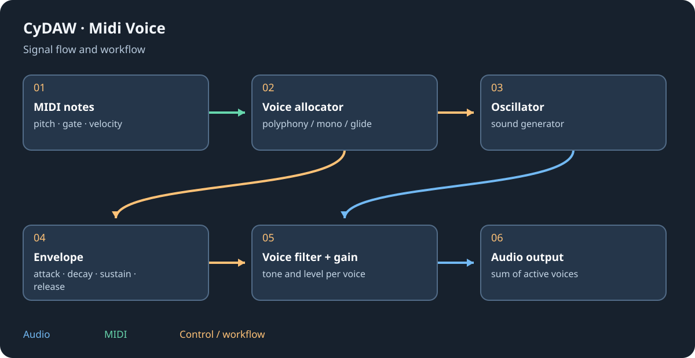

# Recreate a sound as an instrument

Sound recreation analyses isolated notes and produces a playable model or synthesizer patch. It is not a transcription of a complete mixed recording into all its original instruments. Use clean, unaccompanied examples with an audible attack and enough release; several notes/velocities describe an instrument better than one arbitrary chord.

## Choose a method {#methods}

Track > Recreate a sound offers Automatic, Plucked string, Measured partials and Synth patch (Opale/Quartz). The Python companion analyses partials, noise and note structure; optional slower refinement uses its additional dependencies. Synth-patch search fits CyDAW's own synth settings. Choose the method matching the source instead of expecting one universal reconstruction.

## Analyse and play {#analysis}
Configure the Python companion, select source note files and start. Progress/cancel run in the background. A resulting instrument track contains Sound model or the fitted synth. Play pitches and velocities not used in analysis, then listen for wrong root notes, noise, inharmonic tails or an overly long attack. Readable can turn a sound model into a conventional wavetable/envelope/filter patch where offered.

## Store and transfer {#saving}
A .cysound stores the analysed model; the project/device can embed that model. Playback uses the prepared C++ DSP, not an analysis network on every note. Native exports put required voice data in their resources. Retain source examples if you may reanalyse, and test the destination without the original analysis folder. Reconstruction quality and exact reproducibility depend on the method/settings, not just matching a waveform picture.

See [sampler](sampler.md), [synths](synths.md), [companion troubleshooting](troubleshooting.md#files) and [export](plugin-formats.md).
