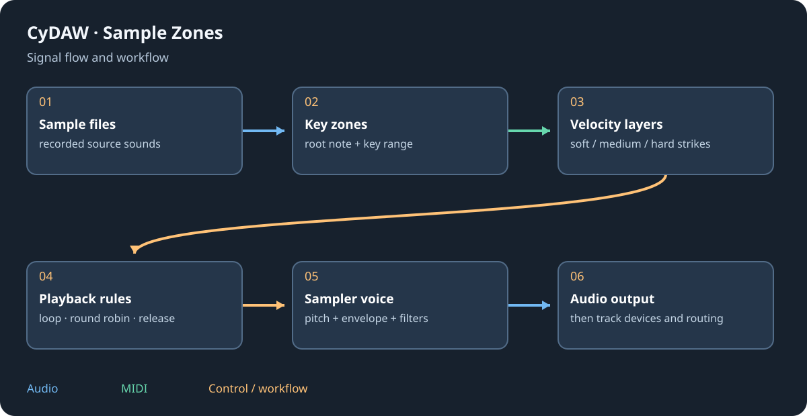

# Sampler, SFZ and factory instruments

Sampler maps recordings to keys and velocities. A zone defines a sample, root pitch, keyboard range and playback rules; layers can overlap. The simple sampler maps a single source across the keyboard. Factory pianos, strings and winds use this engine and separately downloaded CC0 banks.

## Build a mapping {#zones}
Import samples or an SFZ, then inspect zones before playing a wide range. Set the root note to the recorded pitch so transposition is meaningful. Define key and velocity limits; overlap velocity layers only when intentional. Audition low, middle and high notes and soft/hard strikes. An unmapped key is silent; a file name does not guarantee its true root pitch.

Adjust sample start/end, gain, pan, tuning and amp envelope. Loops sustain a short recording; inspect loop boundaries and crossfades for clicks. One-shot, gated and release playback serve different purposes. Round robin alternates samples to reduce repeated-note sameness; exclusion/choke groups stop conflicting sounds.

## SFZ and disk playback {#sfz}
SFZ can bring key switches, controller conditions, velocity curves, release regions and other zone rules. Keep its referenced samples beside the mapping in the expected relative structure. A keyswitch changes articulation and may not play a sound itself. Disk streaming helps long recordings; a native exported instrument instead packages decoded PCM and loads it into memory. Check total size before exporting a large library.

## Other sample instruments {#granular}
Nuée works on your own samples through grains; grain size, density, position and pitch change texture instead of remapping every note conventionally. Batterie is the acoustic-kit sampler with piece/microphone control. Drum Machine and instrument layers hold their own instruments and effects. They are not ordinary sampler zones.

Use Options > Sound banks to download missing factory media. If moving a project/device, include referenced samples; editable graph export lists external files rather than embedding every bank.

See [the sound library](library.md), [drums](drums.md), [containers](containers.md) and [exports](plugin-formats.md).
