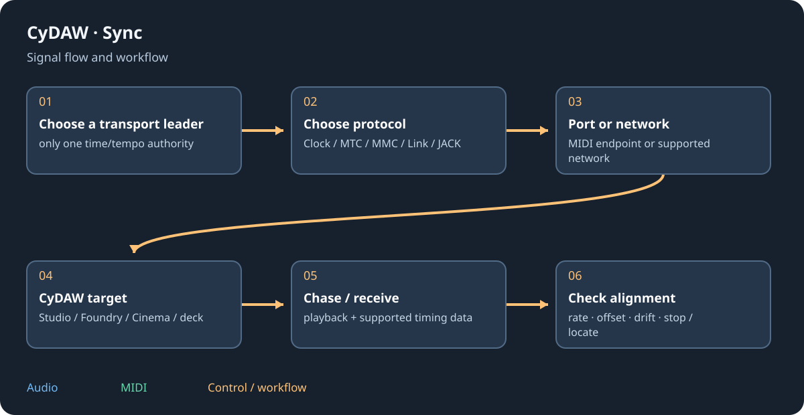

# Transport synchronisation

SYNC opens transport synchronisation. It exchanges timing/control, not audio, and does not change the audio driver. Choose one time/tempo authority. The other application must support the same enabled protocol; a video editor's name alone does not imply compatibility.

## Protocols {#protocols}
| Protocol | Shares | Position and network |
| --- | --- | --- |
| MIDI Clock | Tempo, Start/Stop/Continue | Song Position Pointer at sixteenth-note resolution; network through an installed MIDI network port. |
| MTC + MMC | Timecode and transport | Full/quarter-frame MTC and Locate; MTC itself has no BPM. |
| JACK Transport | Transport/frame position, optional BBT tempo | External JACK server; this client creates no audio ports. |
| Ableton Link | Tempo and musical phase; optional play/stop | Peer discovery on LAN; absolute song position remains local. |

MTC recognises 24, 25, 29.97 drop-frame and 30 fps. Match the video's rate and time offset. Link's quantum is not a command to seek every application to a film timestamp.

## Connect a target {#connect}
Choose Studio, active Foundry/Cinema document or deck A/B/C/D. Choose Follow or Send, endpoint/server and shared elements; Link participants are peers. Enable or Apply/reconnect after changing configuration. Settings persist, but reconnect deliberately after restarting. A missing JACK library/server or MIDI-network driver must be installed/configured separately. JACK transport does not replace the selected WASAPI/ASIO audio device.

## Check behaviour {#check}
Test play, stop, locate and tempo independently. Check offsets, leader roles, receiving ports and stop-on-signal-loss. Avoid a feedback loop between Send and Follow or two competing deck leaders. With a DJ target, tempo must fit its supported speed range and KEY remains an independent pitch-lock choice.

Different audio devices are not made sample-locked by transport sync. UI scheduling, driver/network delay and heavy operations can affect chase. Verify alignment against a visible/audible reference; an exported file may be easier to exchange when the other editor lacks a compatible transport.

See [Cinema](cinema.md), [DJ tempo](dj.md#tempo) and [troubleshooting](troubleshooting.md#sync).
