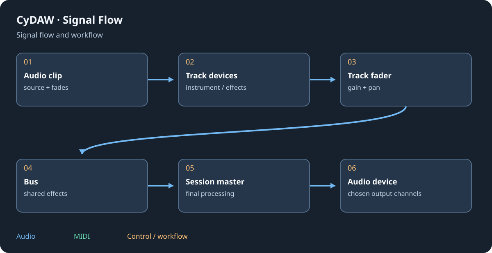

# Troubleshooting and current limits

Start with the smallest reproducible session and change one thing at a time. Keep an untouched copy before moving media, updating plugins or clearing caches. The fact that a UI control moves does not establish that audio reaches the intended hardware.

## No sound or wrong destination {#silence}
1. Check the real audio device and enabled output pair, then its hardware mixer/headphone route.
2. Check common master gain/mute, session/DJ master, bus and track faders, mute/solo and crossfader assignment.
3. Confirm the active transport/source: Arrangement versus Launcher, deck playback, Foundry/Cinema document or simulator.
4. For MIDI, verify input, selected track, instrument, playable key range and note velocities. A note clip alone is silent.
5. Bypass suspect processing. A disconnected graph output, zero gain, wrong channel format, fully wet effect without input or waiting sidechain can explain silence.
6. Play a known ordinary audio file on a clean track, then rebuild the intended chain.

## Crackles, slow interaction or heavy sessions {#performance}
Raise the buffer and compare a minimal project. Reduce needless voices, unison, long releases, oversampling, active heavy effects or simultaneous deck loads. Wait for background analysis. Test a suspect plugin alone; its isolation process and editor may still use CPU/memory. Do not confuse an idle low UI frame rate with audio dropouts. Keep system/device driver changes separate from project changes so you can identify the cause.

## Missing media, codecs or companion {#files}
Extract the complete package with DLLs and resource folders. Restore referenced audio/edits/banks or inspect missing-media reports. In Cinema, unsupported/corrupt video or absent codec DLLs can prevent decoding; try a known supported file and read the decoder error. A picture may be outside its timeline range even with a valid decoder.

For semantic search or sound analysis, verify the configured Python executable and installed optional dependencies. Ordinary sound search and synthesis do not require the analysis companion. Keep a compiler/toolchain and source tree available for plugin/custom-component builds; the runtime executable alone is not the development SDK.

## Sync, plugins and reporting {#sync}
Match protocol, direction, endpoint, target, frame rate and offset on both applications. Link is phase/tempo, not absolute film location. Transport sync does not transmit audio or sample-lock independent devices. For plugins, keep complete bundles/resources, inspect scanner/worker/build diagnostics and test a fresh instance.

When reporting a bug include CyDAW version, Windows/audio backend, rate/buffer, mode, exact steps, expected/actual result and a small shareable example. Include logs or a screenshot only after checking their personal paths/content. State whether it reproduces without external plugins. Known Alpha export/host limitations and the unresolved JSFX tempo check are listed in [plugin formats](plugin-formats.md#limits).

See [setup](setup.md), [media](import-export.md) and [synchronisation](sync.md).
