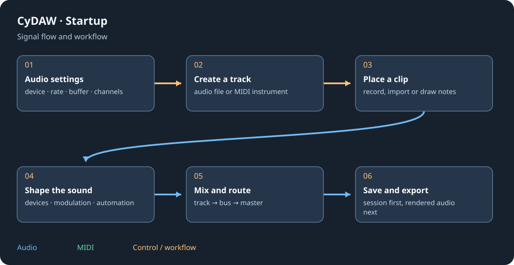

# Welcome and first project

CyDAW combines a music studio, DJ mixer, multitrack sound editor, sound-to-picture workspace, processing editor and plugin workshop. This offline manual describes the shipped V2 interface. English is the default manual language; choose Français above to read the same topics while keeping your place. This does not change the application's language.

## Read, search and navigate {#reading}
Open Help > User manual or press Ctrl+F1. The left column contains chapters and the current chapter's sections. Search checks titles and text throughout the selected language; several words narrow the results. Accents are optional in French. Hover a result for an excerpt, then select it. Ctrl+F focuses search; Clear restores the contents.

Back and Forward restore visited sections and reading positions. Home returns here. Text changes reading size; Figures shows illustrations. Click a figure to enlarge it, then use wheel zoom, middle-button drag (or Space+drag) to pan and double-click to fit. In a narrow window, open Illustration above the text; its selector gives access to every figure. Escape clears search first, then closes the reader.

## Make your first sound {#first-project}
1. In Options > Audio settings choose a real output device and the channels connected to your speakers. Start with a moderate buffer and lower the master before listening.
2. In Studio create a MIDI instrument track. Opale is a useful first synthesizer.
3. Double-click empty space on that MIDI track to make a clip. Open its note editor, draw a short phrase and press Space.
4. Select the track and use the plus at the end of Devices to add an effect. Save the editable project with Ctrl+S.
5. Export a mix when you need an audio file. Saving a project and rendering audio are different operations.

## Choose your workspace {#modes}
| Mode | Purpose |
| --- | --- |
| Studio | Arrange tracks or launch clips and scenes. |
| DJ mix | Blend complete tracks on two or four decks. |
| Foundry | Cut, repair and assemble sound files. |
| Cinema | Place sound against frames, with optional video. |
| Processings | Design and audition reusable audio or note operations. |
| Plugin workshop | Build graphs and designed VST3, CLAP or LV2 interfaces. |

Each mode owns an editing context. Check the active mode before Save, Undo or transport keys. Native module panels keep English labels even in the French interface; both manual languages describe the same controls.

Continue with [audio setup](setup.md), [the workspace](workspace.md) or [Studio](studio.md).
