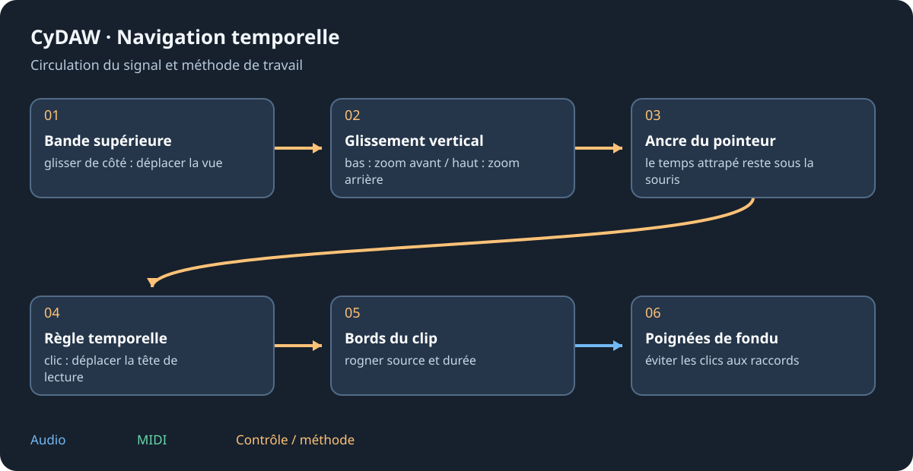

# Audio, prises et étirement

Double-cliquer un clip ouvre les faces Échantillon, Prises, Étirement et Événements. Début, durée, décalage et fondus décrivent ce que joue le clip ; changer sa source est une autre opération. L'écoute utilise les choix réels d'étirement et de prises.

## Éditions de source et historique {#source}
Glisser sur l'onde sélectionne ; Maj étend. Couper, copier, coller, rogner, silence, gain, normaliser, inverser, polarité, suppression DC et échange des canaux portent sur la région choisie ou jouée selon la commande. Reverse change le temps ; la polarité change le signe. L'édition crée un fichier modifié et garde l'original. L'historique liste les versions ; éditer depuis une ancienne remplace sa branche suivante. Garder projet et dossier edits ensemble.

Couper/rogner/insérer/coller sont limités avec repères d'étirement ou prises assemblées ; choisir une prise ou éditer les événements. Garder une version avant d'aplatir une édition complexe.

## Prises et comping {#takes}
Enregistrer sur un clip peut ajouter une prise calée ; la boucle produit plusieurs passages. Dans Prises, les écouter puis choisir leurs meilleures régions. Les découpes restent calées sur le clip. Écouter clics, changements de phase et sauts du bruit aux frontières. Une prise ajoutée d'un fichier doit être alignée à l'interprétation d'origine.

## Étirement et événements {#stretch}
Les repères relient des moments sources au temps du projet. Déplacer un repère change quand son instant joue. Choisir le mode adapté aux percussions ou sons tenus et comparer au tempo final. Transposer change la hauteur ; étirer change la durée en pouvant conserver la hauteur. Événements divise un clip en régions temporisées : éditer ces régions plutôt que supposer un fichier continu.

Voir [Fonderie](foundry.md), [traitements](processing.md) et [médias/export](import-export.md).
