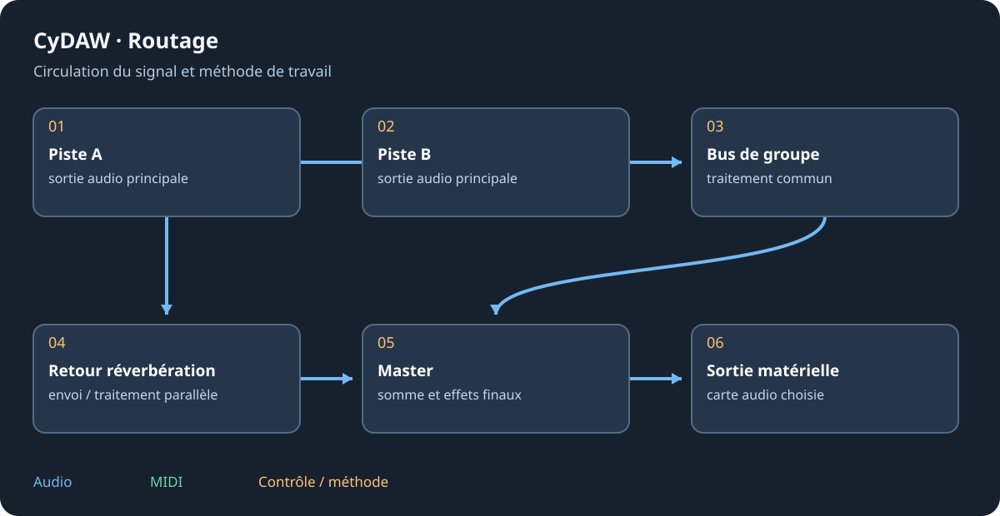

# Conteneurs d’effets et d’instruments

Un conteneur contient des branches qu'il mélange ou sélectionne. L'ajouter par le plus habituel puis ouvrir une branche pour éditer sa chaîne. Un bus route entre pistes ; un conteneur de périphérique route à l'intérieur d'un appareil. Les conteneurs temporels du Cinéma sont encore un autre concept.

## Conteneurs d'effets {#effects}
| Conteneur | Comportement |
| --- | --- |
| Chain | Une chaîne en série. |
| FX Layer | Une à huit couches parallèles additionnées. |
| FX Selector | Une chaîne parmi huit, avec fondu de commutation. |
| Mid-Side Split | Milieu et côtés séparés puis recomposés. |
| Stereo Split | Chemins gauche et droit. |
| Multiband FX-2 / FX-3 | Deux ou trois bandes séparées par coupures. |
| XY FX | Mélange A/B/C/D par pavé XY puis Post FX. |
| Replacer | Les transitoires déclenchent un son ou un instrument. |

Mix mélange l'entrée sèche et les branches ; Wet Gain règle celles-ci. Vérifier niveaux, muet/solo et coupures. Seuil/maintien du Replacer choisissent les déclenchements ; ce n'est pas une entrée de sampler continue.

## Conteneurs d'instruments {#instruments}

Drum Machine associe instrument/effets aux touches. Instrument Layer joue jusqu'à seize couches dans leurs plages de touches/vélocités. Instrument Selector envoie une nouvelle note à une couche ; elle y finit. Choix manuel, round robin, hasard, keyswitch, CC ou programme. Chaque couche possède instrument et chaîne. Ces conteneurs ne s'imbriquent pas entre eux ; changer de type réinitialise sa structure.

## Éditer et transférer {#editing}
Nommer les branches, ajouter au bon niveau et utiliser les retours pour en sortir. Comparer le son recomposé : une bande ou Mid/Side en solo n'est pas le mix final. Garder le preset entier quand le son dépend de plusieurs branches. Ces conteneurs d'instruments sont exclus de l'export plugin natif car leurs voix appartiennent au moteur des pistes.

Voir [graphes](graphs.md), [batteries](drums.md) et [limites d'export](plugin-formats.md#limits).
