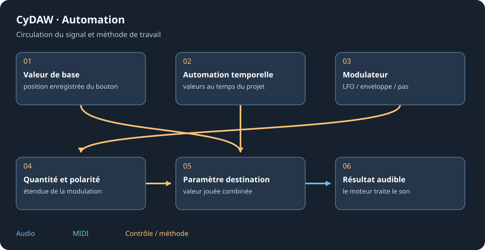

# Contrôleurs MIDI, OSC et matériels

CTRL ou Options > Contrôleurs MIDI/OSC ouvre les appareils. Un périphérique identifie le matériel ; ses règles transforment les contrôles vers les cibles CyDAW. Ce n'est pas simplement activer les notes d'une piste. L'apprentissage part du matériel ou d'un contrôle logiciel encadré.

## Créer et apprendre {#learn}
Ajouter un appareil puis bouger un contrôle pour identifier l'entrée, ou la choisir. MIDI, clavier, plugin manette et points OSC sont distincts. Pour OSC créer le point UDP et ses hôte/ports de retour : ce sont des contrôles, pas un flux audio.

Activer Apprendre dans les règles et bouger les contrôles. Nommer la règle, choisir potard/fader/encodeur/bouton/bascule/pad/axe. Notes permet à l'entrée MIDI de jouer aussi l'instrument sélectionné. Retour choisit LED, fader motorisé, état de tablette ou retour manette géré.

## Transformer et assigner {#rules}
Plage d'entrée, inversion, courbe, décodage relatif, bascule, seuil, zone morte, pas et plage de sortie s'appliquent dans l'ordre ; le retour inverse ce qui est géré. Choisir le bon codage d'encodeur. Ajouter une ou plusieurs cibles par recherche ou Clic cible. Régler plage et reprise pour rattraper la valeur sans saut.

Adresses MIDI : cc/canal/numéro, note/canal/note, pb/canal, at/canal, pc/canal/programme. Le clavier utilise key/Nom ; OSC son adresse reçue. Le moniteur distingue absence d'événements et mauvaise liaison.

## Portée et sauvegarde {#scope}
Ctrl+M ou le menu de CTRL active l'apprentissage dans l'interface : cliquer un contrôle encadré puis bouger le matériel. Échap annule. Les cibles de piste/appareil suivent le projet ; transport, DJ, master et piste sélectionnée peuvent être globaux. Changer entrée/retour emporte les règles. Dupliquer pour un appareil similaire puis identifier sa nouvelle entrée.

Voir [MIDI](setup.md#midi), [modulateurs](modulators.md) et [synchronisation](sync.md).
