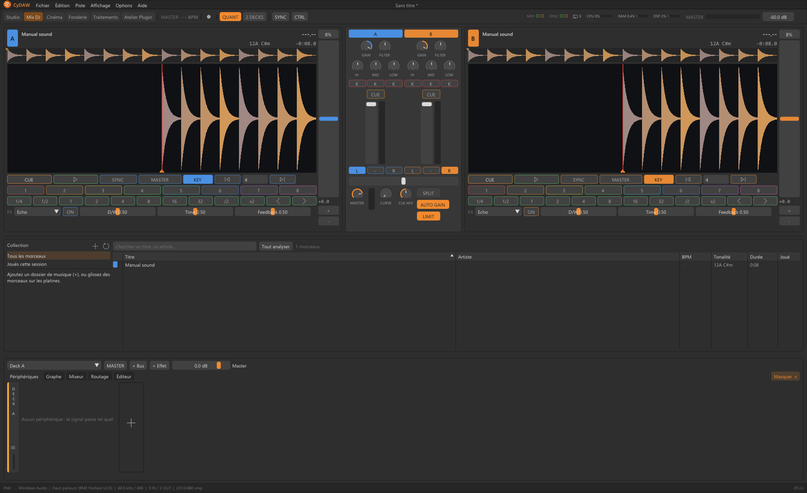
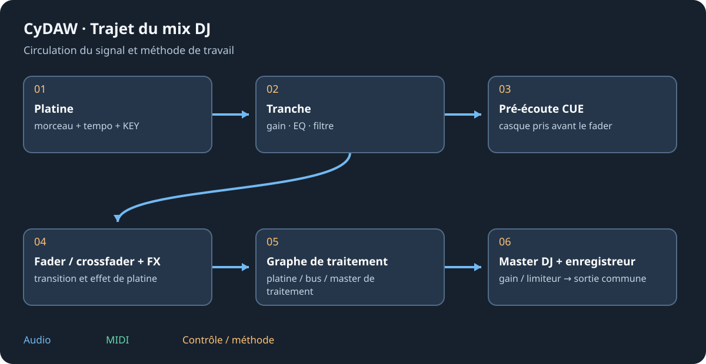

# Mix DJ : platines et transitions

Passer en Mix DJ en haut ou par F10. Il possède collection, platines et graphe de traitement ; les pistes Studio restent disponibles et peuvent jouer en même temps. MASTER d'une platine choisit le meneur du tempo. Master de traitement, niveau MASTER DJ et master commun sont des points distincts du trajet.

## Charger, analyser et préparer {#decks}
Déposer un morceau sur une platine depuis collection, Navigateur ou explorateur ; un double-clic de collection utilise une platine libre. Attendre décodage/analyse. L'aperçu navigue dans tout le morceau ; la grande onde suit la lecture, accepte le scratch glissé et le zoom à la molette. Deux/quatre platines change la disposition. L'analyse estime BPM, premier temps, tonalité et sonie ; vérifier la grille à l'oreille avant synchro.

CUE en lecture revient au repère et arrête ; à l'arrêt il pose/écoute le cue. Les hot cues 1–8 sautent ou posent un repère vide ; Maj+clic/clic droit efface. QUANT cale les actions concernées. Les boucles donnent des durées en temps ; /2 et x2 redimensionnent et les flèches déplacent. Les sauts avancent selon leur longueur choisie.

## Tempo, KEY et SYNC {#tempo}
Le fader accélère/ralentit ; choisir sa plage et double-cliquer pour zéro. Bend +/- pousse temporairement. KEY conserve la hauteur par étirement quand la vitesse change. Le désactiver donne le comportement vitesse/hauteur du vinyle. C'est pourquoi déplacer le tempo peut ne pas transposer. SYNC suit tempo et phase du meneur ; vérifier MASTER et corriger une analyse au demi/double tempo ou un premier temps faux.

## Mixer et préécouter {#mixer}
Chaque tranche possède gain, isolateur HI/MID/LOW et coupes, filtre neutre au centre, CUE, fader et affectation L/-/R. '-' ignore le crossfader mais garde le fader. CURVE règle mélange doux/coupes. CUE MIX équilibre casque et master ; SPLIT utilise une paire stéréo en mix mono/préécoute mono avec un câblage adapté. Il ne crée pas une sortie matérielle.

Les FX de platine suivent fader/crossfader : les échos peuvent continuer après fermeture. Les outils inférieurs ajoutent les modules du Studio aux platines, bus et master de traitement. CUE reste avant fader/traitement. MASTER DJ et LIMIT viennent ensuite ; le résultat rejoint la sortie commune.

## Enregistrer et conserver {#recording}
Le bouton d'enregistrement en haut écrit un WAV 24 bits dans le dossier des mixages et inclut le traitement DJ. Vérifier disque et destination. Collection et traitement persistent séparément ; enregistrer un projet Studio ne capture pas une performance DJ. Arrêter et vérifier le fichier. Pour reprendre les faders/EQ à la main, ne pas rejouer simultanément une démonstration qui les automatise.

Voir [mixage](mixing.md), [synchro](sync.md) et [dépannage](troubleshooting.md#silence).
