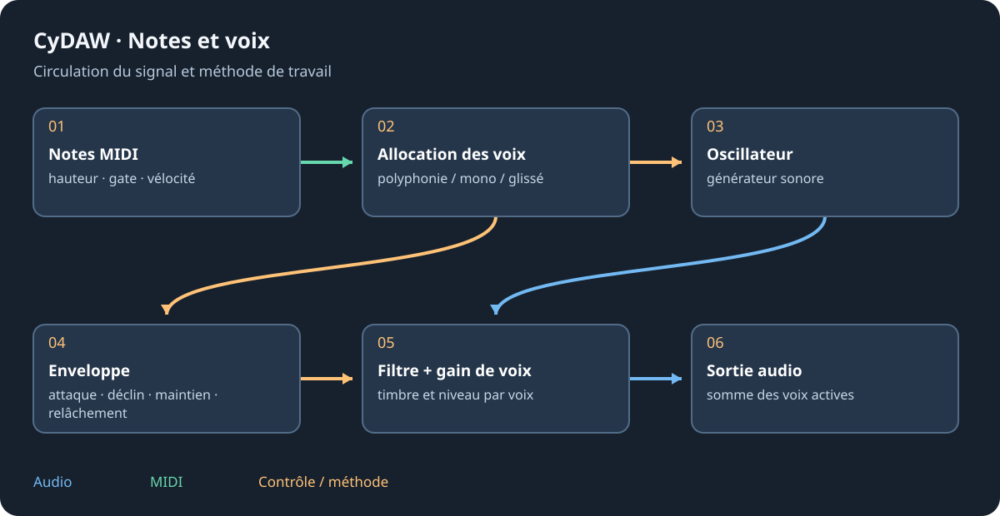

# Kick, Silex, Batterie et pads

Choisir la synthèse pour construire une percussion par oscillation/bruit ; choisir un kit échantillonné pour des pièces et microphones enregistrés. Kick et Silex synthétisent le son. Batterie et kits d'usine dépendent de leurs banques. Drum Machine est un conteneur d'instruments, pas le moteur de Batterie.

## Kick et Silex {#synthesis}
Dans Kick établir hauteur et déclin avant le transitoire/clic et la saturation. Écouter la fin avec la basse et le tempo ; un déclin trop long masque la frappe suivante. Silex fournit kick, caisse claire, clap, charleys, toms, cymbales et percussions synthétiques avec leurs réglages et caractères. Contrôler l'interaction charley fermé/ouvert et équilibrer les pièces avant compression de bus.

## Kits acoustiques et pads {#kits}
Charger un kit Batterie, attendre sa banque et régler niveaux des pièces, microphones et ambiance. Un groove fournit des notes, pas un enregistrement rendu. Dans Drum Machine choisir l'instrument du pad, ouvrir sa chaîne pour les effets, régler gain/pan et groupes de coupure. Les seize pads visibles sont une fenêtre sur la carte de notes ; vérifier la vraie touche MIDI.

## Superposer et terminer {#layering}
Superposer attaque et corps en vérifiant phase/polarité et décalage. Un bus permet leur traitement commun ; garder les sorties individuelles pour l'équilibre. Un passe-haut avant saturation change ce qui la pilote ; après, il change le résultat. Comparer à sonie égale. Les conteneurs d'instruments ne s'exportent pas encore comme instruments natifs complets ; consulter la vérification plutôt que supposer tous les pads inclus.

Voir [sampler](sampler.md), [conteneurs](containers.md) et [mixage](mixing.md).
