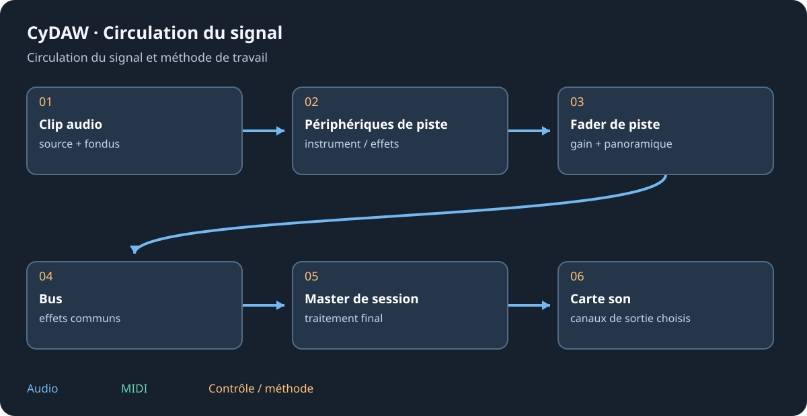

# Ampli, baffle et microphone

Ampli, Baffle et micro et Micro modélisent des étapes différentes de l'enregistrement. L'ampli apporte gain/timbre/non-linéarité ; baffle et microphone règlent spectre et perspective. Ils servent aussi hors guitare, mais ordre et niveau entrant changent fortement le résultat.

## Construire la chaîne {#chain}
Partir d'une source propre à niveau modéré. Choisir le caractère d'ampli puis régler entrée/drive avant compensation de sortie. Ajouter baffle/micro après pour une perspective de guitare enregistrée ; un ampli saturé sans baffle peut être volontairement agressif. Changer une variable de microphone/position à la fois plutôt que compenser tout par une EQ sans rapport.

## Mélanger et jouer {#blend}
Comparer les chemins sec/traité si un mélange est proposé. Plusieurs chemins de baffle/micro peuvent interférer : écouter en mono aussi. Pour la voix faire de petites modifications et juger consonnes, proximité et bruit entre phrases. Le micro modélisé est un effet ; il ne change pas le matériel réel et ne recrée pas l'information absente de l'enregistrement.

## Conserver le son {#presets}
Enregistrer la chaîne ordonnée entière si le résultat dépend de l'ensemble. Le preset d'une étape ne garde pas ses voisines. Contrôler latence et écoute pendant l'enregistrement, et garder une source sans effets pour changer de timbre plus tard. La référence du module donne choix et plages exacts.

Voir [l'enregistrement](studio.md#recording), le [mixage](mixing.md) et la [référence des effets](reference-effects.md).
