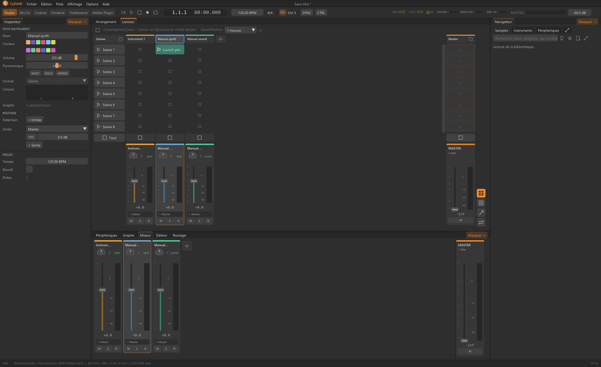

# Lanceur : clips et scènes

Le Lanceur est la vue de performance du Studio. Colonnes : pistes ; lignes : scènes ; cases : clips. Périphériques et routage restent identiques entre Arrangement et Lanceur. L'indication au-dessus de la grille dit quelle source mène la lecture du projet.

## Remplir la grille {#slots}
Déposer un WAV ou son compatible dans une case de piste audio. Double-cliquer une case MIDI crée/édite ses notes. Un son déposé hors des colonnes crée une piste qui le joue en sampler ; ce n'est pas l'insertion d'un enregistrement long dans une case audio existante. Viser la bonne destination.

Nommer clips et scènes selon leur rôle. Un clip ouvert dans l'Éditeur reste lié à sa case. Le menu audio propose Reverse et les éditions ; un clip MIDI contient des notes, pas une onde.

## Lancer en rythme {#launching}
Régler la quantification au-dessus de la grille, puis lancer clip ou scène. Le changement attend cette frontière musicale. Chaque piste possède son arrêt ; une scène lance ses cases remplies ensemble ; l'arrêt général termine le Lanceur. Vérifier les actions en attente et la quantification avant de multiplier les clics.

## Revenir à l'Arrangement {#arrangement}
Un lancement peut remplacer la source arrangée. Contrôler son indicateur et revenir explicitement à la lecture Arrangement pour entendre le morceau de la timeline. Les éditions changent le clip ; faders et effets traitent la source qui alimente actuellement la piste.

Voir [Studio](studio.md), [MIDI](midi.md) et [audio](audio.md).
