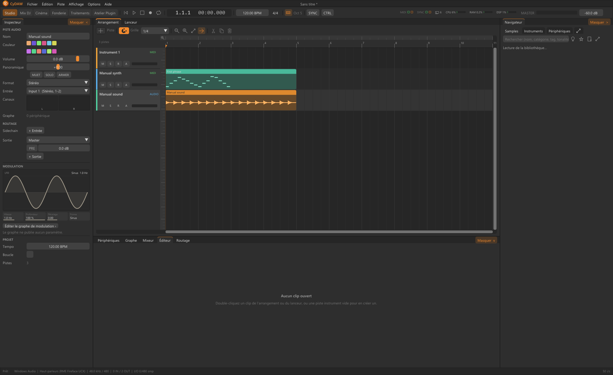

# Bibliothèque sonore et banques d’usine

Le Navigateur réunit dossiers personnels et banques installées. Samples, Instruments et Périphériques sont des recherches différentes. Ajouter un dossier indexe ses fichiers sans forcément les copier au projet. Téléchargements, cache et sources ont des durées de vie distinctes.

## Chercher et classer {#search}
Ajouter les sources par le menu dossier. Filtrer famille, catégorie, instrument, banque et texte ; trier et marquer les favoris. L'analyse prépare en arrière-plan durée, niveaux, onde, tempo/tonalité si pertinents et cache les fichiers inchangés. Un scan incomplet ne prouve pas une disparition. Une catégorie choisie par l'utilisateur prime les règles de noms/dossiers.

Écouter puis glisser vers clip audio, sampler, platine ou emplacement Fonderie/Cinéma voulu. Un enregistrement sur piste audio n'est pas un instrument échantillonné accordé. Les notes d'instruments peuvent utiliser leurs métadonnées plutôt que détecter un tempo de morceau.

## Banques et recherche sémantique {#banks}
Options > Banques de sons affiche disponibilité, téléchargements et sources/licences. Télécharger avant d'utiliser les instruments échantillonnés. Une carte sans média ne sonne pas. Distinguer archives/caches et sources déjà utilisées par un projet.

La recherche sémantique facultative utilise un modèle audio/texte via le compagnon Python pour descriptions et similarité. CLAP désigne ici le modèle audio-langage, pas le format plugin. Sans lui la recherche nom/catégorie reste disponible. Installer modèle/dépendances par les réglages et lire les informations ; qualité liée au modèle et aux sons indexés.

## Conserver les médias {#media}
Déplacer/supprimer une source peut casser les projets/appareils qui la référencent. Garder les fichiers ou relier ce qui est possible puis rouvrir pour vérifier. Chaque banque garde sa licence ; un graphe peut lister les fichiers externes plutôt que les inclure. Consulter les notices avant redistribution d'échantillons ou ressources de plugin.

Voir [sampler](sampler.md), [recréation sonore](resynthesis.md) et [portabilité](import-export.md).
