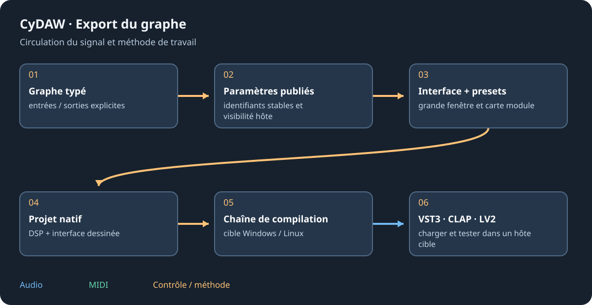

# Versions, licences et documentation

Ce manuel accompagne l'interface Windows CyDAW V2 et décrit les capacités Alpha actuelles sans promettre toutes les fonctions de chaque norme de plugin. Texte, schémas et captures sont locaux. Aucune connexion de navigateur n'est nécessaire à leur lecture.

## Application et dépendances {#licences}
LICENSE distribué avec CyDAW est GNU AGPL version 3. JUCE garde ses conditions ; Dear ImGui et CyUI fournissent MIT. Le paquet contient licence CyUI et notices TextEditor/Lexilla/Scintilla dans Licenses/CyUI, avec les autres notices. FFmpeg est la version partagée LGPL épinglée, avec configuration et sources correspondantes dans son dossier. Lire les textes livrés pour la version utilisée.

SDK des formats, composants, dépendances de plugins, banques et échantillons gardent leurs conditions. Le choix du format d'export ne change pas la licence du code inclus. Les médias d'un instrument ont leurs conditions séparées de l'exécutable.

## Sources et fichiers hors ligne {#sources}
Les [sources CyDAW](https://github.com/MrMybal/CyDaw) et [CyUI](https://github.com/MrMybal/CyUI) identifient les projets. La [licence MIT CyUI épinglée](https://github.com/MrMybal/CyUI/blob/8367401fe45fc22bfed5e227cb3de343177f676b/LICENSE) correspond à l'intégration. Un dépôt privé demande éventuellement l'accès ; les notices installées restent lisibles hors ligne.

docs/manual contient Markdown anglais/français, SVG éditables, captures réelles et instantané du registre servant aux références. Les notes techniques dans docs peuvent décrire des jalons historiques ; les limites explicites du manuel actuel s'appliquent à cette version.

## Entretien et corrections {#maintenance}
Les deux langues partagent les identifiants de chapitres/sections pour conserver le sujet au changement. Les valeurs viennent du registre en exécution, pas de boutons recopiés. La validation vérifie liens locaux, sections, figures et couverture avant paquet. Pour signaler geste faux ou capture dépassée, indiquer version et chapitre/section.

Revenir à [l'accueil](welcome.md), consulter [dépannage](troubleshooting.md) ou [limites plugin](plugin-formats.md#limits).
