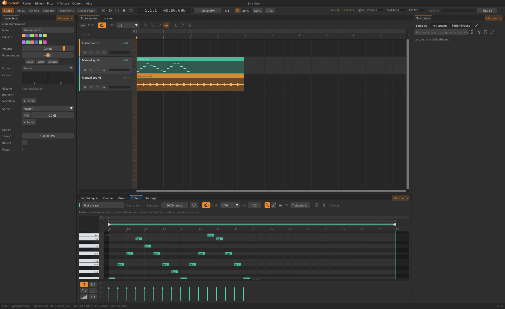

# Notes et expressions MIDI

Un clip MIDI contient des notes ; l'instrument les transforme en son. Ouvrir l'Éditeur affiche le piano roll : temps horizontal, hauteur verticale. Vélocité, contrôleurs et expressions dépendent de l'instrument : écouter avec le son réellement choisi.

## Dessiner et éditer les notes {#notes}
Double-cliquer ajoute/retire ; le clic droit efface. Sélectionner avant de déplacer à la souris ou aux flèches. Tirer un bord règle la durée ; choisir la grille rythmique. Alt peut suspendre le magnétisme. Q quantifie : comparer avant/après plutôt que supposer que toute note doit tomber exactement sur un temps. La vélocité dessine les accents individuels ; le volume de piste change toute la phrase.

## Jeu et expressions {#expression}
Régler la polyphonie. Poly permet les chevauchements ; Mono et Legato changent notes tenues et glissé. Dessiner hauteur/gain par note pour les courbes individuelles. Maintien et relâchement déterminent la suite après note-off. Ctrl+K active le clavier musical de l'ordinateur ; son octave peut sortir des zones du sampler.

## Transformer et réutiliser {#transform}
Dupliquer les clips pour des variations puis éditer leurs notes. Les traitements humanisent, égrènent, changent les durées ou ajoutent des échos en une application annulable. Arpège, Accords, Gamme et Écho de notes transforment plutôt le MIDI entrant avant l'instrument ; ce n'est pas la réécriture hors ligne des notes enregistrées.

Continuer avec les [synthés](synths.md), les [traitements de notes](processing.md#midi) et [l'automation](automation.md).
