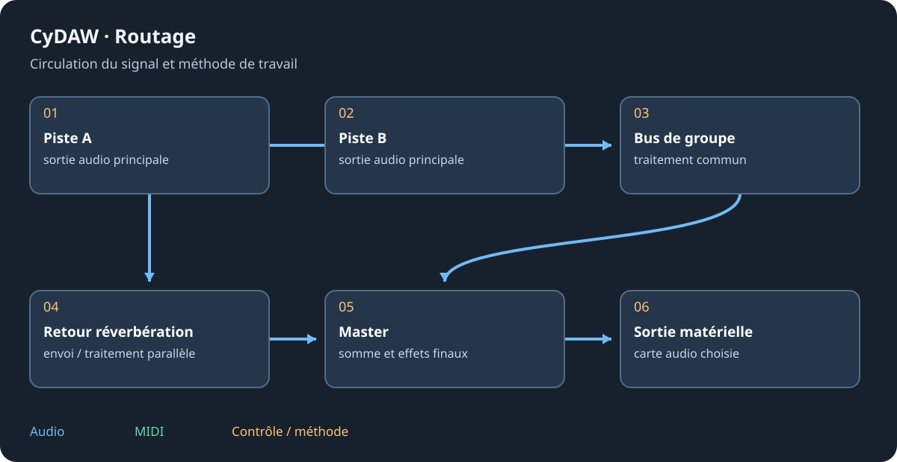

# Effets de mixage, couleur et mastering

Ces modules réunissent plusieurs opérations dans des panneaux dédiés. Partir d'un preset proche du besoin puis changer un aspect à la fois. Garder de la marge dans les étages non linéaires/multibandes et comparer bypass à niveau égal.

## Choisir un module {#modules}
| Module | Rôle |
| --- | --- |
| Pression | Dynamique multibande ascendante/descendante ; régler séparément faible et fort niveau. |
| Fournaise | Saturation/couleur ; vérifier drive, timbre et compensation de sortie. |
| Écho Bande | Écho de bande ; temps, feedback, couleur et mouvement interagissent. |
| Multibande Pro | Dynamique par bandes ; régler coupures avant seuils et équilibre. |
| Velours | Réduction des résonances ; écouter ce qui est retiré, éviter de trop lisser. |
| Patine | Usure analogique, mouvement et bruit ; équilibrer caractère et lisibilité. |
| Sonomètre | Mesures de sonie/niveau ; remettre l'intégrée à zéro pour une passe. |
| Tranche | Traitement de console ; ordre et gains comptent. |
| Finition | Finalisation/mastering ; comparer timbre et dynamique à sonie égale. |
| Halo | Grande réverbération ; régler largeur, couleur, durée et mélange. |

## Travailler par étapes {#workflow}
Sur un bus batterie corriger d'abord les pistes puis ajouter une dynamique commune douce. Sur une voix réparer avant de colorer. En mastering conserver une version sans traitement de niveau final et juger des passages complets. Les multibandes modifient l'équilibre et la phase aux coupures ; comparer les bandes réunies, pas seulement en solo.

## Échos, espace et mesures {#space}
Les répétitions dépassent la source ; Freeze et fort feedback peuvent ne pas décroître. Un export trop court coupe une bonne queue. Vérifier mélange insert/retour et compatibilité mono. Une mesure décrit le point qu'elle reçoit : placer le sonomètre où mesurer. Un preset plus fort ne doit pas gagner automatiquement.

Voir les [effets de studio](studio-effects.md), [l'automation](automation.md) et la [référence complète](reference-effects.md).
