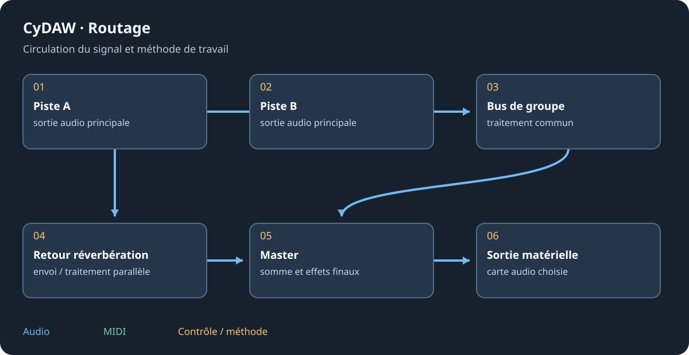
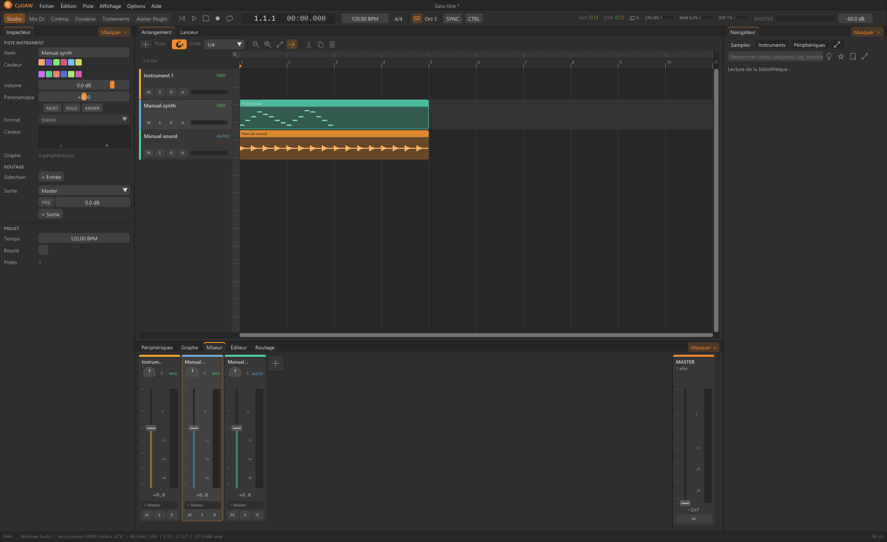

# Mixeur, bus et sidechains

Un bus reçoit des pistes via ses effets et son fader. La sortie principale dirige le signal d'une piste ; un envoi ajoute un chemin parallèle. Garder le trajet complet visible pour contrôler niveaux ou absence de son.

## Pistes, bus et canaux {#buses}
Créer et nommer un bus, puis le choisir comme sortie des pistes liées. Y mettre le traitement commun. Dans Routage vérifier entrées/sorties supplémentaires, format de canaux et niveau d'envoi. Sources mono, effets stéréo et destinations multicanal demandent des affectations compatibles. CyDAW refuse les boucles : corriger le trajet au lieu de forcer un cycle.

## Envois et sidechain {#sidechain}
L'envoi pré-fader est pris avant le fader ; le post-fader le suit. Décider si baisser la source doit aussi baisser son retour. La sidechain alimente le détecteur, pas une autre entrée audible. Le bouton maillons des dynamiques compatibles choisit sa source. Un kick peut piloter le compresseur de basse avec son fader baissé puisque l'envoi est pré-fader ; le couper est différent. Écouter le détecteur si proposé et régler seuil, attaque et relâchement.

## Master et mesures {#master}
Contrôler les niveaux partout. Un plafond de limiteur évite les pics excessifs mais n'annule pas une saturation déjà imprimée dans la source ou un étage précédent. Crête, RMS et sonie mesurent des choses différentes. Remettre l'intégrée à zéro avant une passe complète ; comparer à sonie d'écoute proche.

Fonderie, Cinéma et traitement DJ ont leurs contextes avant la sortie commune. Voir les [effets](studio-effects.md), la [Fonderie](foundry.md) et [l'export](import-export.md).
