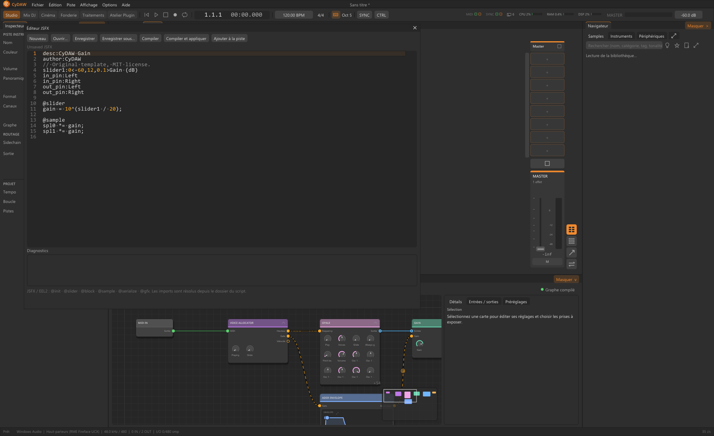
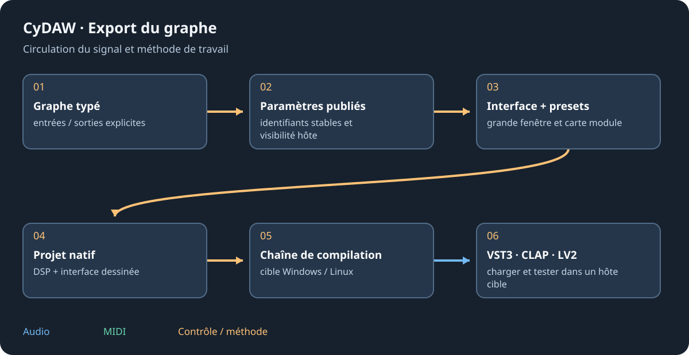

# Héberger, éditer JSFX et exporter

L'hébergement VST3, CLAP, LV2 et JSFX utilise la chaîne externe des pistes audio. L'export natif de l'Atelier est distinct : il compile graphe/interface en VST3, CLAP ou LV2. Le format ne dit ni l'OS ciblé ni les extensions facultatives gérées par l'hôte.

## Scanner et héberger {#hosting}
Ouvrir le plus/bibliothèque puis Dossiers de plugins. Chemins VST3/CLAP système/utilisateur, bundles LV2, JSFX personnels, dossiers REAPER Effects compatibles et exemples sont cherchés. CLAP_PATH/LV2_PATH complètent. Garder les bundles .vst3/.lv2 entiers ; extraire une DLL peut perdre métadonnées, interface ou ressources.

Scan/chargement utilisent workers isolés et cache/délai. Les entrées d'un même bundle peuvent apparaître séparément. Paramètres, programmes, interface et état passent par la chaîne normale. Cette version héberge les plugins externes sur pistes audio ; pas encore comme instruments MIDI ni effets de bus matériels/master. Les modules natifs restent utilisables là.

## Éditeur source JSFX {#jsfx}
Ouvrir Affichage > Éditeur de scripts JSFX, sa commande de bibliothèque/carte ou déposer un .jsfx. Nouveau donne un gain. Ouvrir/Enregistrer/Sous gèrent la source ; Compiler vérifie le texte dans un worker sans sauver. Compiler et appliquer ne sauve/recharge qu'une compilation réussie. Ajouter à la piste compile, sauve et insère/actualise la carte.

~~~eel2
desc:Manual gain
slider1:0<-24,12,0.1>Gain (dB)
@slider
gain = 10^(slider1/20);
@sample
spl0 *= gain;
spl1 *= gain;
~~~

Sauver le nouveau script avant insertion. Imports depuis son dossier et racines Effects/Data compatibles. Sections, sliders, @serialize, fichiers et @gfx sont gérés par ysfx ; les diagnostics ne sont pas un débogueur pas à pas. Le test de propagation du tempo en Alpha 0.78 reste non résolu : compiler ne prouve pas que tout script temporel reçoit le transport attendu.

## Compiler formats et plateformes {#export}
Dans Atelier > Export cocher VST3/CLAP/LV2 et Windows x64/Linux x64. Générer les projets seuls ou compiler les cibles. Résultats par appareil/plateforme/format. Windows demande outils C++, CMake et sources CyDAW. Linux depuis Windows prépare Zig/sysroot vérifiés et demande Python/Ninja ; l'hôte cible demande X11/OpenGL. macOS est reporté.

Copier tout : bundle VST3, CLAP avec Resources/licences nécessaires, ou dossier LV2 avec manifests, presets et binaire. Les lecteurs de samples/modèles exportent des voix décodées, parfois volumineuses. L'interface dessinée s'ouvre, pas le graphe ; cet export natif ne lie pas JUCE.

## Limites et validation {#limits}
La vérification décide : une sortie audio, quatre entrées au plus, huit canaux maximum ; voix des conteneurs/pads exclues. Une frontière scalaire vers un paramètre publié peut devenir ce paramètre hôte ; vers plusieurs, un adaptateur est nécessaire. L'hôte CLAP n'annonce pas les extensions facultatives thread-pool/modulation par note.

Compiler Windows ne valide pas Linux. Tester chargement, état, notes, paramètres, automation, presets, bypass et réouverture d'interface dans l'hôte cible. Changer de format n'enlève pas les licences du moteur, composants, banques et dépendances.

Voir [Atelier](workshop.md), [interface](interface-design.md) et [licences](licenses.md).
