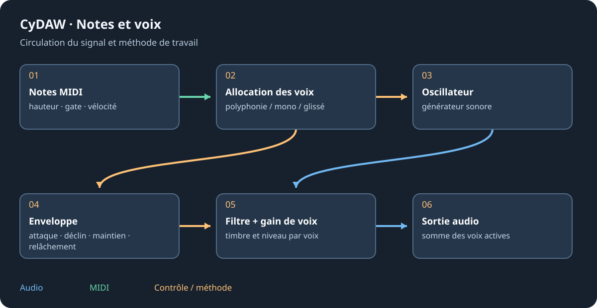

# Prisme : synthèse à tables d’ondes

Prisme est l'instrument dédié aux tables d'ondes. Une table contient une succession de formes ; sa position les parcourt. Hauteur, table, position et modulation sont des réglages distincts. Le grand éditeur montre onde source, filtre, enveloppes et destinations de modulation.

## Établir le timbre {#tone}
Créer une piste Prisme, initialiser ou charger un preset puis réduire le son à une source audible. Choisir sa table, régler octave/accord fin et balayer la position. Monter progressivement l'unisson en compensant le niveau. Ajouter les autres sources quand chacune a un rôle. Vérifier grave et accords : une table riche et une forte résonance peuvent changer l'équilibre selon la note.

## Animer le son {#modulation}
Régler Attack/Decay/Sustain/Release de l'ampli selon l'articulation. Ajouter le mouvement du filtre par enveloppe ou LFO, puis régler profondeur et polarité plutôt que la seule vitesse. Glisser les sources sur les destinations compatibles ; inspecter les liaisons déjà présentes avant d'en ajouter. Choisir vitesse libre/synchronisée et redéclenchement. Les macros coordonnent plusieurs destinations pour le jeu.

## Enregistrer et transférer {#presets}
Tester vélocité, bend et molette avant d'enregistrer un nom décrivant le rôle du son. Preset de piste, preset Prisme et graphe complet n'ont pas le même périmètre. Avant export, contrôler paramètres publiés et interface dessinée. La référence générée donne les clés moteur et plages actuelles ; ne pas les déduire de la seule apparence des potards.

Continuer avec les [bases de synthèse](synths.md), [l'exposition](graphs.md#exposure) et [l'export plugin](plugin-formats.md).
