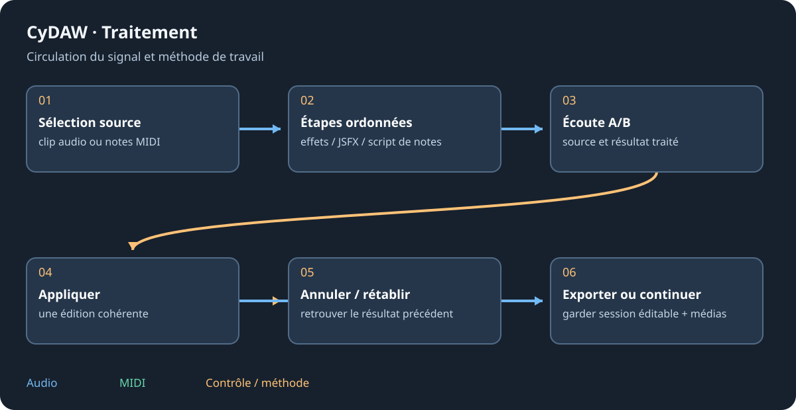

# Traitements : audio et scripts de notes

Traitements construit des transformations réutilisables, compare Avant/Après puis les applique aux clips. Choisir Audio/MIDI, un exemple d'usine ou un élément personnel. Modifier l'usine enregistre une copie personnelle ; Enregistrer comme nouveau crée un autre élément. Un traitement est une recette, pas un projet Studio entier.

## Étapes audio {#audio}
Ajouter dans l'ordre : chaîne native, code JSFX, débruitage, anti-ronflement, anti-clics, passe-haut/bas, gain, normalisation ou coupe de silences. Activer/bypasser, déplacer et enlever avant de juger l'ensemble. Une chaîne utilise les outils du Studio. Cocher les réglages devant apparaître lors de l'application.

Choisir un son d'essai ou le clip d'arrangement sélectionné. Les lignes Avant/Après partagent le temps ; lire l'une ou basculer au même endroit. Le calcul est en arrière-plan. Une erreur garde le dernier résultat valide. Enregistrer le résultat rend un fichier ; appliquer modifie le clip visé.

## Fins de son et application {#apply}
Laisser sonner autorise réverbe/écho après l'entrée. Régler seuil, tenue de silence, fondu final et fin maximale. Un bruit qui ne décroît plus est arrêté ; une queue encore décroissante peut atteindre le maximum. Sans extension, la durée suit la source. Écouter la fin, pas seulement l'attaque.

Le menu du clip applique une recette et ses réglages exposés. Vérifier source/sélection et résultat avant Appliquer. L'opération forme une édition annulable ; elle ne transforme pas l'écrasement d'un fichier externe en récupération illimitée.

## Scripts de notes MIDI {#midi}
Les scripts EEL2 utilisent @init, @note et @end. Champs : pitch, start, length, velocity, chance et keep ; le temps est en noires. Paramètres param1 à param16. Les fonctions interrogent les autres notes, convertissent les millisecondes en temps ou ajoutent des notes. Essayer avant d'appliquer pour garder hauteurs/durées utiles.

~~~eel2
param1:90<1,100,1>Velocity (%)
@note
velocity *= param1 / 100;
~~~

Cet exemple réduit les vélocités enregistrées sans traiter l'audio. keep = 0 enlève une note. Comparer aux effets MIDI en direct, qui transforment la lecture sans réécrire le clip.

Voir [MIDI](midi.md), [audio](audio.md) et [JSFX](plugin-formats.md#jsfx).
