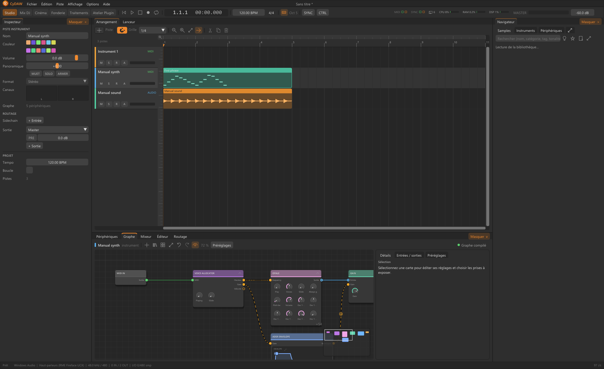

# Référence MIDI, contrôles et conteneurs

Référence générée depuis le registre CyDAW 0.78.0. Chaque section décrit un type natif, pas un preset de piste ni un plugin externe. Utiliser la recherche pour trouver une clé, une plage ou un port.

Les nombres sont les valeurs brutes du schéma moteur. Les unités affichées, échelles logarithmiques, choix et réglages de fichiers/tableaux se lisent dans le panneau du module ; ils ne se déduisent pas de ces nombres. Les défauts décrivent un nœud neuf, pas forcément le preset chargé. Un port déclaré ne garantit pas une frontière de plugin exportable.

Voir le [glossaire](glossary.md#reference), les [instruments](synths.md) et les [effets](studio-effects.md) pour la méthode d’écoute. Pour les limites lire [export](plugin-formats.md#limits).

## CHORDS (accords) {#accords}

Catégorie : Primitives MIDI.

Fait d'une note un accord : majeur, mineur, quinte, sus, septièmes, neuvièmes, octaves ou six intervalles à soi ; renversement, accord ouvert, vélocité des notes ajoutées, notes égrenées vers le haut ou le bas, ou accords qui suivent une gamme.

| Clé moteur | Minimum | Défaut | Maximum |
| --- | --- | --- | --- |
| `velocity` | 0 | 0.850000024 | 1 |
| `strum` | 0 | 0 | 200 |
| `chord-type` | 0 | 0 | 11 |
| `interval-1` | -24 | 4 | 24 |
| `interval-2` | -24 | 7 | 24 |
| `interval-3` | -24 | 0 | 24 |
| `interval-4` | -24 | 0 | 24 |
| `interval-5` | -24 | 0 | 24 |
| `interval-6` | -24 | 0 | 24 |
| `inversion` | -3 | 0 | 3 |
| `spread` | 0 | 0 | 1 |
| `strum-mode` | 0 | 0 | 2 |
| `key` | 0 | 0 | 11 |
| `scale` | 0 | 0 | 11 |

| Port / clé | Sens | Type | Canaux |
| --- | --- | --- | --- |
| midi-in / `midi-in` | Entrée | midi | 1 |
| midi-out / `midi-out` | Sortie | midi | 1 |

## RANDOM (alea) {#alea}

Catégorie : Primitives MIDI.

Rend le jeu humain ou imprévisible : un peu de retard au hasard, des vélocités qui varient, des notes qui ne jouent pas toujours, ou qui changent de hauteur de temps en temps.

| Clé moteur | Minimum | Défaut | Maximum |
| --- | --- | --- | --- |
| `timing` | 0 | 0 | 50 |
| `velocity` | 0 | 0.150000006 | 1 |
| `chance` | 0 | 1 | 1 |
| `pitch-chance` | 0 | 0 | 1 |
| `pitch-range` | 0 | 0 | 12 |

| Port / clé | Sens | Type | Canaux |
| --- | --- | --- | --- |
| midi-in / `midi-in` | Entrée | midi | 1 |
| midi-out / `midi-out` | Sortie | midi | 1 |

## ARPEGGIATOR (arpege) {#arpege}

Catégorie : Primitives MIDI.

Joue les notes tenues l'une après l'autre en rythme : vers le haut, vers le bas, aller-retour, dans l'ordre joué, au hasard, en accord, qui se rapprochent ou s'écartent ; sur une à quatre octaves, au pas choisi, avec swing, durée des notes, vélocité jouée, fixe ou accentuée, maintien.

| Clé moteur | Minimum | Défaut | Maximum |
| --- | --- | --- | --- |
| `gate` | 0.0500000007 | 0.600000024 | 2 |
| `swing` | 0 | 0 | 0.75 |
| `velocity` | 1 | 100 | 127 |
| `rate-sync` | 1 | 3 | 12 |
| `mode` | 0 | 0 | 8 |
| `octaves` | 1 | 1 | 4 |
| `velocity-mode` | 0 | 0 | 2 |
| `latch` | 0 | 0 | 1 |
| `retrigger` | 0 | 1 | 1 |

| Port / clé | Sens | Type | Canaux |
| --- | --- | --- | --- |
| midi-in / `midi-in` | Entrée | midi | 1 |
| midi-out / `midi-out` | Sortie | midi | 1 |

## CONTROL MATH (control-math) {#control-math}

Catégorie : Générateurs de valeurs / primitives.

| Clé moteur | Minimum | Défaut | Maximum |
| --- | --- | --- | --- |
| `amount` | 0 | 1 | 1 |
| `offset` | -1 | 0 | 1 |

| Port / clé | Sens | Type | Canaux |
| --- | --- | --- | --- |
| value / `value` | Entrée | value | 1 |
| result / `result` | Sortie | value | 1 |

## DRUM MACHINE (drum-rack) {#drum-rack}

Catégorie : Conteneurs.

Aucun paramètre numérique déclaré par ce schéma.

| Port / clé | Sens | Type | Canaux |
| --- | --- | --- | --- |
| audio-out / `audio-out` | Sortie | audio | 2 |
| frequency / `frequency` | Entrée | value | 1 |
| level / `level` | Entrée | value | 1 |

## NOTE LENGTH (duree) {#duree}

Catégorie : Primitives MIDI.

Donne aux notes la longueur choisie, quelle que soit celle jouée : un temps fixe, une valeur de note, une longueur étirée, ou jusqu'à la note suivante (legato).

| Clé moteur | Minimum | Défaut | Maximum |
| --- | --- | --- | --- |
| `length` | 10 | 250 | 4000 |
| `factor` | 1 | 1.5 | 4 |
| `mode` | 0 | 0 | 3 |
| `length-sync` | 1 | 6 | 12 |

| Port / clé | Sens | Type | Canaux |
| --- | --- | --- | --- |
| midi-in / `midi-in` | Entrée | midi | 1 |
| midi-out / `midi-out` | Sortie | midi | 1 |

## NOTE ECHO (echo-notes) {#echo-notes}

Catégorie : Primitives MIDI.

Répète chaque note comme un écho, en notes : au temps choisi ou à une valeur de note, autant de fois que voulu, chaque écho plus doux et, si on veut, plus haut ou plus bas.

| Clé moteur | Minimum | Défaut | Maximum |
| --- | --- | --- | --- |
| `time` | 10 | 250 | 2000 |
| `decay` | 0 | 0.300000012 | 1 |
| `pitch` | -12 | 0 | 12 |
| `sync` | 0 | 6 | 12 |
| `repeats` | 1 | 3 | 16 |

| Port / clé | Sens | Type | Canaux |
| --- | --- | --- | --- |
| midi-in / `midi-in` | Entrée | midi | 1 |
| midi-out / `midi-out` | Sortie | midi | 1 |

## ENVELOPE FOLLOWER (envelope-follower) {#envelope-follower}

Catégorie : Visualisation / Analyseurs.

| Clé moteur | Minimum | Défaut | Maximum |
| --- | --- | --- | --- |
| `attack` | 0.0001 | 0.01 | 1 |
| `release` | 0.001 | 0.1 | 5 |

| Port / clé | Sens | Type | Canaux |
| --- | --- | --- | --- |
| audio-in / `audio-in` | Entrée | audio | 2 |
| envelope / `envelope` | Sortie | value | 1 |

## CHAIN (fx-chain) {#fx-chain}

Catégorie : Conteneurs.

Une chaîne de périphériques dans une boîte, mêlée au son d'entrée par Mix.

| Clé moteur | Minimum | Défaut | Maximum |
| --- | --- | --- | --- |
| `mix` | 0 | 1 | 1 |
| `wet-gain` | -36 | 0 | 12 |

| Port / clé | Sens | Type | Canaux |
| --- | --- | --- | --- |
| audio-in / `audio-in` | Entrée | audio | 2 |
| dry-out / `dry-out` | Sortie | audio | 2 |
| branch-1 / `branch-1` | Sortie | audio | 2 |
| branch-2 / `branch-2` | Sortie | audio | 2 |
| branch-3 / `branch-3` | Sortie | audio | 2 |
| branch-4 / `branch-4` | Sortie | audio | 2 |
| branch-5 / `branch-5` | Sortie | audio | 2 |
| branch-6 / `branch-6` | Sortie | audio | 2 |
| branch-7 / `branch-7` | Sortie | audio | 2 |
| branch-8 / `branch-8` | Sortie | audio | 2 |
| mix / `mix` | Entrée | value | 1 |
| wet-gain / `wet-gain` | Entrée | value | 1 |

## FX LAYER (fx-layer) {#fx-layer}

Catégorie : Conteneurs.

Des chaînes côte à côte, chacune entend tout le son, additionnées : un volume, un pan, solo et muet chacune.

| Clé moteur | Minimum | Défaut | Maximum |
| --- | --- | --- | --- |
| `mix` | 0 | 1 | 1 |
| `wet-gain` | -36 | 0 | 12 |
| `chains` | 1 | 2 | 8 |
| `volume1` | -60 | 0 | 12 |
| `pan1` | -1 | 0 | 1 |
| `mute1` | 0 | 0 | 1 |
| `solo1` | 0 | 0 | 1 |
| `volume2` | -60 | 0 | 12 |
| `pan2` | -1 | 0 | 1 |
| `mute2` | 0 | 0 | 1 |
| `solo2` | 0 | 0 | 1 |
| `volume3` | -60 | 0 | 12 |
| `pan3` | -1 | 0 | 1 |
| `mute3` | 0 | 0 | 1 |
| `solo3` | 0 | 0 | 1 |
| `volume4` | -60 | 0 | 12 |
| `pan4` | -1 | 0 | 1 |
| `mute4` | 0 | 0 | 1 |
| `solo4` | 0 | 0 | 1 |
| `volume5` | -60 | 0 | 12 |
| `pan5` | -1 | 0 | 1 |
| `mute5` | 0 | 0 | 1 |
| `solo5` | 0 | 0 | 1 |
| `volume6` | -60 | 0 | 12 |
| `pan6` | -1 | 0 | 1 |
| `mute6` | 0 | 0 | 1 |
| `solo6` | 0 | 0 | 1 |
| `volume7` | -60 | 0 | 12 |
| `pan7` | -1 | 0 | 1 |
| `mute7` | 0 | 0 | 1 |
| `solo7` | 0 | 0 | 1 |
| `volume8` | -60 | 0 | 12 |
| `pan8` | -1 | 0 | 1 |
| `mute8` | 0 | 0 | 1 |
| `solo8` | 0 | 0 | 1 |

| Port / clé | Sens | Type | Canaux |
| --- | --- | --- | --- |
| audio-in / `audio-in` | Entrée | audio | 2 |
| dry-out / `dry-out` | Sortie | audio | 2 |
| branch-1 / `branch-1` | Sortie | audio | 2 |
| branch-2 / `branch-2` | Sortie | audio | 2 |
| branch-3 / `branch-3` | Sortie | audio | 2 |
| branch-4 / `branch-4` | Sortie | audio | 2 |
| branch-5 / `branch-5` | Sortie | audio | 2 |
| branch-6 / `branch-6` | Sortie | audio | 2 |
| branch-7 / `branch-7` | Sortie | audio | 2 |
| branch-8 / `branch-8` | Sortie | audio | 2 |
| mix / `mix` | Entrée | value | 1 |
| wet-gain / `wet-gain` | Entrée | value | 1 |
| chains / `chains` | Entrée | value | 1 |
| volume1 / `volume1` | Entrée | value | 1 |
| pan1 / `pan1` | Entrée | value | 1 |
| mute1 / `mute1` | Entrée | value | 1 |
| solo1 / `solo1` | Entrée | value | 1 |
| volume2 / `volume2` | Entrée | value | 1 |
| pan2 / `pan2` | Entrée | value | 1 |
| mute2 / `mute2` | Entrée | value | 1 |
| solo2 / `solo2` | Entrée | value | 1 |
| volume3 / `volume3` | Entrée | value | 1 |
| pan3 / `pan3` | Entrée | value | 1 |
| mute3 / `mute3` | Entrée | value | 1 |
| solo3 / `solo3` | Entrée | value | 1 |
| volume4 / `volume4` | Entrée | value | 1 |
| pan4 / `pan4` | Entrée | value | 1 |
| mute4 / `mute4` | Entrée | value | 1 |
| solo4 / `solo4` | Entrée | value | 1 |
| volume5 / `volume5` | Entrée | value | 1 |
| pan5 / `pan5` | Entrée | value | 1 |
| mute5 / `mute5` | Entrée | value | 1 |
| solo5 / `solo5` | Entrée | value | 1 |
| volume6 / `volume6` | Entrée | value | 1 |
| pan6 / `pan6` | Entrée | value | 1 |
| mute6 / `mute6` | Entrée | value | 1 |
| solo6 / `solo6` | Entrée | value | 1 |
| volume7 / `volume7` | Entrée | value | 1 |
| pan7 / `pan7` | Entrée | value | 1 |
| mute7 / `mute7` | Entrée | value | 1 |
| solo7 / `solo7` | Entrée | value | 1 |
| volume8 / `volume8` | Entrée | value | 1 |
| pan8 / `pan8` | Entrée | value | 1 |
| mute8 / `mute8` | Entrée | value | 1 |
| solo8 / `solo8` | Entrée | value | 1 |

## FX SELECTOR (fx-selector) {#fx-selector}

Catégorie : Conteneurs.

Plusieurs chaînes, une seule entendue à la fois, en fondu de l'une à l'autre.

| Clé moteur | Minimum | Défaut | Maximum |
| --- | --- | --- | --- |
| `mix` | 0 | 1 | 1 |
| `wet-gain` | -36 | 0 | 12 |
| `chains` | 1 | 2 | 8 |
| `selected` | 0 | 0 | 7 |
| `fade` | 0 | 20 | 500 |
| `volume1` | -60 | 0 | 12 |
| `pan1` | -1 | 0 | 1 |
| `mute1` | 0 | 0 | 1 |
| `solo1` | 0 | 0 | 1 |
| `volume2` | -60 | 0 | 12 |
| `pan2` | -1 | 0 | 1 |
| `mute2` | 0 | 0 | 1 |
| `solo2` | 0 | 0 | 1 |
| `volume3` | -60 | 0 | 12 |
| `pan3` | -1 | 0 | 1 |
| `mute3` | 0 | 0 | 1 |
| `solo3` | 0 | 0 | 1 |
| `volume4` | -60 | 0 | 12 |
| `pan4` | -1 | 0 | 1 |
| `mute4` | 0 | 0 | 1 |
| `solo4` | 0 | 0 | 1 |
| `volume5` | -60 | 0 | 12 |
| `pan5` | -1 | 0 | 1 |
| `mute5` | 0 | 0 | 1 |
| `solo5` | 0 | 0 | 1 |
| `volume6` | -60 | 0 | 12 |
| `pan6` | -1 | 0 | 1 |
| `mute6` | 0 | 0 | 1 |
| `solo6` | 0 | 0 | 1 |
| `volume7` | -60 | 0 | 12 |
| `pan7` | -1 | 0 | 1 |
| `mute7` | 0 | 0 | 1 |
| `solo7` | 0 | 0 | 1 |
| `volume8` | -60 | 0 | 12 |
| `pan8` | -1 | 0 | 1 |
| `mute8` | 0 | 0 | 1 |
| `solo8` | 0 | 0 | 1 |

| Port / clé | Sens | Type | Canaux |
| --- | --- | --- | --- |
| audio-in / `audio-in` | Entrée | audio | 2 |
| dry-out / `dry-out` | Sortie | audio | 2 |
| branch-1 / `branch-1` | Sortie | audio | 2 |
| branch-2 / `branch-2` | Sortie | audio | 2 |
| branch-3 / `branch-3` | Sortie | audio | 2 |
| branch-4 / `branch-4` | Sortie | audio | 2 |
| branch-5 / `branch-5` | Sortie | audio | 2 |
| branch-6 / `branch-6` | Sortie | audio | 2 |
| branch-7 / `branch-7` | Sortie | audio | 2 |
| branch-8 / `branch-8` | Sortie | audio | 2 |
| mix / `mix` | Entrée | value | 1 |
| wet-gain / `wet-gain` | Entrée | value | 1 |
| chains / `chains` | Entrée | value | 1 |
| selected / `selected` | Entrée | value | 1 |
| fade / `fade` | Entrée | value | 1 |
| volume1 / `volume1` | Entrée | value | 1 |
| pan1 / `pan1` | Entrée | value | 1 |
| mute1 / `mute1` | Entrée | value | 1 |
| solo1 / `solo1` | Entrée | value | 1 |
| volume2 / `volume2` | Entrée | value | 1 |
| pan2 / `pan2` | Entrée | value | 1 |
| mute2 / `mute2` | Entrée | value | 1 |
| solo2 / `solo2` | Entrée | value | 1 |
| volume3 / `volume3` | Entrée | value | 1 |
| pan3 / `pan3` | Entrée | value | 1 |
| mute3 / `mute3` | Entrée | value | 1 |
| solo3 / `solo3` | Entrée | value | 1 |
| volume4 / `volume4` | Entrée | value | 1 |
| pan4 / `pan4` | Entrée | value | 1 |
| mute4 / `mute4` | Entrée | value | 1 |
| solo4 / `solo4` | Entrée | value | 1 |
| volume5 / `volume5` | Entrée | value | 1 |
| pan5 / `pan5` | Entrée | value | 1 |
| mute5 / `mute5` | Entrée | value | 1 |
| solo5 / `solo5` | Entrée | value | 1 |
| volume6 / `volume6` | Entrée | value | 1 |
| pan6 / `pan6` | Entrée | value | 1 |
| mute6 / `mute6` | Entrée | value | 1 |
| solo6 / `solo6` | Entrée | value | 1 |
| volume7 / `volume7` | Entrée | value | 1 |
| pan7 / `pan7` | Entrée | value | 1 |
| mute7 / `mute7` | Entrée | value | 1 |
| solo7 / `solo7` | Entrée | value | 1 |
| volume8 / `volume8` | Entrée | value | 1 |
| pan8 / `pan8` | Entrée | value | 1 |
| mute8 / `mute8` | Entrée | value | 1 |
| solo8 / `solo8` | Entrée | value | 1 |

## SCALE (gamme) {#gamme}

Catégorie : Primitives MIDI.

Ramène les notes jouées dans une tonalité et une gamme : à la plus proche, au-dessus, en dessous, ou en retirant celles qui n'y sont pas ; transposition en demi-tons ou en degrés de la gamme.

| Clé moteur | Minimum | Défaut | Maximum |
| --- | --- | --- | --- |
| `transpose` | -24 | 0 | 24 |
| `degrees` | -7 | 0 | 7 |
| `key` | 0 | 0 | 11 |
| `scale` | 0 | 1 | 11 |
| `mode` | 0 | 0 | 3 |

| Port / clé | Sens | Type | Canaux |
| --- | --- | --- | --- |
| midi-in / `midi-in` | Entrée | midi | 1 |
| midi-out / `midi-out` | Sortie | midi | 1 |

## INSTRUMENT LAYER (instrument-layer) {#instrument-layer}

Catégorie : Conteneurs.

Aucun paramètre numérique déclaré par ce schéma.

| Port / clé | Sens | Type | Canaux |
| --- | --- | --- | --- |
| audio-out / `audio-out` | Sortie | audio | 2 |
| frequency / `frequency` | Entrée | value | 1 |
| level / `level` | Entrée | value | 1 |

## INSTRUMENT SELECTOR (instrument-selector) {#instrument-selector}

Catégorie : Conteneurs.

| Clé moteur | Minimum | Défaut | Maximum |
| --- | --- | --- | --- |
| `mode` | 0 | 0 | 5 |
| `layer` | 1 | 1 | 16 |
| `controller` | 0 | 1 | 127 |
| `keyswitch` | 0 | 24 | 127 |

| Port / clé | Sens | Type | Canaux |
| --- | --- | --- | --- |
| audio-out / `audio-out` | Sortie | audio | 2 |
| frequency / `frequency` | Entrée | value | 1 |
| level / `level` | Entrée | value | 1 |

## LEVEL METER (level-meter) {#level-meter}

Catégorie : Visualisation / Analyseurs.

Aucun paramètre numérique déclaré par ce schéma.

| Port / clé | Sens | Type | Canaux |
| --- | --- | --- | --- |
| audio-in / `audio-in` | Entrée | audio | 2 |
| audio-out / `audio-out` | Sortie | audio | 2 |
| level / `level` | Sortie | other | 1 |

## LFO OSCILLATOR (lfo-core) {#lfo-core}

Catégorie : Générateurs de valeurs / primitives.

| Clé moteur | Minimum | Défaut | Maximum |
| --- | --- | --- | --- |
| `rate` | 0.001 | 1 | 100 |
| `shape` | 0 | 0 | 4 |
| `depth` | 0 | 1 | 1 |
| `offset` | -1 | 0 | 1 |

| Port / clé | Sens | Type | Canaux |
| --- | --- | --- | --- |
| reset / `reset` | Entrée | trigger | 1 |
| value / `value` | Sortie | value | 1 |

## LOGIC AND (logic-and) {#logic-and}

Catégorie : Booléen / Logique.

| Clé moteur | Minimum | Défaut | Maximum |
| --- | --- | --- | --- |
| `operand` | 0 | 0 | 1 |

| Port / clé | Sens | Type | Canaux |
| --- | --- | --- | --- |
| a / `a` | Entrée | trigger | 1 |
| b / `b` | Entrée | trigger | 1 |
| result / `result` | Sortie | trigger | 1 |

## EQUAL (logic-equal) {#logic-equal}

Catégorie : Booléen / Logique.

| Clé moteur | Minimum | Défaut | Maximum |
| --- | --- | --- | --- |
| `operand` | -1000000 | 0 | 1000000 |

| Port / clé | Sens | Type | Canaux |
| --- | --- | --- | --- |
| a / `a` | Entrée | value | 1 |
| b / `b` | Entrée | value | 1 |
| result / `result` | Sortie | trigger | 1 |

## GREATER THAN (logic-greater) {#logic-greater}

Catégorie : Booléen / Logique.

| Clé moteur | Minimum | Défaut | Maximum |
| --- | --- | --- | --- |
| `operand` | -1000000 | 0 | 1000000 |

| Port / clé | Sens | Type | Canaux |
| --- | --- | --- | --- |
| a / `a` | Entrée | value | 1 |
| b / `b` | Entrée | value | 1 |
| result / `result` | Sortie | trigger | 1 |

## LESS THAN (logic-less) {#logic-less}

Catégorie : Booléen / Logique.

| Clé moteur | Minimum | Défaut | Maximum |
| --- | --- | --- | --- |
| `operand` | -1000000 | 0 | 1000000 |

| Port / clé | Sens | Type | Canaux |
| --- | --- | --- | --- |
| a / `a` | Entrée | value | 1 |
| b / `b` | Entrée | value | 1 |
| result / `result` | Sortie | trigger | 1 |

## LOGIC NOT (logic-not) {#logic-not}

Catégorie : Booléen / Logique.

Aucun paramètre numérique déclaré par ce schéma.

| Port / clé | Sens | Type | Canaux |
| --- | --- | --- | --- |
| a / `a` | Entrée | trigger | 1 |
| result / `result` | Sortie | trigger | 1 |

## LOGIC OR (logic-or) {#logic-or}

Catégorie : Booléen / Logique.

| Clé moteur | Minimum | Défaut | Maximum |
| --- | --- | --- | --- |
| `operand` | 0 | 0 | 1 |

| Port / clé | Sens | Type | Canaux |
| --- | --- | --- | --- |
| a / `a` | Entrée | trigger | 1 |
| b / `b` | Entrée | trigger | 1 |
| result / `result` | Sortie | trigger | 1 |

## LOGIC XOR (logic-xor) {#logic-xor}

Catégorie : Booléen / Logique.

| Clé moteur | Minimum | Défaut | Maximum |
| --- | --- | --- | --- |
| `operand` | 0 | 0 | 1 |

| Port / clé | Sens | Type | Canaux |
| --- | --- | --- | --- |
| a / `a` | Entrée | trigger | 1 |
| b / `b` | Entrée | trigger | 1 |
| result / `result` | Sortie | trigger | 1 |

## MACRO (macro) {#macro}

Catégorie : Générateurs de valeurs / primitives.

| Clé moteur | Minimum | Défaut | Maximum |
| --- | --- | --- | --- |
| `value` | -1 | 0 | 1 |

| Port / clé | Sens | Type | Canaux |
| --- | --- | --- | --- |
| value / `value` | Sortie | value | 1 |

## MAP RANGE (map-range) {#map-range}

Catégorie : Float / Maths.

| Clé moteur | Minimum | Défaut | Maximum |
| --- | --- | --- | --- |
| `input-min` | -1 | 0 | 1 |
| `input-max` | -1 | 1 | 1 |
| `output-min` | -1000 | 0 | 1000 |
| `output-max` | -1000 | 1 | 1000 |

| Port / clé | Sens | Type | Canaux |
| --- | --- | --- | --- |
| value / `value` | Entrée | value | 1 |
| mapped / `mapped` | Sortie | value | 1 |

## MID-SIDE SPLIT (mid-side-split) {#mid-side-split}

Catégorie : Conteneurs.

Le milieu de la stéréo et ses côtés, chacun dans sa chaîne, puis réunis.

| Clé moteur | Minimum | Défaut | Maximum |
| --- | --- | --- | --- |
| `mix` | 0 | 1 | 1 |
| `wet-gain` | -36 | 0 | 12 |
| `mid-gain` | -36 | 0 | 12 |
| `side-gain` | -36 | 0 | 12 |

| Port / clé | Sens | Type | Canaux |
| --- | --- | --- | --- |
| audio-in / `audio-in` | Entrée | audio | 2 |
| dry-out / `dry-out` | Sortie | audio | 2 |
| branch-1 / `branch-1` | Sortie | audio | 2 |
| branch-2 / `branch-2` | Sortie | audio | 2 |
| branch-3 / `branch-3` | Sortie | audio | 2 |
| branch-4 / `branch-4` | Sortie | audio | 2 |
| branch-5 / `branch-5` | Sortie | audio | 2 |
| branch-6 / `branch-6` | Sortie | audio | 2 |
| branch-7 / `branch-7` | Sortie | audio | 2 |
| branch-8 / `branch-8` | Sortie | audio | 2 |
| mix / `mix` | Entrée | value | 1 |
| wet-gain / `wet-gain` | Entrée | value | 1 |
| mid-gain / `mid-gain` | Entrée | value | 1 |
| side-gain / `side-gain` | Entrée | value | 1 |

## MIDI MONITOR (midi-monitor) {#midi-monitor}

Catégorie : Visualisation / Analyseurs.

Aucun paramètre numérique déclaré par ce schéma.

| Port / clé | Sens | Type | Canaux |
| --- | --- | --- | --- |
| midi-in / `midi-in` | Entrée | midi | 1 |
| midi-out / `midi-out` | Sortie | midi | 1 |
| events / `events` | Sortie | other | 1 |

## MIDI TRANSPOSE (midi-transpose) {#midi-transpose}

Catégorie : Primitives MIDI.

| Clé moteur | Minimum | Défaut | Maximum |
| --- | --- | --- | --- |
| `semitones` | -48 | 0 | 48 |

| Port / clé | Sens | Type | Canaux |
| --- | --- | --- | --- |
| midi-in / `midi-in` | Entrée | midi | 1 |
| midi-out / `midi-out` | Sortie | midi | 1 |

## ADSR (mod-adsr) {#mod-adsr}

Catégorie : Générateurs de valeurs / primitives.

Une enveloppe que les notes de la piste ouvrent et ferment : attaque, déclin, maintien, relâchement.

| Clé moteur | Minimum | Défaut | Maximum |
| --- | --- | --- | --- |
| `attack` | 0.00100000005 | 0.00999999978 | 10 |
| `decay` | 0.00100000005 | 0.300000012 | 10 |
| `sustain` | 0 | 0.600000024 | 1 |
| `release` | 0.00100000005 | 0.400000006 | 10 |
| `velocity` | 0 | 0 | 1 |
| `legato` | 0 | 0 | 1 |
| `owner-low` | 0 | 0 | 16777215 |
| `owner-high` | 0 | 0 | 16777215 |

| Port / clé | Sens | Type | Canaux |
| --- | --- | --- | --- |
| a / `a` | Entrée | value | 1 |
| b / `b` | Entrée | value | 1 |
| value / `value` | Sortie | value | 1 |

## BUTTON (mod-button) {#mod-button}

Catégorie : Générateurs de valeurs / primitives.

Un interrupteur : allumé, il bouge ses potards de toute leur quantité ; éteint, pas du tout.

| Clé moteur | Minimum | Défaut | Maximum |
| --- | --- | --- | --- |
| `on` | 0 | 0 | 1 |
| `owner-low` | 0 | 0 | 16777215 |
| `owner-high` | 0 | 0 | 16777215 |

| Port / clé | Sens | Type | Canaux |
| --- | --- | --- | --- |
| a / `a` | Entrée | value | 1 |
| b / `b` | Entrée | value | 1 |
| value / `value` | Sortie | value | 1 |

## EXPRESSIONS (mod-expression) {#mod-expression}

Catégorie : Générateurs de valeurs / primitives.

La molette de modulation, l'aftertouch, le pitch bend ou n'importe quel contrôleur de la piste.

| Clé moteur | Minimum | Défaut | Maximum |
| --- | --- | --- | --- |
| `source` | 0 | 0 | 3 |
| `controller` | 0 | 74 | 127 |
| `smooth` | 0 | 0.100000001 | 1 |
| `owner-low` | 0 | 0 | 16777215 |
| `owner-high` | 0 | 0 | 16777215 |

| Port / clé | Sens | Type | Canaux |
| --- | --- | --- | --- |
| a / `a` | Entrée | value | 1 |
| b / `b` | Entrée | value | 1 |
| value / `value` | Sortie | value | 1 |

## ENVELOPE FOLLOWER (mod-follower) {#mod-follower}

Catégorie : Générateurs de valeurs / primitives.

Le volume de son module, en valeur : plus c'est fort, plus il bouge ses potards.

| Clé moteur | Minimum | Défaut | Maximum |
| --- | --- | --- | --- |
| `attack` | 1 | 10 | 500 |
| `release` | 5 | 150 | 2000 |
| `gain` | -24 | 0 | 24 |
| `owner-low` | 0 | 0 | 16777215 |
| `owner-high` | 0 | 0 | 16777215 |

| Port / clé | Sens | Type | Canaux |
| --- | --- | --- | --- |
| a / `a` | Entrée | value | 1 |
| b / `b` | Entrée | value | 1 |
| value / `value` | Sortie | value | 1 |

## LFO (mod-lfo) {#mod-lfo}

Catégorie : Générateurs de valeurs / primitives.

Un oscillateur basse fréquence : une forme qui tourne, libre ou au tempo, relancée par les notes si demandé.

| Clé moteur | Minimum | Défaut | Maximum |
| --- | --- | --- | --- |
| `rate` | 0.00999999978 | 1 | 40 |
| `sync` | 0 | 0 | 13 |
| `shape` | 0 | 0 | 6 |
| `phase` | 0 | 0 | 1 |
| `retrigger` | 0 | 0 | 1 |
| `bipolar` | 0 | 1 | 1 |
| `smooth` | 0 | 0 | 1 |
| `owner-low` | 0 | 0 | 16777215 |
| `owner-high` | 0 | 0 | 16777215 |

| Port / clé | Sens | Type | Canaux |
| --- | --- | --- | --- |
| a / `a` | Entrée | value | 1 |
| b / `b` | Entrée | value | 1 |
| value / `value` | Sortie | value | 1 |

## MACRO (mod-macro) {#mod-macro}

Catégorie : Générateurs de valeurs / primitives.

Un potard qui en bouge plusieurs : tournez-le ou automatisez-le.

| Clé moteur | Minimum | Défaut | Maximum |
| --- | --- | --- | --- |
| `value` | 0 | 0.5 | 1 |
| `bipolar` | 0 | 0 | 1 |
| `owner-low` | 0 | 0 | 16777215 |
| `owner-high` | 0 | 0 | 16777215 |

| Port / clé | Sens | Type | Canaux |
| --- | --- | --- | --- |
| a / `a` | Entrée | value | 1 |
| b / `b` | Entrée | value | 1 |
| value / `value` | Sortie | value | 1 |

## MATH (mod-math) {#mod-math}

Catégorie : Générateurs de valeurs / primitives.

Deux valeurs combinées : mélangées, ajoutées, multipliées, la plus basse, la plus haute… Branchez des modulateurs sur A et B.

| Clé moteur | Minimum | Défaut | Maximum |
| --- | --- | --- | --- |
| `mode` | 0 | 0 | 6 |
| `blend` | 0 | 0.5 | 1 |
| `a` | -1 | 0 | 1 |
| `b` | -1 | 0 | 1 |
| `owner-low` | 0 | 0 | 16777215 |
| `owner-high` | 0 | 0 | 16777215 |

| Port / clé | Sens | Type | Canaux |
| --- | --- | --- | --- |
| a / `a` | Entrée | value | 1 |
| b / `b` | Entrée | value | 1 |
| value / `value` | Sortie | value | 1 |

## KEYTRACK (mod-note) {#mod-note}

Catégorie : Générateurs de valeurs / primitives.

La dernière note jouée : sa hauteur autour d'une fondamentale, sa vélocité, ou si une touche est tenue.

| Clé moteur | Minimum | Défaut | Maximum |
| --- | --- | --- | --- |
| `source` | 0 | 0 | 2 |
| `root` | 0 | 60 | 127 |
| `range` | 1 | 48 | 127 |
| `owner-low` | 0 | 0 | 16777215 |
| `owner-high` | 0 | 0 | 16777215 |

| Port / clé | Sens | Type | Canaux |
| --- | --- | --- | --- |
| a / `a` | Entrée | value | 1 |
| b / `b` | Entrée | value | 1 |
| value / `value` | Sortie | value | 1 |

## RANDOM (mod-random) {#mod-random}

Catégorie : Générateurs de valeurs / primitives.

Une nouvelle valeur au hasard à chaque cycle (échantillonné-bloqué), lissée si demandé.

| Clé moteur | Minimum | Défaut | Maximum |
| --- | --- | --- | --- |
| `rate` | 0.0500000007 | 4 | 40 |
| `sync` | 0 | 6 | 13 |
| `smooth` | 0 | 0 | 1 |
| `bipolar` | 0 | 1 | 1 |
| `chance` | 0 | 1 | 1 |
| `retrigger` | 0 | 0 | 1 |
| `owner-low` | 0 | 0 | 16777215 |
| `owner-high` | 0 | 0 | 16777215 |

| Port / clé | Sens | Type | Canaux |
| --- | --- | --- | --- |
| a / `a` | Entrée | value | 1 |
| b / `b` | Entrée | value | 1 |
| value / `value` | Sortie | value | 1 |

## STEPS (mod-steps) {#mod-steps}

Catégorie : Générateurs de valeurs / primitives.

Une suite de valeurs pas à pas, un pas par valeur de note du tempo, ou à sa propre vitesse.

| Clé moteur | Minimum | Défaut | Maximum |
| --- | --- | --- | --- |
| `steps` | 1 | 8 | 16 |
| `sync` | 0 | 6 | 13 |
| `rate` | 0.0500000007 | 4 | 40 |
| `smooth` | 0 | 0 | 1 |
| `bipolar` | 0 | 0 | 1 |
| `retrigger` | 0 | 0 | 1 |
| `step1` | 0 | 1 | 1 |
| `step2` | 0 | 0.25 | 1 |
| `step3` | 0 | 0.75 | 1 |
| `step4` | 0 | 0.5 | 1 |
| `step5` | 0 | 1 | 1 |
| `step6` | 0 | 0 | 1 |
| `step7` | 0 | 0.600000024 | 1 |
| `step8` | 0 | 0.300000012 | 1 |
| `step9` | 0 | 0.899999976 | 1 |
| `step10` | 0 | 0.200000003 | 1 |
| `step11` | 0 | 0.699999988 | 1 |
| `step12` | 0 | 0.400000006 | 1 |
| `step13` | 0 | 0.800000012 | 1 |
| `step14` | 0 | 0.100000001 | 1 |
| `step15` | 0 | 0.5 | 1 |
| `step16` | 0 | 0.349999994 | 1 |
| `owner-low` | 0 | 0 | 16777215 |
| `owner-high` | 0 | 0 | 16777215 |

| Port / clé | Sens | Type | Canaux |
| --- | --- | --- | --- |
| a / `a` | Entrée | value | 1 |
| b / `b` | Entrée | value | 1 |
| value / `value` | Sortie | value | 1 |

## MULTIBAND FX-2 (multiband-2) {#multiband-2}

Catégorie : Conteneurs.

Les graves et les aigus, séparés à une fréquence, chacun dans sa chaîne, puis réunis.

| Clé moteur | Minimum | Défaut | Maximum |
| --- | --- | --- | --- |
| `mix` | 0 | 1 | 1 |
| `wet-gain` | -36 | 0 | 12 |
| `crossover` | 40 | 400 | 16000 |
| `volume1` | -60 | 0 | 12 |
| `mute1` | 0 | 0 | 1 |
| `solo1` | 0 | 0 | 1 |
| `volume2` | -60 | 0 | 12 |
| `mute2` | 0 | 0 | 1 |
| `solo2` | 0 | 0 | 1 |

| Port / clé | Sens | Type | Canaux |
| --- | --- | --- | --- |
| audio-in / `audio-in` | Entrée | audio | 2 |
| dry-out / `dry-out` | Sortie | audio | 2 |
| branch-1 / `branch-1` | Sortie | audio | 2 |
| branch-2 / `branch-2` | Sortie | audio | 2 |
| branch-3 / `branch-3` | Sortie | audio | 2 |
| branch-4 / `branch-4` | Sortie | audio | 2 |
| branch-5 / `branch-5` | Sortie | audio | 2 |
| branch-6 / `branch-6` | Sortie | audio | 2 |
| branch-7 / `branch-7` | Sortie | audio | 2 |
| branch-8 / `branch-8` | Sortie | audio | 2 |
| mix / `mix` | Entrée | value | 1 |
| wet-gain / `wet-gain` | Entrée | value | 1 |
| crossover / `crossover` | Entrée | value | 1 |
| volume1 / `volume1` | Entrée | value | 1 |
| mute1 / `mute1` | Entrée | value | 1 |
| solo1 / `solo1` | Entrée | value | 1 |
| volume2 / `volume2` | Entrée | value | 1 |
| mute2 / `mute2` | Entrée | value | 1 |
| solo2 / `solo2` | Entrée | value | 1 |

## MULTIBAND FX-3 (multiband-3) {#multiband-3}

Catégorie : Conteneurs.

Graves, médiums et aigus, séparés à deux fréquences, chacun dans sa chaîne.

| Clé moteur | Minimum | Défaut | Maximum |
| --- | --- | --- | --- |
| `mix` | 0 | 1 | 1 |
| `wet-gain` | -36 | 0 | 12 |
| `crossover-low` | 40 | 250 | 16000 |
| `crossover-high` | 40 | 2500 | 16000 |
| `volume1` | -60 | 0 | 12 |
| `mute1` | 0 | 0 | 1 |
| `solo1` | 0 | 0 | 1 |
| `volume2` | -60 | 0 | 12 |
| `mute2` | 0 | 0 | 1 |
| `solo2` | 0 | 0 | 1 |
| `volume3` | -60 | 0 | 12 |
| `mute3` | 0 | 0 | 1 |
| `solo3` | 0 | 0 | 1 |

| Port / clé | Sens | Type | Canaux |
| --- | --- | --- | --- |
| audio-in / `audio-in` | Entrée | audio | 2 |
| dry-out / `dry-out` | Sortie | audio | 2 |
| branch-1 / `branch-1` | Sortie | audio | 2 |
| branch-2 / `branch-2` | Sortie | audio | 2 |
| branch-3 / `branch-3` | Sortie | audio | 2 |
| branch-4 / `branch-4` | Sortie | audio | 2 |
| branch-5 / `branch-5` | Sortie | audio | 2 |
| branch-6 / `branch-6` | Sortie | audio | 2 |
| branch-7 / `branch-7` | Sortie | audio | 2 |
| branch-8 / `branch-8` | Sortie | audio | 2 |
| mix / `mix` | Entrée | value | 1 |
| wet-gain / `wet-gain` | Entrée | value | 1 |
| crossover-low / `crossover-low` | Entrée | value | 1 |
| crossover-high / `crossover-high` | Entrée | value | 1 |
| volume1 / `volume1` | Entrée | value | 1 |
| mute1 / `mute1` | Entrée | value | 1 |
| solo1 / `solo1` | Entrée | value | 1 |
| volume2 / `volume2` | Entrée | value | 1 |
| mute2 / `mute2` | Entrée | value | 1 |
| solo2 / `solo2` | Entrée | value | 1 |
| volume3 / `volume3` | Entrée | value | 1 |
| mute3 / `mute3` | Entrée | value | 1 |
| solo3 / `solo3` | Entrée | value | 1 |

## NOTE FILTER (note-filter) {#note-filter}

Catégorie : Primitives MIDI.

| Clé moteur | Minimum | Défaut | Maximum |
| --- | --- | --- | --- |
| `minimum-note` | 0 | 0 | 127 |
| `maximum-note` | 0 | 127 | 127 |

| Port / clé | Sens | Type | Canaux |
| --- | --- | --- | --- |
| midi-in / `midi-in` | Entrée | midi | 1 |
| midi-out / `midi-out` | Sortie | midi | 1 |

## OSCILLOSCOPE (oscilloscope) {#oscilloscope}

Catégorie : Visualisation / Analyseurs.

Aucun paramètre numérique déclaré par ce schéma.

| Port / clé | Sens | Type | Canaux |
| --- | --- | --- | --- |
| audio-in / `audio-in` | Entrée | audio | 2 |
| audio-out / `audio-out` | Sortie | audio | 2 |
| waveform / `waveform` | Sortie | other | 1 |

## REPLACER (replacer) {#replacer}

Catégorie : Conteneurs.

Chaque transitoire remplacé par un son à lui (une grosse caisse, une note, du bruit, un clic), passé dans sa chaîne.

| Clé moteur | Minimum | Défaut | Maximum |
| --- | --- | --- | --- |
| `mix` | 0 | 1 | 1 |
| `wet-gain` | -36 | 0 | 12 |
| `threshold` | -60 | -24 | 0 |
| `sensitivity` | 1 | 6 | 24 |
| `hold` | 10 | 60 | 500 |
| `generator` | 0 | 0 | 4 |
| `pitch` | 20 | 55 | 2000 |
| `decay` | 5 | 250 | 2000 |
| `velocity` | 0 | 0.5 | 1 |
| `note` | 0 | 36 | 127 |
| `length` | 10 | 120 | 2000 |

| Port / clé | Sens | Type | Canaux |
| --- | --- | --- | --- |
| audio-in / `audio-in` | Entrée | audio | 2 |
| dry-out / `dry-out` | Sortie | audio | 2 |
| branch-1 / `branch-1` | Sortie | audio | 2 |
| branch-2 / `branch-2` | Sortie | audio | 2 |
| branch-3 / `branch-3` | Sortie | audio | 2 |
| branch-4 / `branch-4` | Sortie | audio | 2 |
| branch-5 / `branch-5` | Sortie | audio | 2 |
| branch-6 / `branch-6` | Sortie | audio | 2 |
| branch-7 / `branch-7` | Sortie | audio | 2 |
| branch-8 / `branch-8` | Sortie | audio | 2 |
| mix / `mix` | Entrée | value | 1 |
| wet-gain / `wet-gain` | Entrée | value | 1 |
| threshold / `threshold` | Entrée | value | 1 |
| sensitivity / `sensitivity` | Entrée | value | 1 |
| hold / `hold` | Entrée | value | 1 |
| generator / `generator` | Entrée | value | 1 |
| pitch / `pitch` | Entrée | value | 1 |
| decay / `decay` | Entrée | value | 1 |
| velocity / `velocity` | Entrée | value | 1 |
| note / `note` | Entrée | value | 1 |
| length / `length` | Entrée | value | 1 |

## NOTE REPEAT (roulement) {#roulement}

Catégorie : Primitives MIDI.

Répète une note tant qu'elle est tenue, à une valeur de note ou à une vitesse libre : roulements de caisse claire, charleston rapide ; durée des coups, vélocité qui monte ou qui descend.

| Clé moteur | Minimum | Défaut | Maximum |
| --- | --- | --- | --- |
| `rate` | 1 | 8 | 40 |
| `gate` | 0.100000001 | 0.5 | 1 |
| `ramp` | -1 | 0 | 1 |
| `sync` | 0 | 3 | 12 |

| Port / clé | Sens | Type | Canaux |
| --- | --- | --- | --- |
| midi-in / `midi-in` | Entrée | midi | 1 |
| midi-out / `midi-out` | Sortie | midi | 1 |

## STEP SEQUENCER (sequenceur) {#sequenceur}

Catégorie : Primitives MIDI.

Un séquenceur de seize pas : chaque pas joué ou non, sa note, sa vélocité et sa longueur ; joué tant qu'une touche est tenue (et transposé par elle) ou avec le transport ; pas, swing, sens (avant, arrière, aller-retour, hasard).

| Clé moteur | Minimum | Défaut | Maximum |
| --- | --- | --- | --- |
| `swing` | 0 | 0 | 0.75 |
| `gate` | 0.0500000007 | 0.75 | 1 |
| `mode` | 0 | 0 | 1 |
| `steps` | 1 | 16 | 16 |
| `rate-sync` | 1 | 3 | 12 |
| `direction-mode` | 0 | 0 | 3 |
| `root` | 24 | 60 | 96 |
| `step-1-on` | 0 | 1 | 1 |
| `step-1-note` | -24 | 0 | 24 |
| `step-1-velocity` | 1 | 120 | 127 |
| `step-1-length` | 0.100000001 | 1 | 1 |
| `step-2-on` | 0 | 1 | 1 |
| `step-2-note` | -24 | 0 | 24 |
| `step-2-velocity` | 1 | 96 | 127 |
| `step-2-length` | 0.100000001 | 1 | 1 |
| `step-3-on` | 0 | 1 | 1 |
| `step-3-note` | -24 | 12 | 24 |
| `step-3-velocity` | 1 | 96 | 127 |
| `step-3-length` | 0.100000001 | 1 | 1 |
| `step-4-on` | 0 | 1 | 1 |
| `step-4-note` | -24 | 0 | 24 |
| `step-4-velocity` | 1 | 96 | 127 |
| `step-4-length` | 0.100000001 | 1 | 1 |
| `step-5-on` | 0 | 1 | 1 |
| `step-5-note` | -24 | 7 | 24 |
| `step-5-velocity` | 1 | 120 | 127 |
| `step-5-length` | 0.100000001 | 1 | 1 |
| `step-6-on` | 0 | 1 | 1 |
| `step-6-note` | -24 | 0 | 24 |
| `step-6-velocity` | 1 | 96 | 127 |
| `step-6-length` | 0.100000001 | 1 | 1 |
| `step-7-on` | 0 | 1 | 1 |
| `step-7-note` | -24 | 12 | 24 |
| `step-7-velocity` | 1 | 96 | 127 |
| `step-7-length` | 0.100000001 | 1 | 1 |
| `step-8-on` | 0 | 1 | 1 |
| `step-8-note` | -24 | 3 | 24 |
| `step-8-velocity` | 1 | 96 | 127 |
| `step-8-length` | 0.100000001 | 1 | 1 |
| `step-9-on` | 0 | 1 | 1 |
| `step-9-note` | -24 | 0 | 24 |
| `step-9-velocity` | 1 | 120 | 127 |
| `step-9-length` | 0.100000001 | 1 | 1 |
| `step-10-on` | 0 | 1 | 1 |
| `step-10-note` | -24 | 0 | 24 |
| `step-10-velocity` | 1 | 96 | 127 |
| `step-10-length` | 0.100000001 | 1 | 1 |
| `step-11-on` | 0 | 1 | 1 |
| `step-11-note` | -24 | 12 | 24 |
| `step-11-velocity` | 1 | 96 | 127 |
| `step-11-length` | 0.100000001 | 1 | 1 |
| `step-12-on` | 0 | 1 | 1 |
| `step-12-note` | -24 | 0 | 24 |
| `step-12-velocity` | 1 | 96 | 127 |
| `step-12-length` | 0.100000001 | 1 | 1 |
| `step-13-on` | 0 | 1 | 1 |
| `step-13-note` | -24 | 10 | 24 |
| `step-13-velocity` | 1 | 120 | 127 |
| `step-13-length` | 0.100000001 | 1 | 1 |
| `step-14-on` | 0 | 1 | 1 |
| `step-14-note` | -24 | 7 | 24 |
| `step-14-velocity` | 1 | 96 | 127 |
| `step-14-length` | 0.100000001 | 1 | 1 |
| `step-15-on` | 0 | 1 | 1 |
| `step-15-note` | -24 | 12 | 24 |
| `step-15-velocity` | 1 | 96 | 127 |
| `step-15-length` | 0.100000001 | 1 | 1 |
| `step-16-on` | 0 | 1 | 1 |
| `step-16-note` | -24 | 5 | 24 |
| `step-16-velocity` | 1 | 96 | 127 |
| `step-16-length` | 0.100000001 | 1 | 1 |

| Port / clé | Sens | Type | Canaux |
| --- | --- | --- | --- |
| midi-in / `midi-in` | Entrée | midi | 1 |
| midi-out / `midi-out` | Sortie | midi | 1 |

## SONOMETRE (sonometre) {#sonometre}

Catégorie : Visualisation / Analyseurs.

Mesure la sonie (LUFS) : momentanée, court terme, intégrée, plage dynamique, crête vraie, PLR, et leur historique, comparés à une cible (streaming, Apple Music, radio, télé, CD). Le son passe sans changer.

| Clé moteur | Minimum | Défaut | Maximum |
| --- | --- | --- | --- |
| `target` | 0 | 0 | 6 |
| `history` | 10 | 60 | 600 |
| `true-peak` | -3 | -1 | 0 |

| Port / clé | Sens | Type | Canaux |
| --- | --- | --- | --- |
| audio-in / `audio-in` | Entrée | audio | 2 |
| audio-out / `audio-out` | Sortie | audio | 2 |
| target / `target` | Entrée | value | 1 |
| history / `history` | Entrée | value | 1 |
| true-peak / `true-peak` | Entrée | value | 1 |

## SPECTROMETER (spectrometer) {#spectrometer}

Catégorie : Visualisation / Analyseurs.

Analyse le son sans le changer : grande courbe du spectre avec ses crêtes maintenues, et une cascade qui défile (le spectre dans le temps).

| Clé moteur | Minimum | Défaut | Maximum |
| --- | --- | --- | --- |
| `floor` | -120 | -90 | -36 |
| `tilt` | 0 | 3 | 6 |
| `smoothing` | 0 | 0.5 | 1 |
| `hold` | 0 | 2 | 10 |
| `history` | 2 | 8 | 30 |

| Port / clé | Sens | Type | Canaux |
| --- | --- | --- | --- |
| audio-in / `audio-in` | Entrée | audio | 2 |
| audio-out / `audio-out` | Sortie | audio | 2 |
| floor / `floor` | Entrée | value | 1 |
| tilt / `tilt` | Entrée | value | 1 |
| smoothing / `smoothing` | Entrée | value | 1 |
| hold / `hold` | Entrée | value | 1 |
| history / `history` | Entrée | value | 1 |

## SPECTRUM (spectrum) {#spectrum}

Catégorie : Visualisation / Analyseurs.

Aucun paramètre numérique déclaré par ce schéma.

| Port / clé | Sens | Type | Canaux |
| --- | --- | --- | --- |
| audio-in / `audio-in` | Entrée | audio | 2 |
| audio-out / `audio-out` | Sortie | audio | 2 |
| spectrum / `spectrum` | Sortie | other | 1 |

## STEREO SPLIT (stereo-split) {#stereo-split}

Catégorie : Conteneurs.

La gauche et la droite, chacune dans sa chaîne.

| Clé moteur | Minimum | Défaut | Maximum |
| --- | --- | --- | --- |
| `mix` | 0 | 1 | 1 |
| `wet-gain` | -36 | 0 | 12 |
| `left-gain` | -36 | 0 | 12 |
| `right-gain` | -36 | 0 | 12 |

| Port / clé | Sens | Type | Canaux |
| --- | --- | --- | --- |
| audio-in / `audio-in` | Entrée | audio | 2 |
| dry-out / `dry-out` | Sortie | audio | 2 |
| branch-1 / `branch-1` | Sortie | audio | 2 |
| branch-2 / `branch-2` | Sortie | audio | 2 |
| branch-3 / `branch-3` | Sortie | audio | 2 |
| branch-4 / `branch-4` | Sortie | audio | 2 |
| branch-5 / `branch-5` | Sortie | audio | 2 |
| branch-6 / `branch-6` | Sortie | audio | 2 |
| branch-7 / `branch-7` | Sortie | audio | 2 |
| branch-8 / `branch-8` | Sortie | audio | 2 |
| mix / `mix` | Entrée | value | 1 |
| wet-gain / `wet-gain` | Entrée | value | 1 |
| left-gain / `left-gain` | Entrée | value | 1 |
| right-gain / `right-gain` | Entrée | value | 1 |

## STEREOSCOPE (stereoscope) {#stereoscope}

Catégorie : Visualisation / Analyseurs.

Montre l'image stéréo du son : le nuage gauche-droite (goniomètre), la corrélation de phase dans le temps et par bande (graves, médiums, aigus), l'équilibre et la largeur. Le son passe tel quel.

| Clé moteur | Minimum | Défaut | Maximum |
| --- | --- | --- | --- |
| `zoom` | 0.5 | 1 | 4 |
| `persistence` | 0 | 0.5 | 1 |
| `history` | 1 | 10 | 30 |
| `display-mode` | 0 | 0 | 1 |

| Port / clé | Sens | Type | Canaux |
| --- | --- | --- | --- |
| audio-in / `audio-in` | Entrée | audio | 2 |
| audio-out / `audio-out` | Sortie | audio | 2 |
| zoom / `zoom` | Entrée | value | 1 |
| persistence / `persistence` | Entrée | value | 1 |
| history / `history` | Entrée | value | 1 |
| display-mode / `display-mode` | Entrée | value | 1 |

## TRANSPORT BEAT (transport-beat) {#transport-beat}

Catégorie : Primitives de transport.

Aucun paramètre numérique déclaré par ce schéma.

| Port / clé | Sens | Type | Canaux |
| --- | --- | --- | --- |
| transport / `transport` | Entrée | transport | 1 |
| beat / `beat` | Sortie | value | 1 |

## TRANSPORT PLAYING (transport-playing) {#transport-playing}

Catégorie : Primitives de transport.

Aucun paramètre numérique déclaré par ce schéma.

| Port / clé | Sens | Type | Canaux |
| --- | --- | --- | --- |
| transport / `transport` | Entrée | transport | 1 |
| playing / `playing` | Sortie | trigger | 1 |

## TRANSPORT (transport-reader) {#transport-reader}

Catégorie : Primitives de transport.

Aucun paramètre numérique déclaré par ce schéma.

| Port / clé | Sens | Type | Canaux |
| --- | --- | --- | --- |
| transport / `transport` | Entrée | transport | 1 |
| tempo / `tempo` | Sortie | value | 1 |
| beat / `beat` | Sortie | value | 1 |
| playing / `playing` | Sortie | trigger | 1 |

## TRANSPORT TEMPO (transport-tempo) {#transport-tempo}

Catégorie : Primitives de transport.

Aucun paramètre numérique déclaré par ce schéma.

| Port / clé | Sens | Type | Canaux |
| --- | --- | --- | --- |
| transport / `transport` | Entrée | transport | 1 |
| tempo / `tempo` | Sortie | value | 1 |

## TUNER (tuner) {#tuner}

Catégorie : Visualisation / Analyseurs.

Montre la note jouée et de combien elle s'écarte de la note juste, à l'aiguille ou au stroboscope ; le La de référence se règle. Le son passe tel quel, ou se tait pendant qu'on s'accorde.

| Clé moteur | Minimum | Défaut | Maximum |
| --- | --- | --- | --- |
| `reference` | 415 | 440 | 466 |
| `mute` | 0 | 0 | 1 |
| `display-mode` | 0 | 0 | 1 |

| Port / clé | Sens | Type | Canaux |
| --- | --- | --- | --- |
| audio-in / `audio-in` | Entrée | audio | 2 |
| audio-out / `audio-out` | Sortie | audio | 2 |
| reference / `reference` | Entrée | value | 1 |
| mute / `mute` | Entrée | value | 1 |
| display-mode / `display-mode` | Entrée | value | 1 |

## ABSOLUTE (value-abs) {#value-abs}

Catégorie : Float / Maths.

Aucun paramètre numérique déclaré par ce schéma.

| Port / clé | Sens | Type | Canaux |
| --- | --- | --- | --- |
| value / `value` | Entrée | value | 1 |
| absolute / `absolute` | Sortie | value | 1 |

## ADD (value-add) {#value-add}

Catégorie : Float / Maths.

| Clé moteur | Minimum | Défaut | Maximum |
| --- | --- | --- | --- |
| `operand` | -1000000 | 0 | 1000000 |

| Port / clé | Sens | Type | Canaux |
| --- | --- | --- | --- |
| a / `a` | Entrée | value | 1 |
| b / `b` | Entrée | value | 1 |
| sum / `sum` | Sortie | value | 1 |

## CEIL (value-ceil) {#value-ceil}

Catégorie : Float / Maths.

Aucun paramètre numérique déclaré par ce schéma.

| Port / clé | Sens | Type | Canaux |
| --- | --- | --- | --- |
| value / `value` | Entrée | value | 1 |
| result / `result` | Sortie | value | 1 |

## CLAMP (value-clamp) {#value-clamp}

Catégorie : Float / Maths.

| Clé moteur | Minimum | Défaut | Maximum |
| --- | --- | --- | --- |
| `minimum` | -1000000 | -1 | 1000000 |
| `maximum` | -1000000 | 1 | 1000000 |

| Port / clé | Sens | Type | Canaux |
| --- | --- | --- | --- |
| value / `value` | Entrée | value | 1 |
| clamped / `clamped` | Sortie | value | 1 |

## CONSTANT (value-constant) {#value-constant}

Catégorie : Float / Maths.

| Clé moteur | Minimum | Défaut | Maximum |
| --- | --- | --- | --- |
| `value` | -1000000 | 0 | 1000000 |

| Port / clé | Sens | Type | Canaux |
| --- | --- | --- | --- |
| value / `value` | Sortie | value | 1 |

## COSINE (value-cosine) {#value-cosine}

Catégorie : Float / Maths.

Aucun paramètre numérique déclaré par ce schéma.

| Port / clé | Sens | Type | Canaux |
| --- | --- | --- | --- |
| radians / `radians` | Entrée | value | 1 |
| result / `result` | Sortie | value | 1 |

## VALUE DISPLAY (value-display) {#value-display}

Catégorie : Visualisation / Analyseurs.

Aucun paramètre numérique déclaré par ce schéma.

| Port / clé | Sens | Type | Canaux |
| --- | --- | --- | --- |
| value-in / `value-in` | Entrée | value | 1 |
| value-out / `value-out` | Sortie | value | 1 |
| analysis / `analysis` | Sortie | other | 1 |

## DIVIDE (value-divide) {#value-divide}

Catégorie : Float / Maths.

| Clé moteur | Minimum | Défaut | Maximum |
| --- | --- | --- | --- |
| `operand` | -1000000 | 1 | 1000000 |

| Port / clé | Sens | Type | Canaux |
| --- | --- | --- | --- |
| numerator / `numerator` | Entrée | value | 1 |
| denominator / `denominator` | Entrée | value | 1 |
| quotient / `quotient` | Sortie | value | 1 |

## FLOOR (value-floor) {#value-floor}

Catégorie : Float / Maths.

Aucun paramètre numérique déclaré par ce schéma.

| Port / clé | Sens | Type | Canaux |
| --- | --- | --- | --- |
| value / `value` | Entrée | value | 1 |
| result / `result` | Sortie | value | 1 |

## MAXIMUM (value-max) {#value-max}

Catégorie : Float / Maths.

| Clé moteur | Minimum | Défaut | Maximum |
| --- | --- | --- | --- |
| `operand` | -1000000 | 0 | 1000000 |

| Port / clé | Sens | Type | Canaux |
| --- | --- | --- | --- |
| a / `a` | Entrée | value | 1 |
| b / `b` | Entrée | value | 1 |
| maximum / `maximum` | Sortie | value | 1 |

## MINIMUM (value-min) {#value-min}

Catégorie : Float / Maths.

| Clé moteur | Minimum | Défaut | Maximum |
| --- | --- | --- | --- |
| `operand` | -1000000 | 0 | 1000000 |

| Port / clé | Sens | Type | Canaux |
| --- | --- | --- | --- |
| a / `a` | Entrée | value | 1 |
| b / `b` | Entrée | value | 1 |
| minimum / `minimum` | Sortie | value | 1 |

## MODULO (value-modulo) {#value-modulo}

Catégorie : Float / Maths.

| Clé moteur | Minimum | Défaut | Maximum |
| --- | --- | --- | --- |
| `operand` | -1000000 | 1 | 1000000 |

| Port / clé | Sens | Type | Canaux |
| --- | --- | --- | --- |
| a / `a` | Entrée | value | 1 |
| b / `b` | Entrée | value | 1 |
| remainder / `remainder` | Sortie | value | 1 |

## MULTIPLY (value-multiply) {#value-multiply}

Catégorie : Float / Maths.

| Clé moteur | Minimum | Défaut | Maximum |
| --- | --- | --- | --- |
| `operand` | -1000000 | 1 | 1000000 |

| Port / clé | Sens | Type | Canaux |
| --- | --- | --- | --- |
| a / `a` | Entrée | value | 1 |
| b / `b` | Entrée | value | 1 |
| product / `product` | Sortie | value | 1 |

## NEGATE (value-negate) {#value-negate}

Catégorie : Float / Maths.

Aucun paramètre numérique déclaré par ce schéma.

| Port / clé | Sens | Type | Canaux |
| --- | --- | --- | --- |
| value / `value` | Entrée | value | 1 |
| negated / `negated` | Sortie | value | 1 |

## POWER (value-power) {#value-power}

Catégorie : Float / Maths.

| Clé moteur | Minimum | Défaut | Maximum |
| --- | --- | --- | --- |
| `operand` | -32 | 1 | 32 |

| Port / clé | Sens | Type | Canaux |
| --- | --- | --- | --- |
| base / `base` | Entrée | value | 1 |
| exponent / `exponent` | Entrée | value | 1 |
| result / `result` | Sortie | value | 1 |

## ROUND (value-round) {#value-round}

Catégorie : Float / Maths.

Aucun paramètre numérique déclaré par ce schéma.

| Port / clé | Sens | Type | Canaux |
| --- | --- | --- | --- |
| value / `value` | Entrée | value | 1 |
| result / `result` | Sortie | value | 1 |

## SINE (value-sine) {#value-sine}

Catégorie : Float / Maths.

Aucun paramètre numérique déclaré par ce schéma.

| Port / clé | Sens | Type | Canaux |
| --- | --- | --- | --- |
| radians / `radians` | Entrée | value | 1 |
| result / `result` | Sortie | value | 1 |

## SQUARE ROOT (value-square-root) {#value-square-root}

Catégorie : Float / Maths.

Aucun paramètre numérique déclaré par ce schéma.

| Port / clé | Sens | Type | Canaux |
| --- | --- | --- | --- |
| value / `value` | Entrée | value | 1 |
| result / `result` | Sortie | value | 1 |

## SUBTRACT (value-subtract) {#value-subtract}

Catégorie : Float / Maths.

| Clé moteur | Minimum | Défaut | Maximum |
| --- | --- | --- | --- |
| `operand` | -1000000 | 0 | 1000000 |

| Port / clé | Sens | Type | Canaux |
| --- | --- | --- | --- |
| a / `a` | Entrée | value | 1 |
| b / `b` | Entrée | value | 1 |
| difference / `difference` | Sortie | value | 1 |

## VELOCITY MAP (velocity-map) {#velocity-map}

Catégorie : Primitives MIDI.

| Clé moteur | Minimum | Défaut | Maximum |
| --- | --- | --- | --- |
| `scale` | 0 | 1 | 2 |

| Port / clé | Sens | Type | Canaux |
| --- | --- | --- | --- |
| midi-in / `midi-in` | Entrée | midi | 1 |
| midi-out / `midi-out` | Sortie | midi | 1 |

## XY FX (xy-fx) {#xy-fx}

Catégorie : Conteneurs.

Quatre chaînes aux coins d'un pavé : là où est le point, le mélange entendu.

| Clé moteur | Minimum | Défaut | Maximum |
| --- | --- | --- | --- |
| `mix` | 0 | 1 | 1 |
| `wet-gain` | -36 | 0 | 12 |
| `x` | 0 | 0.5 | 1 |
| `y` | 0 | 0.5 | 1 |

| Port / clé | Sens | Type | Canaux |
| --- | --- | --- | --- |
| audio-in / `audio-in` | Entrée | audio | 2 |
| dry-out / `dry-out` | Sortie | audio | 2 |
| branch-1 / `branch-1` | Sortie | audio | 2 |
| branch-2 / `branch-2` | Sortie | audio | 2 |
| branch-3 / `branch-3` | Sortie | audio | 2 |
| branch-4 / `branch-4` | Sortie | audio | 2 |
| branch-5 / `branch-5` | Sortie | audio | 2 |
| branch-6 / `branch-6` | Sortie | audio | 2 |
| branch-7 / `branch-7` | Sortie | audio | 2 |
| branch-8 / `branch-8` | Sortie | audio | 2 |
| mix / `mix` | Entrée | value | 1 |
| wet-gain / `wet-gain` | Entrée | value | 1 |
| x / `x` | Entrée | value | 1 |
| y / `y` | Entrée | value | 1 |
