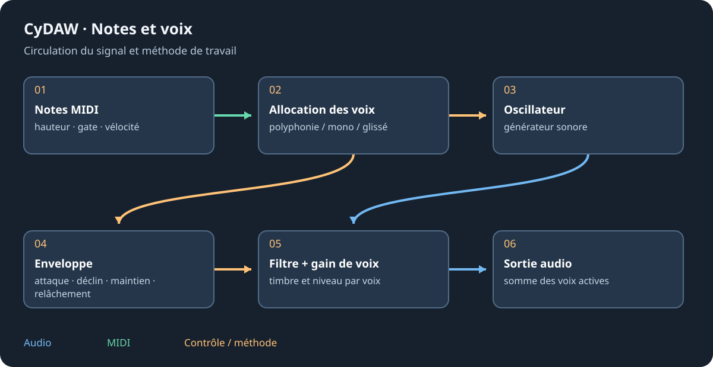

# Recréer un son en instrument

La recréation analyse des notes isolées pour produire modèle ou patch jouable. Elle ne retranscrit pas un mix complet dans tous ses instruments d'origine. Utiliser des exemples propres, sans accompagnement, avec attaque et fin ; plusieurs notes/vélocités décrivent mieux l'instrument qu'un accord arbitraire.

## Choisir la méthode {#methods}
Piste > Recréer un son propose Automatique, Corde pincée, Partiels mesurés et Patch de synthé (Opale/Quartz). Le compagnon Python mesure partiels, bruit et structure ; l'affinage facultatif plus lent demande ses dépendances. La recherche de patch ajuste les réglages des synthés CyDAW. Choisir selon la source plutôt qu'attendre une reconstruction universelle.

## Analyser et jouer {#analysis}
Configurer le compagnon, choisir les fichiers de notes et lancer. Progression/annulation travaillent en arrière-plan. La piste résultante contient Modèle de son ou le synthé ajusté. Jouer des hauteurs/vélocités absentes de l'analyse puis écouter racine fausse, bruit, fins inharmoniques et attaque trop longue. Lisible peut transformer le modèle en patch table/enveloppe/filtre classique.

## Garder et transférer {#saving}
.cysound conserve l'analyse ; projet/appareil peut l'incorporer. La lecture utilise le DSP C++ préparé, pas un réseau d'analyse à chaque note. Les exports natifs placent les voix nécessaires en ressources. Garder les exemples pour réanalyser et tester l'autre poste sans le dossier d'analyse. Qualité et reproductibilité dépendent de la méthode et des réglages, pas seulement d'une image d'onde.

Voir [sampler](sampler.md), [synthés](synths.md), [dépannage du compagnon](troubleshooting.md#files) et [export](plugin-formats.md).
