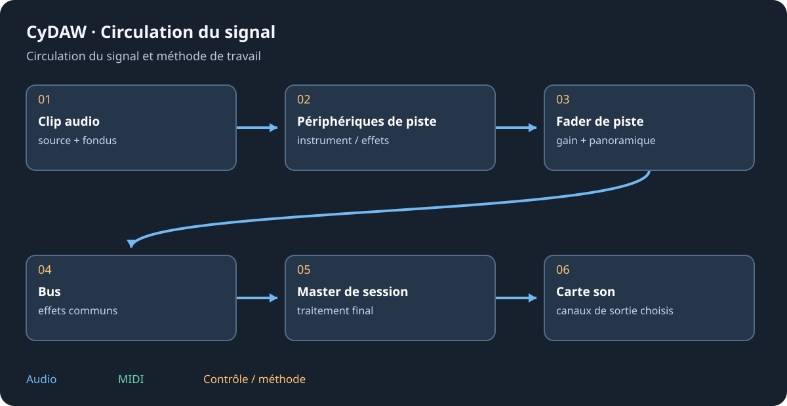

# Audio, MIDI et premier lancement

Extraire tout le paquet Windows avant de lancer CyDAW 2.exe. Garder DLL, polices, documentation et worker à côté. L'Alpha utilise Windows Audio/WASAPI ; un backend facultatif n'apparaît que dans une compilation qui le contient. Un vumètre actif ne prouve pas que les canaux matériels choisis vont aux enceintes.

## Carte, fréquence et tampon {#device}
Dans Options > Réglages audio choisir pilote, carte, fréquence et tampon. Activer la paire reliée aux enceintes. Sur une carte multicanal, les sorties 1/2 peuvent différer de la paire choisie dans son mixeur matériel. Lire un signal connu à faible niveau et contrôler dans l'ordre piste, master, sortie sélectionnée et monitoring matériel.

Un petit tampon réduit le retard mais demande une exécution plus régulière. L'augmenter si le son craque ou si les surcharges montent. Garder une fréquence compatible avec la session et les applications utilisant un pilote partagé. Installer ASIO n'ajoute pas ce backend au paquet WASAPI.

## MIDI et écoute {#midi}
Activer l'entrée MIDI voulue, sélectionner une piste instrument et jouer. Une piste audio demande une source ou entrée d'enregistrement ; un clip MIDI demande un instrument. Armer la piste et contrôler entrée et écoute avant d'enregistrer. Ctrl+K active le clavier musical de l'ordinateur ; octave et vélocité se règlent dans le transport.

## Emplacements et déplacements {#storage}
Options > Emplacements liste caches, périphériques, presets, banques, exports et sessions des modes. Utiliser ce panneau pour changer les dossiers gérés. Les grandes banques peuvent être sur un disque de données ; caches et échantillons sources ont des rôles différents. Conserver projet et sons référencés pour déplacer le travail.

Si tout semble correct mais que rien ne sort, suivre le [dépannage](troubleshooting.md#silence). Continuer avec [l'espace de travail](workspace.md) et [l'enregistrement](studio.md#recording).
