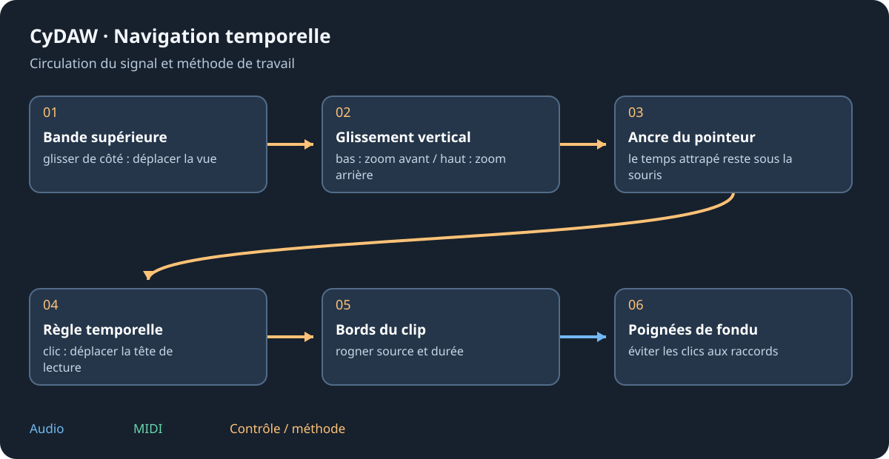

# Référence clavier et souris

Les commandes suivent l'éditeur au focus et le mode actif. Texte/code gardent la frappe. Le manuel capte sa recherche/navigation sans éditer le projet. Des assignations matérielles peuvent ajouter des fonctions : les vérifier si une touche diffère.

## Global et espaces de travail {#global}
| Touche | Action |
| --- | --- |
| Ctrl+F1 | Ouvrir le manuel. |
| Ctrl+N / Ctrl+O / Ctrl+S | Nouveau/ouvrir/enregistrer selon la session active. |
| Ctrl+Maj+S | Enregistrer sous. |
| Ctrl+Z / Ctrl+Y / Ctrl+Maj+Z | Annuler / rétablir dans l'éditeur concerné. |
| Ctrl+J | Masquer/restaurer le panneau inférieur. |
| F1 / F2 | Arrangement / Lanceur Studio. |
| F3 / F4 / F5 / F6 | Périphériques / Graphe / Mixeur / Éditeur. |
| F7 / F8 / F9 | Atelier / Routage / Bibliothèque. |
| F10 / F11 | Mix DJ / Fonderie. |
| Ctrl+K | Clavier musical de l'ordinateur. |
| Ctrl+M | Apprentissage des contrôleurs. |
| ? | Résumé des raccourcis existant. |

Cinéma réutilise les touches de fonction pour ses outils inférieurs ; suivre ses libellés. Dans le manuel Ctrl+F cherche ; Échap efface puis ferme ; les figures ont leur fenêtre.

## Transport et édition {#editing}
| Geste | Contexte et résultat |
| --- | --- |
| Espace | Lecture/pause du mode ; simulateur dans l'Atelier. |
| Origine / R / L | Retour/enregistrement/boucle du Studio quand il possède les touches. |
| S / Ctrl+D / Suppr | Scinder au curseur / dupliquer / supprimer si proposé. |
| Ctrl+X / C / V | Couper / copier / coller dans l'éditeur actif. |
| Ctrl+Maj+V / Ctrl+T | Fonderie : coller en mixant / rogner. |
| M / Maj+M | Fonderie : marqueur / région de sélection. |
| Q / Maj+flèches | Quantifier / changer d'octave au piano roll. |
| Double-clic / clic droit note | Ajouter/retirer / effacer. |

## Souris et graphe {#mouse}
La bande temporelle glissée de côté déplace, bas/haut zoome ; double-clic cadre. Ctrl+molette zoome Arrangement/Cinéma autour du pointeur ; Maj+molette parcourt le temps. Fonderie : molette zoome l'onde et Ctrl+molette sa hauteur. Piano roll : Alt+molette règle les rangées.

Graphe : Tab/double-clic cherche, F cadre, A range ; Alt+clic coupe un câble. Ctrl+G groupe. Les contrôles natifs se glissent verticalement, Ctrl affine et Maj accélère ; molette ajuste, double-clic réinitialise. Les valeurs compatibles acceptent la saisie. Échap sort de la modulation/apprentissage armé.

Voir [espace de travail](workspace.md), [graphes](graphs.md) et [contrôleurs](controllers.md).
