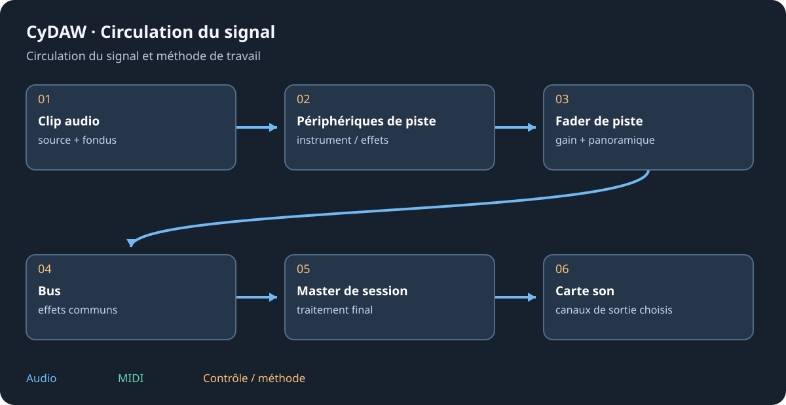

# EQ, dynamique, réverbe et filtrage

Choisir une piste et ajouter l'effet depuis la bibliothèque habituelle. La carte expose les réglages courants ; agrandir pour l'éditeur visuel complet. Utiliser bypass et comparer à sonie proche. La référence donne clés moteur, plages et défauts actuels.

## EQ et Filtre Pro {#eq}
Égaliseur Pro modèle les bandes, avec dynamique quand elle est activée. Commencer largement et écouter dans le mix ; un pic étroit peut sembler petit et s'entendre beaucoup. Une bande dynamique demande seuil/plage en plus de fréquence et Q. Filtre Pro propose trajet et caractères : choisir type/pente, coupure et résonance avant drive ou modulation. Glisser les points pour l'approche puis contrôler les nombres.

## Compresseur Pro et Limiteur Pro {#dynamics}
Le compresseur réduit au-dessus d'un seuil selon ratio/genou et constantes de temps. Régler seuil pour la réduction voulue, attaque pour garder le transitoire et relâchement pour le retour ; Mix permet le parallèle. Plage limite la réduction. Filtres du détecteur et sidechain définissent ce qui pilote, pas une EQ de sortie. Les styles changent la réponse.

Limiteur Pro traite les pics finaux par gain, plafond, anticipation, attaque/relâchement, suréchantillonnage/true peak et styles proposés. Surveiller réduction et sonie ; pousser le gain augmente la limitation, pas forcément la clarté. Réinitialiser les mesures avant une passe. Les mesures et approximations affichées ne sont pas un rapport de livraison certifié.

## Réverbe Pro {#reverb}
Régler décroissance et espace, puis pré-délai pour séparer source et réflexions. Les poignées graves/médiums/aigus règlent les queues par fréquence ; l'amortissement n'est pas un simple niveau de sortie. Largeur, distance, diffusion, réflexions et modulation changent l'espace. Ducking efface la réverbe sous la source ; Freeze peut la prolonger indéfiniment. Garder une traîne adaptée à l'export. Sur un retour, utiliser le traitement mouillé et équilibrer par l'envoi.

Voir [sidechain](mixing.md#sidechain), [effets de mixage](mixing-effects.md) et [référence](reference-effects.md).
