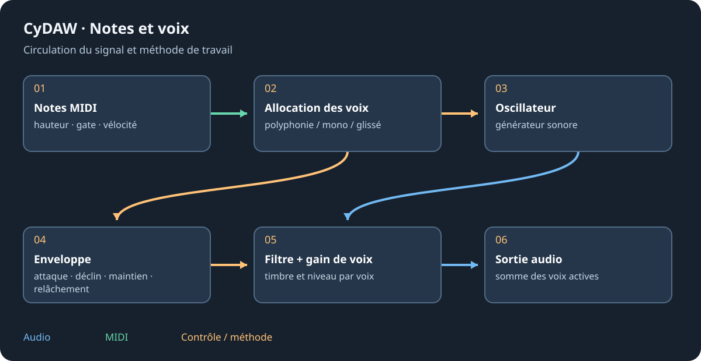

# Famille de synthés et création sonore

Commencer avec un oscillateur et une courte phrase avant de complexifier. La famille partage généralement mode de voix, polyphonie, glissé, bend et niveau master. Le même modèle existe comme instrument de piste et nœud ; le câblage des notes et voix détermine son jeu.

## Choisir son moteur {#models}
| Instrument | Moteur et point de départ |
| --- | --- |
| Ambre | Polysynthé analogique à trois oscillateurs ; en écouter un avant de désaccorder. |
| Colosse | Deux tables d'ondes modernes, deux filtres, séquence et modulation ; explorer une table. |
| Mosaïque | Deux moteurs hybrides : analogique, table, harmonique ou modal ; comparer à niveau égal. |
| Nébuleuse | Couches atmosphériques synthèse/grains, Harmonia et Orb ; commencer par une couche. |
| Opale | Polysynthé courant : deux oscillateurs, sub, synchro/unisson, mélangeur créatif et filtre. |
| Quartz | FM à quatre opérateurs en matrice libre ; écouter une porteuse puis monter un modulateur. |
| Saphir | FM à quatre opérateurs et onze algorithmes ; choisir le trajet avant les ratios. |
| Tirette | Orgue neuf tirettes, percussion, vibrato/chorus, saturation et cabine tournante. |
| Onyx | Distorsion de phase et formes résonantes ; balayer lentement la forme. |
| Alliage | Choix modulaire des moteurs oscillateur/filtre ; partir d'un trajet simple. |
| Argile | Oscillateurs, subs, filtres et amplis doublés ; comparer série et parallèle. |
| Dérive | Voix analogiques simples avec dérive contrôlée et enveloppe bouclable. |
| Bronze | Maillet/bruit excitant deux objets résonants ; accorder avant de pousser l'excitation. |
| Jade | Piano électrique modélisé, micro/préampli, trémolo et chorus ; la vélocité compte. |
| Silex | Percussions synthétisées et caractères ; les charleys peuvent se couper mutuellement. |

## Voix, timbre et enveloppes {#voice}
Poly permet les notes superposées ; Mono privilégie une voix ; Legato change les redéclenchements. Plus de voix et de longs relâchements augmentent le travail simultané. Temps et option Always définissent le glissé. L'étendue du bend interprète la molette de hauteur. Régler le master après l'unisson et le nombre d'oscillateurs.

Attack règle le départ, Decay rejoint Sustain et Release contrôle la fin après note-off. La quantité d'enveloppe du filtre fait bouger le timbre ; négative, elle inverse le sens. Coupure et résonance interagissent : écouter les pics à niveau modéré.

## Modulation et effets {#design}
Utiliser les LFO synchronisés pour le rythme et les vitesses libres pour un mouvement indépendant. Comparer une destination avant d'en associer plusieurs à une macro. Les FX internes suivent les voix ; les effets de piste suivent l'instrument entier. Nommer le preset et le tester aux vélocités douces/fortes, dans le grave/aigu et en accords.

Voir [Prisme](prisme.md), les [modulateurs](modulators.md) et la [référence des paramètres](reference-instruments.md).
