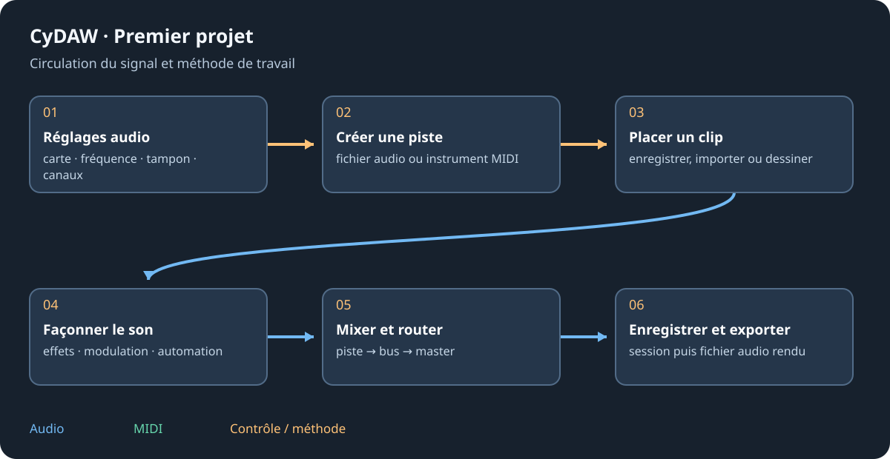

# Bienvenue et premier projet

CyDAW réunit studio musical, table DJ, éditeur de sons multipiste, espace son à l'image, éditeur de traitements et atelier de plugins. Ce manuel hors ligne décrit l'interface V2 distribuée. Sa langue initiale est l'anglais ; choisir Français en haut retrouve les mêmes sujets en gardant la section courante. Cela ne change pas la langue de l'application.

## Lire, chercher et naviguer {#reading}
Ouvrir Aide > Manuel utilisateur ou Ctrl+F1. La colonne gauche contient les chapitres et les sections du chapitre courant. La recherche porte sur titres et texte de toute la langue choisie ; plusieurs mots précisent les résultats. Les accents sont facultatifs en français. Survoler un résultat affiche un extrait ; le sélectionner l'ouvre. Ctrl+F active la recherche ; Effacer rétablit le sommaire.

Retour et Suivant retrouvent sections et positions de lecture. Accueil revient ici. Texte règle la taille ; Figures affiche les illustrations. Cliquer une figure l'agrandit : molette pour zoomer, glisser avec le bouton du milieu (ou Espace+glisser) pour déplacer, double-clic pour cadrer. Dans une fenêtre étroite, ouvrir Illustration au-dessus du texte ; le sélecteur donne accès à toutes les figures. Échap efface d'abord la recherche, puis ferme le lecteur.

## Produire un premier son {#first-project}
1. Dans Options > Réglages audio choisir la carte et les canaux reliés aux enceintes. Commencer avec un tampon modéré et baisser le master avant l'écoute.
2. Dans Studio créer une piste instrument MIDI. Opale est un bon premier synthé.
3. Double-cliquer dans cette piste MIDI vide pour créer un clip. Ouvrir son éditeur, dessiner une phrase et appuyer sur Espace.
4. Sélectionner la piste et utiliser le plus au bout de Périphériques pour ajouter un effet. Enregistrer avec Ctrl+S.
5. Exporter un mixage pour obtenir un fichier audio. Enregistrer le projet et rendre l'audio sont deux opérations différentes.

## Choisir son mode {#modes}
| Mode | Utilisation |
| --- | --- |
| Studio | Arranger des pistes ou lancer clips et scènes. |
| Mix DJ | Mélanger des morceaux sur deux ou quatre platines. |
| Fonderie | Couper, réparer et assembler des fichiers son. |
| Cinéma | Placer les sons à l'image, avec une vidéo facultative. |
| Traitements | Créer et essayer des opérations audio ou sur les notes. |
| Atelier Plugin | Construire des graphes et interfaces VST3, CLAP ou LV2. |

Chaque mode possède son contexte. Vérifier le mode actif avant Enregistrer, Annuler ou le transport. Les modules natifs gardent des noms anglais même dans l'interface française ; les deux langues du manuel décrivent les mêmes réglages.

Continuer avec les [réglages audio](setup.md), [l'espace de travail](workspace.md) ou le [Studio](studio.md).
