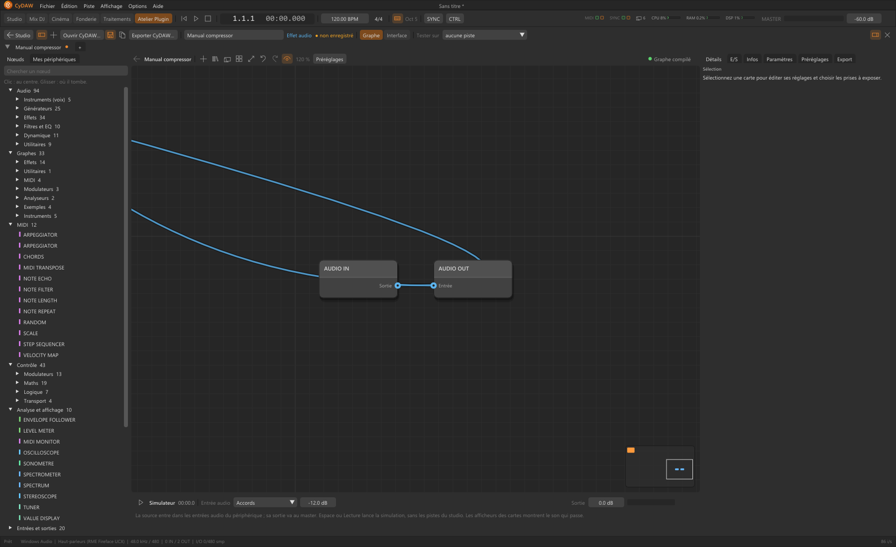
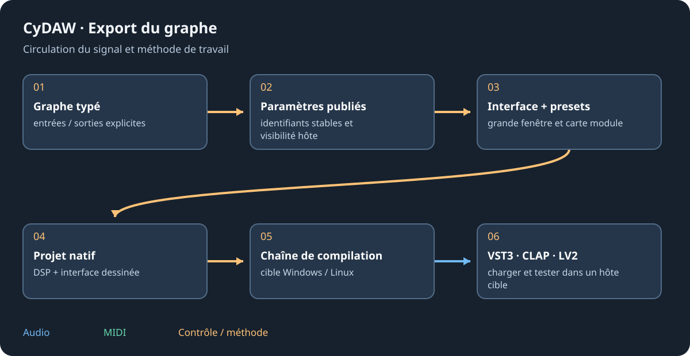

# Atelier Plugin : du graphe au périphérique

Ouvrir Atelier Plugin en haut, par Affichage ou F7. C'est un espace de création séparé du Studio. Créer effet/instrument ou ouvrir un périphérique de graphe par son crayon. Un appareil lié à une piste s'écoute en édition ; un fichier de bibliothèque n'est pas automatiquement chaque instance des pistes.

## Démarrer et écouter {#start}
Choisir effet pour audio entrée/sortie ; instrument pour MIDI vers audio. Faire d'abord le trajet minimal. Le simulateur fournit source de test, motif et clavier. Tester sur lie l'appareil à une piste compatible ; aucune piste détache l'écoute et garde deux copies. Modérer piste/master lors des premiers essais de feedback ou résonance.

## Définir le produit {#product}
Régler nom, auteur/fabricant, catégorie, description et identité stable. Définir E/S typées et seuls réglages utiles à l'utilisateur/hôte. Choisir des valeurs initiales musicales. Créer les programmes et tester leur rappel. Dessiner grande fenêtre et carte module ; un graphe nu avec paramètres publiés n'est pas encore une interface d'instrument conçue.

## Sauver et vérifier {#save}
Enregistrer dans Mes périphériques. Exporter CyDAW crée un instantané .cydawdevice éditable avec modules utilisés, interfaces, code et banques de presets. Il liste l'audio externe sans copier toutes les banques. L'autre poste demande schéma compatible et médias ; compiler son C++ demande son compilateur.

Vérifier avant compilation. Résoudre nœuds, frontières ou adaptateurs non gérés. La compilation native utilise sources/chaînes choisies et caches ; les effacer impose une nouvelle préparation. Compiler les cibles et examiner chaque résultat, puis tester dans un vrai hôte.

Voir [graphe](graphs.md), [design d'interface](interface-design.md) et [export formats/plateformes](plugin-formats.md).
